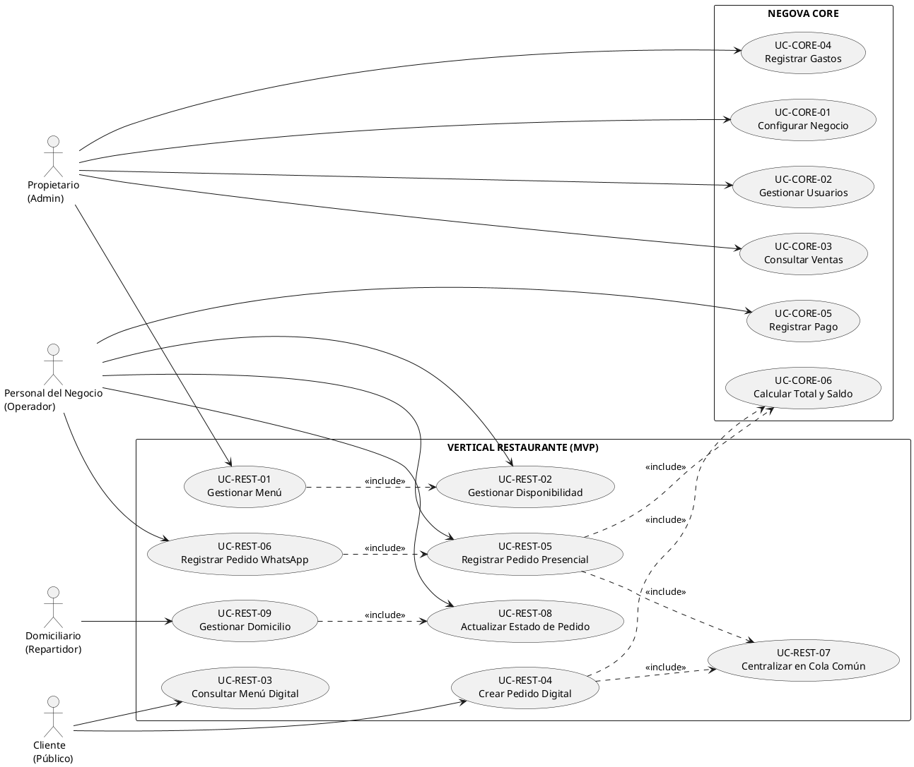
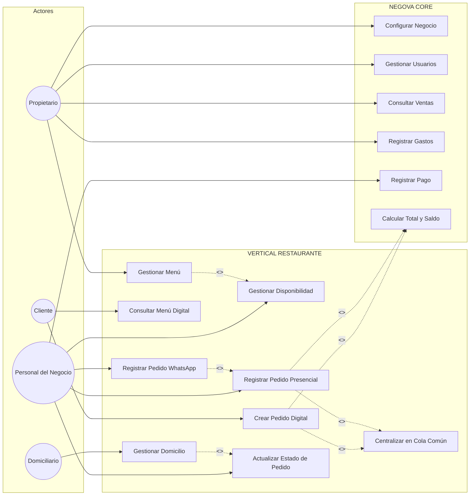

# 2.6 — Diagrama de Casos de Uso (UML)

## NEGOVA — MVP Restaurante de comida rápida

**Versión:** 1.0  
**Estado:** ✅ Completado  
**Fase:** Fase 2 — Modelo y análisis  
**Vertical:** Restaurantes de comida rápida  

---

## 1. Objetivo del diagrama

Este documento define la especificación formal y el diagrama UML de casos de uso correspondiente al primer vertical de NEGOVA: **Restaurante de comida rápida**.

El diagrama representa las interacciones esenciales entre los actores humanos del negocio y el sistema NEGOVA durante la operación cotidiana, permitiendo identificar:
- Quién interactúa con la plataforma.
- Qué acciones y límites tiene cada rol.
- Qué funcionalidades pertenecen al CORE y cuáles al Vertical Restaurante.
- Qué casos de uso incluyen obligatoriamente a otros (`<<include>>`).
- El alcance formal del MVP sin caer en sobrediseño.

---

# 2. Actores del sistema

```text
┌──────────────┐      ┌──────────────────┐      ┌─────────────┐      ┌─────────────────┐
│ Propietario  │      │ Personal Negocio │      │   Cliente   │      │   Domiciliario  │
│    (Admin)   │      │   (Operativo)    │      │  (Público)  │      │   (Repartidor)  │
└──────────────┘      └──────────────────┘      └─────────────┘      └─────────────────┘
```

### 2.1 Propietario (Administrador)
Responsable legal y operativo del negocio:
- Configurar datos comerciales y de identidad del negocio.
- Gestionar el catálogo y menú (crear, editar precios y categorías).
- Gestionar usuarios del sistema y asignar roles.
- Consultar métricas de ventas y balances diarios.
- Registrar egresos y gastos operativos.

### 2.2 Personal del negocio (Operador multifuncional)
Personal encargado del despacho, mostrador y atención en establecimientos de comida rápida:
- Registrar pedidos presenciales (mostrador/local).
- Registrar pedidos recibidos manualmente por WhatsApp.
- Gestionar la cola unificada de preparación de cocina.
- Actualizar estados del pedido (`Recibido` $\rightarrow$ `En preparación` $\rightarrow$ `Listo`).
- Registrar y liquidar pagos (efectivo y transferencias).
- Despachar pedidos que requieren entrega a domicilio.

### 2.3 Cliente (Consumidor final)
Usuario que solicita alimentos sin obligación de registro previo:
- Consultar el menú digital público desde su navegador móvil.
- Seleccionar platos, cantidades y modificadores ("sin cebolla", adiciones).
- Crear el pedido digital y seleccionar tipo de entrega (Local / Domicilio).
- Consultar el estado y resumen de su orden.

### 2.4 Domiciliario (Repartidor del negocio)
Actor opcional del vertical de restaurantes para la logística de última milla:
- Consultar pedidos listos asignados para entrega.
- Consultar direcciones y referencias comunitarias de entrega.
- Recaudar cobros pendientes contra entrega (efectivo/flete).
- Confirmar la entrega física del pedido en el sistema.

---

# 3. Casos de uso estructurados

## 3.1 Módulo CORE (Plataforma base)
- **UC-CORE-01:** Configurar datos del negocio.
- **UC-CORE-02:** Gestionar usuarios y credenciales.
- **UC-CORE-03:** Consultar reporte de ventas e ingresos.
- **UC-CORE-04:** Registrar gastos operativos.
- **UC-CORE-05:** Registrar transacción de pago.
- **UC-CORE-06:** Calcular total y saldo pendiente.

## 3.2 Módulo VERTICAL RESTAURANTE (Operación de comida rápida)
- **UC-REST-01:** Gestionar catálogo y menú de comidas.
- **UC-REST-02:** Conmutar disponibilidad de productos (`Disponible` / `Agotado`).
- **UC-REST-03:** Consultar menú digital público.
- **UC-REST-04:** Crear pedido desde menú digital.
- **UC-REST-05:** Registrar pedido presencial (Mostrador).
- **UC-REST-06:** Registrar pedido manual de WhatsApp.
- **UC-REST-07:** Centralizar pedidos en cola común cronológica.
- **UC-REST-08:** Actualizar estado operativo del pedido.
- **UC-REST-09:** Gestionar despacho y confirmación de domicilio.

---

# 4. Relaciones de Inclusión (`<<include>>`) y Reglas UML

1. **`Registrar Pedido WhatsApp` $\xrightarrow{<<include>>}$ `Registrar Pedido`:** Todo pedido de WhatsApp pasa por el flujo base de creación de pedidos en el sistema.
2. **`Registrar Pedido Presencial` $\xrightarrow{<<include>>}$ `Registrar Pedido`:** La orden presencial utiliza la entidad común de pedido.
3. **`Crear Pedido Digital` $\xrightarrow{<<include>>}$ `Calcular Total del Pedido`:** Al confirmar la orden en el menú web, el sistema totaliza productos y flete.
4. **`Registrar Pedido` $\xrightarrow{<<include>>}$ `Calcular Total del Pedido`:** El registro manual calcula y valida los subtotales automáticamente.
5. **`Registrar Pedido` $\xrightarrow{<<include>>}$ `Centralizar en Cola Común`:** Toda orden creada ingresa inmediatamente a la lista única ordenada por tiempo de llegada.
6. **`Crear Pedido Digital` $\xrightarrow{<<include>>}$ `Centralizar en Cola Común`:** Los pedidos web ingresan a la misma cola compartida de cocina.
7. **`Gestionar Menú` $\xrightarrow{<<include>>}$ `Gestionar Disponibilidad`:** La activación/desactivación de ítems forma parte del control de menú.

---

# 5. Diagrama de Casos de Uso en PlantUML



---

# 6. Diagrama de Casos de Uso en Mermaid



---

# 7. Notas y Restricciones UML

1. **Aislamiento Multi-Tenant:** Ningún caso de uso permite acceso cruzado entre negocios distintos.
2. **Sin autenticación para Clientes:** El caso de uso `UC-REST-03 (Consultar Menú Digital)` y `UC-REST-04 (Crear Pedido Digital)` no exige inicio de sesión ni registro previo.
3. **Cola Única Centralizada:** Los canales de entrada (WhatsApp manual, Menú web, Mostrador) convergen en un único caso de uso de centralización (`UC-REST-07`).
4. **Exclusiones Explícitas:** No existen casos de uso para inventario automático por recetas, facturación electrónica, cálculo GPS ni chatbots de IA en el MVP.

---

# 8. Estado del Documento

**Estado:** ✅ Completado y Validado  
**Fase:** Fase 2 — Modelo y análisis  
**Sección:** 2.6 — Diagrama de casos de uso  
**Documento:** 2.6-diagrama-casos-de-uso.md  
