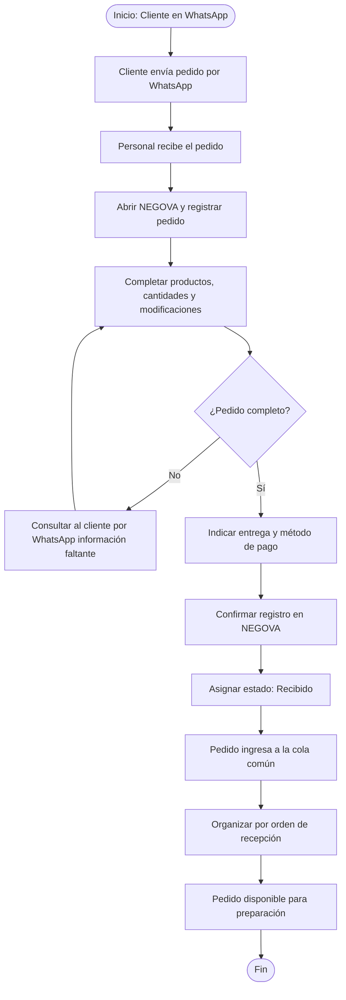

# 2.7.1 — Flujo: Registro de pedido por WhatsApp

## NEGOVA — MVP Restaurante de comida rápida

**Versión:** 1.0  
**Estado:** Definido  
**Producto:** NEGOVA  
**Vertical:** Restaurantes de comida rápida  

---

## 1. Objetivo

Definir el proceso mediante el cual un pedido recibido por WhatsApp es registrado manualmente en NEGOVA y enviado a la cola común de pedidos.

---

## 2. Actores

- **Cliente:** Envía el pedido a través de mensaje de WhatsApp al número del negocio.
- **Personal del negocio:** Lee el mensaje, atiende dudas y registra manualmente la orden en NEGOVA.
- **NEGOVA:** Registra el pedido, calcula montos y lo posiciona en la cola común cronológica.

---

## 3. Reglas del proceso

- WhatsApp es un canal externo de comunicación sin integración directa vía API en el MVP.
- El pedido se registra manualmente en NEGOVA por el personal en su teléfono móvil.
- No existe bot ni automatización en la versión inicial.
- Los pedidos se organizan primariamente por orden cronológico de recepción.
- La hora solicitada por el cliente no altera automáticamente el orden de preparación.
- Un pedido puede incluir entrega a domicilio.
- El valor del domicilio es independiente del valor de los productos.

---

## 4. Flujo principal

1. El cliente envía el pedido por WhatsApp.
2. El personal recibe y lee el mensaje.
3. El personal abre NEGOVA y selecciona "Registrar Pedido".
4. Se registran los productos, cantidades y modificaciones solicitadas ("sin cebolla", "salsas aparte", adiciones).
5. Se indica el tipo de entrega (Local / Domicilio).
6. Si es domicilio, se registra la dirección o referencia del cliente.
7. Se registra la información de pago disponible (Efectivo / Transferencia).
8. NEGOVA valida la información del pedido y calcula los totales.
9. El personal confirma el registro.
10. El pedido queda registrado con estado `Recibido`.
11. El pedido entra en la cola común operativa.
12. La cola organiza el pedido por orden de recepción.
13. El pedido queda disponible para preparación en cocina.

---

## 5. Diagrama de flujo

