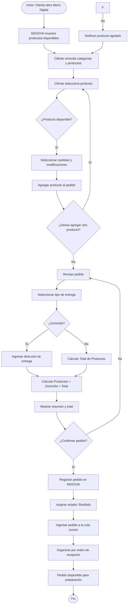

# 2.7.2 — Flujo: Pedido desde menú digital

## NEGOVA — MVP Restaurante de comida rápida

**Versión:** 1.0  
**Estado:** Definido  
**Producto:** NEGOVA  
**Vertical:** Restaurantes de comida rápida  

---

## 1. Objetivo

Definir el proceso mediante el cual un cliente consulta el menú digital de un restaurante, selecciona los productos que desea y genera un pedido que queda registrado en NEGOVA.

El pedido digital debe integrarse al mismo flujo operativo utilizado por los pedidos recibidos por WhatsApp y los pedidos registrados presencialmente.

El objetivo principal es facilitar la realización del pedido sin obligar al cliente a comunicarse directamente con el restaurante para seleccionar los productos.

---

## 2. Actores

### Cliente
Persona que consulta el menú digital y realiza el pedido desde su navegador web móvil.

### Personal del negocio
Persona responsable de recibir, consultar y gestionar el pedido dentro de NEGOVA.

### NEGOVA
Sistema responsable de registrar el pedido, calcular los valores correspondientes y enviarlo a la cola común de pedidos.

---

## 3. Reglas del proceso

### 3.1 Registro del cliente
El cliente NO debe estar obligado a crear una cuenta para realizar un pedido. El objetivo es reducir la fricción y permitir que una persona pueda realizar un pedido rápidamente.

### 3.2 Menú y disponibilidad
El cliente solamente debe visualizar productos que estén disponibles. Los productos que el negocio marque como no disponibles no deben poder seleccionarse para un nuevo pedido.

### 3.3 Datos del producto
Cada producto contiene: Nombre, Imagen, Descripción, Precio, Categoría y Estado de Disponibilidad.

### 3.4 Cantidades y modificaciones
El cliente puede seleccionar la cantidad deseada e indicar modificaciones disponibles (ej. sin cebolla, adiciones extra). Las modificaciones quedan asociadas al producto individual.

### 3.5 Tipo de entrega
El cliente indica si el pedido es:
- `En el local` (para recoger o mesa).
- `Domicilio` (proporcionando dirección o referencia de entrega).

### 3.6 Desglose independiente del domicilio
El valor del domicilio se maneja de forma independiente al valor de los productos.
$$\text{Total} = \text{Valor de Productos} + \text{Valor del Domicilio}$$

### 3.7 Cola común por orden de llegada
El pedido entra a la misma cola centralizada utilizada por WhatsApp y mostrador, ordenado por tiempo de recepción en el sistema.

---

## 4. Flujo principal

1. El cliente accede al menú digital mediante enlace o código QR.
2. NEGOVA muestra el menú y categorías disponibles.
3. El cliente consulta y selecciona productos.
4. El cliente indica cantidades y modificaciones deseadas.
5. Los productos se agregan al carrito de pedido.
6. El cliente revisa el resumen del pedido.
7. El cliente selecciona el tipo de entrega (Local / Domicilio).
8. Si selecciona domicilio, proporciona la dirección o referencia.
9. NEGOVA calcula el valor de los productos, el flete de domicilio y muestra el total.
10. El cliente confirma el pedido.
11. NEGOVA registra el pedido de forma persistente.
12. El pedido recibe el estado `Recibido`.
13. El pedido entra a la cola común operativa.
14. El pedido queda disponible para preparación en cocina.

---

## 5. Flujos alternativos

### 5.1 Producto no disponible
Si un producto se marca como agotado durante la navegación, el sistema impide agregarlo, muestra una notificación visual clara y el cliente puede continuar eligiendo otros ítems.

### 5.2 Pedido en el local
Si se selecciona `En el local`, no se solicita dirección ni se cobra flete; el total equivale exclusivamente a los productos consumidos.

### 5.3 Pedido con domicilio
Si se selecciona `Domicilio`, el sistema solicita dirección/referencia y añade el costo del flete configurado, presentándolo desglosado.

---

## 6. Diagrama de flujo

