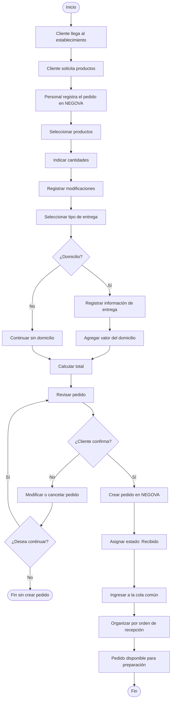

# 2.7.3 — Flujo: Registrar pedido presencial

## NEGOVA — MVP Restaurante de comida rápida

**Versión:** 1.0  
**Estado:** Definido  
**Producto:** NEGOVA  
**Vertical:** Restaurantes de comida rápida  

---

## 1. Objetivo

Definir el proceso mediante el cual un cliente que se encuentra físicamente en el restaurante realiza un pedido y el personal del negocio lo registra en NEGOVA.

El pedido presencial debe utilizar el mismo modelo de pedido utilizado por los demás canales de entrada.

El resultado final debe ser:

$$\text{Pedido Presencial} \longrightarrow \text{Pedido NEGOVA} \longrightarrow \text{Cola Común de Pedidos}$$

---

# 2. Actores

## 2.1 Cliente
Persona que se encuentra físicamente en el establecimiento y desea realizar un pedido (en mostrador o para consumir en mesa).

## 2.2 Personal del negocio
Persona que atiende al cliente, registra el pedido y gestiona su operación dentro de NEGOVA.

En negocios pequeños esta misma persona puede realizar simultáneamente otras funciones, como:
- Atender clientes presenciales.
- Responder WhatsApp.
- Registrar pedidos.
- Consultar pedidos.
- Gestionar pagos.

---

# 3. Condiciones iniciales

Para iniciar el proceso:
- El negocio debe estar configurado en NEGOVA.
- El menú debe contener los productos disponibles.
- El personal debe tener acceso a NEGOVA desde su dispositivo móvil o estación.
- El cliente debe encontrarse en el establecimiento.

---

# 4. Flujo principal

1. El cliente llega al establecimiento.
2. El cliente solicita los productos que desea.
3. El personal escucha y registra el pedido en NEGOVA.
4. El personal selecciona los productos en la interfaz.
5. El personal indica las cantidades.
6. El personal registra las modificaciones solicitadas ("sin cebolla", adiciones, etc.).
7. El personal selecciona el tipo de entrega (Local / Domicilio).
8. NEGOVA calcula el valor de los productos.
9. Si corresponde, NEGOVA agrega el valor del domicilio.
10. El personal revisa el pedido junto al cliente.
11. El personal confirma el registro.
12. NEGOVA crea el pedido de forma persistente.
13. El pedido recibe el estado `Recibido`.
14. El pedido ingresa a la cola común operativa.
15. El pedido queda disponible para preparación en cocina.

---

# 5. Identificación del pedido

Los pedidos presenciales deben poder identificarse mediante información básica del cliente:
- Nombre del cliente o referencia rápida (ej. "Mesa 2", "Cliente camisa azul", "Juan").
- Identificador correlativo asignado automáticamente por el sistema.

> **Regla:** El sistema no debe exigir un proceso complejo de registro de cliente para poder realizar un pedido presencial.

---

# 6. Productos

El personal selecciona desde el menú del negocio los productos solicitados por el cliente.

Cada producto debe permitir indicar:
- Producto seleccionado.
- Cantidad de unidades.
- Modificaciones disponibles.
- Observaciones específicas de preparación.

---

# 7. Modificaciones

El cliente puede solicitar modificaciones sobre los productos:
- Sin ingredientes específicos (ej. "sin cebolla", "sin tártara").
- Con adiciones o extras con costo adicional (ej. "doble queso", "tocineta extra").
- Indicaciones especiales de cocción.

Las modificaciones quedan asociadas explícitamente al producto correspondiente dentro del pedido.

---

# 8. Tipo de entrega

El pedido presencial puede tener dos tipos principales de entrega:

### 8.1 En el local (Para consumir / Para llevar en mano)
El cliente consume o recibe el pedido directamente en el establecimiento.

### 8.2 Domicilio (Encargado en persona para entrega posterior)
El cliente se acerca a pedir en persona pero solicita que sea entregado en una ubicación externa. Se registra la información necesaria de entrega.

---

# 9. Domicilio

El domicilio es opcional.

Cuando el pedido requiere domicilio:
- Se registra el valor del flete de domicilio.
- El valor del domicilio se mantiene separado del valor de los productos.
- El pedido queda asignable al repartidor del negocio.

Ejemplo:
```text
Productos:      $25.000 COP
Domicilio:       $2.000 COP
---------------------------
Total:          $27.000 COP
```

---

# 10. Diagrama de flujo



