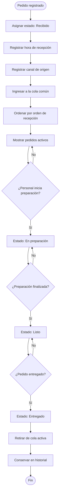

# 2.7.4 — Flujo: Gestionar cola de pedidos

## NEGOVA — MVP Restaurante de comida rápida

**Versión:** 1.0  
**Estado:** En definición  
**Producto:** NEGOVA  
**Vertical:** Restaurantes de comida rápida  

---

## 1. Objetivo

Definir cómo NEGOVA recibe, organiza y presenta los pedidos que ingresan desde los diferentes canales del restaurante.

La cola de pedidos constituye el punto central de la operación del negocio.

Todos los pedidos registrados en NEGOVA deben terminar en una única cola operativa.

Los canales de entrada pueden ser diferentes, pero el pedido debe utilizar una estructura común.

---

# 2. Canales de entrada

NEGOVA contempla inicialmente tres canales de entrada:

1. **WhatsApp** (Registro manual por personal)
2. **Menú digital** (Autogestión por cliente)
3. **Atención presencial** (Registro en mostrador/local)

Cada pedido debe conservar información sobre su canal de origen:

```text
WhatsApp       → canal_origen = whatsapp
Menú digital   → canal_origen = digital
Presencial     → canal_origen = presencial
```

---

# 3. Principio de centralización y cola única

```text
  [WhatsApp]     ──┐
  [Menú Digital] ──┼──► [COLA CENTRALIZADA DE PEDIDOS] ──► [Preparación y Despacho]
  [Presencial]   ──┘    (Orden cronológico de llegada)
```

---

# 4. Estados operativos de la cola

1. `Recibido`: El pedido ingresa a la cola común con registro de hora y canal de origen.
2. `En Preparación`: El personal inicia la elaboración de los productos en cocina.
3. `Listo`: La orden está completamente empacada o servida, lista para recogida o despacho.
4. `Entregado`: El cliente recibe su pedido y se formaliza el cierre operativo.
5. `Retiro de cola activa y persistencia`: El pedido sale de la visualización activa de trabajo y se conserva en el historial de ventas.

---

# 5. Diagrama de flujo de la cola



