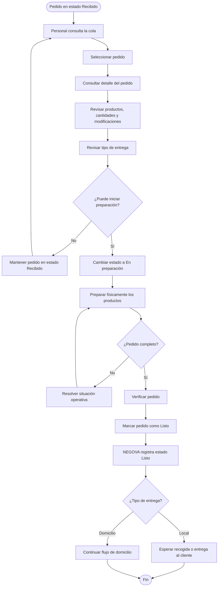

# 2.7.5 — Flujo: Preparar pedido

## NEGOVA — MVP Restaurante de comida rápida

---

## 1. Objetivo

Definir el proceso mediante el cual el personal del restaurante consulta un pedido recibido, inicia su preparación, finaliza la preparación y marca el pedido como listo.

Este flujo comienza cuando un pedido se encuentra en estado:

$$\mathbf{RECIBIDO}$$

y termina cuando el pedido pasa a:

$$\mathbf{LISTO}$$

> **Principio:** La preparación física de los alimentos ocurre fuera de NEGOVA. NEGOVA se encarga de organizar y registrar el estado operativo del pedido.

---

# 2. Actores

## 2.1 Personal del negocio
Responsable de consultar los pedidos y actualizar su estado conforme avanza la preparación.

El personal puede ser una persona encargada específicamente de preparar los alimentos o cualquier integrante autorizado del negocio. En los negocios familiares una misma persona puede realizar varias funciones.

---

# 3. Condiciones iniciales

Para iniciar este flujo:
- El pedido debe estar registrado en NEGOVA.
- El pedido debe encontrarse en estado `Recibido`.
- El pedido debe aparecer en la cola activa.
- El personal debe tener acceso a NEGOVA.

---

# 4. Flujo principal

1. El personal consulta la cola de pedidos.
2. Identifica un pedido en estado `Recibido`.
3. Consulta el detalle del pedido.
4. Revisa los productos.
5. Revisa cantidades.
6. Revisa modificaciones y observaciones.
7. Revisa el tipo de entrega.
8. Si corresponde, revisa la información del domicilio.
9. El personal inicia la preparación.
10. NEGOVA cambia el estado a `En preparación`.
11. El personal prepara físicamente los productos.
12. Cuando termina, marca el pedido como listo.
13. NEGOVA cambia el estado a `Listo`.
14. El pedido queda disponible para entrega o recogida.

---

# 5. Información del pedido

Antes de comenzar la preparación, el personal debe poder consultar como mínimo:
- Identificador del pedido.
- Nombre o referencia del cliente.
- Productos.
- Cantidades.
- Modificaciones.
- Observaciones.
- Tipo de entrega.
- Información de domicilio cuando corresponda.
- Canal de origen.
- Información relevante del pago.

---

# 6. Inicio de preparación

Cuando el personal comienza a preparar un pedido:
$$\text{Recibido} \longrightarrow \text{En preparación}$$

Este cambio indica que el restaurante está trabajando activamente en ese pedido. NEGOVA debe registrar el cambio de estado.

---

# 7. Preparación física

La preparación de los alimentos ocurre fuera del sistema.

NEGOVA **NO** intenta controlar:
- Cantidades exactas de ingredientes.
- Gramajes.
- Recetas.
- Tiempo exacto de cocción.
- Temperatura.
- Equipos de cocina.
- Consumo automático de ingredientes.

El sistema solamente registra el estado del pedido.

---

# 8. Preparación simultánea

El restaurante puede preparar varios pedidos simultáneamente.

Por ejemplo:
```text
Pedido #001 → En preparación
Pedido #002 → En preparación
Pedido #003 → Recibido
```

NEGOVA permite que existan varios pedidos en estado `En preparación` al mismo tiempo.

---

# 9. Finalización de preparación

Cuando el personal termina de preparar el pedido:
1. Verifica físicamente que el pedido esté completo.
2. Marca el pedido como `Listo`.
3. NEGOVA registra el nuevo estado.
4. El pedido deja de aparecer como pendiente de preparación.
5. El pedido queda pendiente de entrega o recogida.

---

# 10. Pedido con modificaciones

Si un pedido contiene modificaciones:
```text
Producto:     Salchipapa
Modificación: Sin cebolla
```
La modificación debe mostrarse claramente al personal encargado de preparar el pedido. NEGOVA no valida físicamente si la modificación fue aplicada; el personal es responsable de preparar el producto según las indicaciones.

---

# 11. Pedido incompleto durante preparación

Si el personal detecta que no puede completar el pedido:
- El pedido permanece en `En preparación`.
- El personal debe resolver la situación según la operación del negocio.
- NEGOVA no modifica automáticamente el pedido.
- Si es necesario cambiar el pedido, se realiza mediante el mecanismo correspondiente.
- No se implementa en este flujo una lógica automática de sustitución de productos.

---

# 12. Producto agotado durante preparación

Puede ocurrir que un producto haya sido registrado como disponible pero, durante la preparación, el personal descubra que no puede prepararlo.

Por ejemplo:
```text
Pedido:   Salchipapa
Problema: No hay salchicha disponible.
```
NEGOVA no debe inventar automáticamente una sustitución. El personal debe resolver la situación con el cliente según las políticas del negocio.  
*(La gestión general de disponibilidad se documenta en: `2.7.8 — Gestionar disponibilidad de productos`).*

---

# 13. Orden de preparación

La cola presenta los pedidos según el orden de recepción.

Sin embargo, NEGOVA no impide que el personal comience a preparar otro pedido cuando las condiciones operativas del restaurante lo permitan (ej. agrupar frituras o asados).

La cola representa el orden de llegada, pero no intenta controlar físicamente cómo organiza el restaurante su producción.

---

# 14. Hora solicitada

Una hora solicitada por el cliente no modifica automáticamente la cola.

Por ejemplo:
```text
11:00 → Pedido A
11:05 → Pedido B (con nota: "Para las 12:00")
```
NEGOVA no mueve automáticamente el pedido B por encima del pedido A; el personal mantiene el control operativo.

---

# 15. Pedido para consumo en el local

Si el pedido es para consumo o recogida en el establecimiento:
`tipo_entrega = local`

Cuando termina la preparación:
$$\text{En preparación} \longrightarrow \text{Listo}$$
El pedido queda esperando la entrega o recogida por parte del cliente.

---

# 16. Pedido con domicilio

Si el pedido requiere domicilio:
`tipo_entrega = domicilio`

Cuando termina la preparación:
$$\text{En preparación} \longrightarrow \text{Listo}$$
El pedido queda preparado para continuar con el proceso de despacho.  
*(El flujo de asignación y entrega se documenta en: `2.7.6 — Gestionar domicilio`).*

---

# 17. Estados involucrados

Este flujo utiliza estrictamente:
$$\text{RECIBIDO} \longrightarrow \text{EN PREPARACIÓN} \longrightarrow \text{LISTO}$$

*(El estado `Entregado` pertenece al proceso posterior de entrega).*

---

# 18. Diagrama de flujo



---

# 19. Principio de responsabilidad

```text
NEGOVA
   │
   ├── Organiza pedidos
   ├── Muestra información
   └── Registra estados
          │
          ↓
    PERSONAL DEL NEGOCIO
          │
          ├── Prepara alimentos
          ├── Verifica productos
          └── Marca pedido como listo
```

---

# 20. Resultado

El proceso termina cuando:
- El pedido ha sido preparado físicamente.
- El personal ha verificado los productos y modificaciones.
- El estado ha cambiado a `Listo`.
- El pedido queda disponible para entrega en local o despacho a domicilio.

$$\mathbf{Recibido} \longrightarrow \mathbf{En\ preparación} \longrightarrow \mathbf{Listo}$$

---

# 21. Exclusiones del MVP

Este flujo **NO** incluye:
- Inventario automático ni descuento de ingredientes.
- Recetas digitales ni control de gramajes.
- Control automático de tiempos de cocina ni pantallas KDS multipantalla complejas.
- Asignación automática de cocineros ni IA para organizar la cocina.
- Predicción del tiempo de preparación ni optimización automática de producción.
- Priorización automática por hora.

---

# 22. Estado del documento

**Estado:** Completado  
**Fase:** Modelo y análisis  
**Sección:** 2.7 — Flujos detallados  
**Vertical:** Restaurante de comida rápida  
**Versión:** MVP  
**Documento:** 2.7.5 — Preparar pedido  
