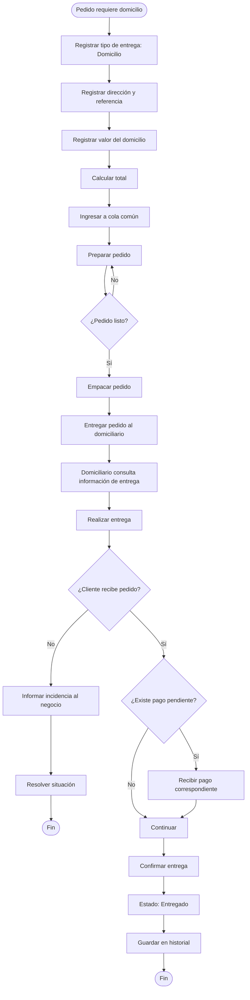

# 2.7.6 — Flujo: Gestionar domicilio

## NEGOVA — MVP Restaurante de comida rápida

---

## 1. Objetivo

Definir el proceso mediante el cual un pedido que requiere domicilio pasa desde su preparación hasta su entrega al cliente.

NEGOVA debe permitir diferenciar claramente:
- El valor de los productos.
- El valor del domicilio.
- El total del pedido.
- El estado del pedido.
- La información necesaria para realizar la entrega.

> **Nota:** El domicilio es una característica opcional del pedido. No todos los pedidos requieren este proceso.

---

# 2. Actores

## 2.1 Personal del negocio
Responsable de registrar y gestionar la información del domicilio:
- Indicar que un pedido requiere domicilio.
- Registrar la información de entrega.
- Registrar el valor del domicilio.
- Consultar el estado del pedido.
- Entregar el pedido al domiciliario.

## 2.2 Domiciliario
Persona encargada físicamente de transportar y entregar el pedido:
- Consultar los pedidos que debe entregar.
- Consultar la información necesaria para realizar la entrega.
- Confirmar que realizó la entrega.

*(En el MVP normalmente se contempla un único domiciliario por negocio, aunque la estructura no debe impedir que existan varios).*

## 2.3 Cliente
Persona que recibe el pedido en la ubicación indicada. El cliente no necesita utilizar NEGOVA directamente para que el domicilio pueda realizarse.

---

# 3. Condiciones iniciales

Para iniciar este flujo:
- El pedido debe existir en NEGOVA.
- El pedido debe indicar que requiere domicilio.
- El pedido debe contener información suficiente para realizar la entrega.
- El pedido debe haber sido preparado.
- El pedido debe encontrarse en estado `Listo`.

---

# 4. Información del domicilio

Cuando un pedido requiere domicilio se debe registrar como mínimo:
- Nombre del cliente.
- Información de contacto cuando sea necesaria.
- Dirección o ubicación indicada por el cliente.
- Referencia adicional cuando sea necesaria.
- Valor del domicilio.

En negocios pequeños puede ser necesario utilizar referencias textuales, por ejemplo:

```text
"Casa azul después de la tienda"
o:
"Al lado de la cancha"
```

> **Regla:** El sistema no debe obligar a utilizar coordenadas GPS en el MVP.

---

# 5. Valor del domicilio

El valor del domicilio debe mantenerse separado del valor de los productos.

Ejemplo:
```text
Productos:      $30.000 COP
Domicilio:       $2.000 COP
---------------------------
Total:          $32.000 COP
```

NEGOVA debe almacenar ambos valores independientemente:
```text
subtotal_productos = 30000
valor_domicilio    = 2000
total_pedido       = 32000
```

---

# 6. Valor configurable

Aunque el mercado inicial contemple un valor habitual de domicilio, NEGOVA no debe asumir que todos los negocios cobrarán siempre el mismo valor.

El sistema debe permitir configurar el valor del domicilio desde la configuración del negocio. Para el primer vertical puede existir un valor predeterminado, pero debe poder modificarse.

---

# 7. Flujo principal

1. El cliente solicita un pedido con domicilio.
2. El personal registra el tipo de entrega como `Domicilio`.
3. El personal registra la información de entrega.
4. NEGOVA registra el valor del domicilio.
5. NEGOVA calcula el total.
6. El pedido entra a la cola común.
7. El restaurante prepara el pedido.
8. El pedido cambia a `Listo`.
9. El personal identifica que el pedido requiere domicilio.
10. El pedido queda disponible para entrega.
11. El domiciliario consulta la información del pedido.
12. El domiciliario recibe el pedido.
13. El domiciliario se dirige al destino.
14. El domiciliario realiza la entrega.
15. El domiciliario confirma la entrega.
16. NEGOVA cambia el estado del pedido a `Entregado`.
17. El pedido pasa al historial.

---

# 8. Preparación antes de entregar

El pedido NO debe entregarse al domiciliario antes de estar listo.

Flujo:
$$\text{RECIBIDO} \longrightarrow \text{EN PREPARACIÓN} \longrightarrow \text{LISTO} \longrightarrow \text{ENTREGA}$$

El estado `Listo` representa que el restaurante terminó la preparación.

---

# 9. Entrega al domiciliario

Cuando el pedido está listo:
- El personal verifica el pedido.
- El pedido se empaca.
- El personal entrega físicamente el pedido al domiciliario.
- El domiciliario obtiene la información necesaria para realizar la entrega.

*(NEGOVA no necesita registrar cada movimiento físico interno del paquete).*

---

# 10. Información visible para el domiciliario

El domiciliario debe poder consultar en su vista simplificada:
- Identificador del pedido.
- Nombre del cliente.
- Dirección.
- Referencia comunitaria.
- Teléfono o medio de contacto cuando sea necesario.
- Valor de los productos.
- Valor del domicilio.
- Total.
- Información relacionada con el estado del pago.

---

# 11. Pago del pedido

El valor del domicilio y el valor de los productos son conceptos diferentes.

- **Caso A — Todo en efectivo:** Comida $\rightarrow$ Efectivo, Domicilio $\rightarrow$ Efectivo (recaudado por el repartidor).
- **Caso B — Comida pagada por transferencia:** Comida $\rightarrow$ Transferencia, Domicilio $\rightarrow$ Efectivo (al repartidor).
- **Caso C — Domicilio pagado por transferencia:** Comida $\rightarrow$ Efectivo / Transferencia, Domicilio $\rightarrow$ Transferencia.
- **Caso D — Todo pagado junto:** Comida + Domicilio $\rightarrow$ Un único pago previo.

*(La gestión detallada de pagos se documenta en: `2.7.7 — Registrar y gestionar pagos`).*

---

# 12. Entrega física

Cuando el domiciliario llega al destino:
1. Entrega el pedido.
2. El cliente recibe los productos.
3. Si existe un valor pendiente, se realiza el pago correspondiente.
4. El domiciliario confirma la entrega en NEGOVA.

---

# 13. Confirmación de entrega

El MVP permite que el domiciliario o el operador indique: `Pedido entregado`.

Esto cambia el estado:
$$\text{LISTO} \longrightarrow \text{ENTREGADO}$$

La confirmación **no requiere obligatoriamente**: firma digital, fotografía, código OTP, geolocalización ni firma del cliente.

---

# 14. Cliente no localizado

Si el domiciliario no puede localizar al cliente:
- El pedido NO debe marcarse como entregado.
- El pedido permanece pendiente.
- El domiciliario contacta al cliente mediante los medios disponibles.
- El negocio decide cómo proceder (NEGOVA no cancela automáticamente).

---

# 15. Cliente no recibe el pedido

Si el cliente rechaza o no recibe el pedido:
- El domiciliario informa al negocio.
- El pedido no se marca como `Entregado`.
- El negocio decide qué acción tomar según su política manual.

---

# 16. Domiciliario único y escalabilidad

El negocio puede operar inicialmente con un único domiciliario. NEGOVA soporta este escenario de forma sencilla y permite a futuro ampliarse a múltiples repartidores sin rediseñar la entidad del pedido.

---

# 17. Cola de pedidos común

Los pedidos con domicilio utilizan la misma cola común cronológica. No se crea una cola independiente:

```text
Pedido #001 — Presencial
Pedido #002 — WhatsApp + Domicilio
Pedido #003 — Digital
Pedido #004 — WhatsApp + Domicilio
```

El domicilio representa un atributo del pedido: `tipo_entrega = domicilio`.

---

# 18. Flujo completo de estados

Flujo general conceptual:
$$\text{PEDIDO RECIBIDO} \longrightarrow \text{EN PREPARACIÓN} \longrightarrow \text{LISTO} \longrightarrow \text{EMPACADO} \longrightarrow \text{ENTREGADO AL DOMICILIARIO} \longrightarrow \text{EN RUTA} \longrightarrow \text{ENTREGA} \longrightarrow \text{ENTREGADO}$$

Para el MVP, el modelo principal de estados se simplifica en:
$$\mathbf{RECIBIDO} \longrightarrow \mathbf{EN\ PREPARACIÓN} \longrightarrow \mathbf{LISTO} \longrightarrow \mathbf{ENTREGADO}$$

---

# 19. Diagrama de flujo



---

# 20. Principio de separación de valores

```text
┌─────────────────────────┐
│ Valor de productos      │
├─────────────────────────┤
│ Valor del domicilio     │
├─────────────────────────┤
│ Total del pedido        │
└─────────────────────────┘
```

---

# 21. Principio de separación de pagos

```text
PRODUCTOS
    │
    └── Método de pago A

DOMICILIO
    │
    └── Método de pago B

o:

PRODUCTOS + DOMICILIO
          │
          └── Un único pago
```

---

# 22. Resultado

El flujo termina correctamente cuando:
- El pedido ha sido preparado, empacado y entregado.
- El cliente ha recibido la orden.
- Los pagos pendientes han sido gestionados.
- La entrega ha sido confirmada y pasa al historial de ventas.

---

# 23. Exclusiones del MVP

Este flujo NO incluye:
- GPS obligatorio ni rastreo en tiempo real.
- Optimización ni asignación automática de rutas.
- Aplicación nativa independiente para repartidores.
- Integración con Google Maps API.
- Firma digital, fotografía obligatoria ni código OTP.
- Integración con plataformas externas (Rappi, iFood, etc.).
- Cálculo automático de tarifas por distancia.

---

# 24. Estado del documento

**Estado:** Completado  
**Fase:** Modelo y análisis  
**Sección:** 2.7 — Flujos detallados  
**Vertical:** Restaurante de comida rápida  
**Versión:** MVP  
**Documento:** 2.7.6 — Gestionar domicilio  
