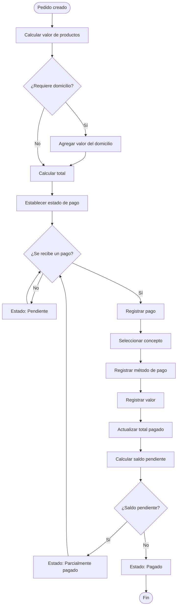

# 2.7.7 — Flujo: Registrar y gestionar pagos

## NEGOVA — MVP Restaurante de comida rápida

---

## 1. Objetivo

Definir cómo NEGOVA registra y representa los pagos asociados a un pedido.

El sistema debe permitir diferenciar:
- Valor de los productos.
- Valor del domicilio.
- Total del pedido.
- Estado de pago.
- Método de pago.
- Concepto al que corresponde cada pago.

NEGOVA no debe asumir que los productos y el domicilio se pagan siempre de la misma manera.

---

# 2. Principio fundamental

El valor de los productos y el valor del domicilio son conceptos independientes.

Ejemplo:
```text
Productos:      $30.000 COP
Domicilio:       $2.000 COP
---------------------------
Total:          $32.000 COP
```

El sistema debe conservar esta separación. No debe almacenar únicamente `total = $32.000` sin poder determinar posteriormente cuánto correspondía a productos y cuánto al domicilio.

---

# 3. Actores

## 3.1 Personal del negocio
Puede:
- Registrar pagos.
- Consultar el estado de pago.
- Registrar el método de pago.
- Identificar pagos pendientes.
- Consultar el valor de productos.
- Consultar el valor del domicilio.

## 3.2 Domiciliario
Puede participar en el proceso cuando recibe dinero directamente del cliente durante la entrega.
$$\text{Cliente} \longrightarrow \text{Domiciliario} \longrightarrow \text{Negocio}$$
El domiciliario puede informar posteriormente cuánto dinero recibió.

## 3.3 Cliente
Es quien realiza el pago correspondiente al pedido mediante los métodos aceptados por el negocio.

---

# 4. Métodos de pago

Para el MVP se contemplan como mínimo:
- **Efectivo.**
- **Transferencia / Billeteras digitales (Nequi, Daviplata, Bancolombia, etc.).**

La arquitectura debe permitir incorporar posteriormente otros métodos sin rediseñar el modelo de pagos.

---

# 5. Conceptos de pago

NEGOVA debe distinguir entre:
- `PRODUCTOS`
- `DOMICILIO`

Un pedido puede contener pago de productos y pago de domicilio realizados separadamente o juntos.

---

# 6. Caso A — Todo en efectivo

El cliente paga productos y domicilio en efectivo:
```text
Productos: $30.000 → Efectivo
Domicilio:  $2.000 → Efectivo
-----------------------------
Total recibido: $32.000 Efectivo
```

---

# 7. Caso B — Productos por transferencia y domicilio en efectivo

El cliente paga previamente los productos por transferencia y el flete en efectivo al repartidor:
```text
Productos: $30.000 → Transferencia
Domicilio:  $2.000 → Efectivo
```
NEGOVA debe representar ambos pagos por separado.

---

# 8. Caso C — Productos en efectivo y domicilio por transferencia

El cliente paga los productos en efectivo en local y el domicilio por transferencia:
```text
Productos: $30.000 → Efectivo
Domicilio:  $2.000 → Transferencia
```

---

# 9. Caso D — Todo por transferencia

El cliente paga el total unificado por transferencia bancaria:
```text
Productos + Domicilio: $32.000 → Transferencia
```

---

# 10. Caso E — Pedido sin domicilio

Para consumir en local o para llevar:
```text
Productos → Método de pago (No existe concepto de domicilio)
```

---

# 11. Estado de pago

Estados conceptuales:
- `PENDIENTE`
- `PARCIALMENTE PAGADO`
- `PAGADO`

---

# 12. PENDIENTE

El pedido se encuentra pendiente cuando no se ha registrado ningún abono:
```text
Productos: $30.000
Domicilio:  $2.000
Total:     $32.000
Pagado:         $0
Pendiente: $32.000
```

---

# 13. PARCIALMENTE PAGADO

Cuando solo una parte del valor total ha sido cubierta:
```text
Total:     $32.000
Pagado:    $30.000 (Productos por Transferencia)
Pendiente:  $2.000 (Domicilio en Efectivo)
```

---

# 14. PAGADO

Cuando el total ha sido cubierto al 100%:
$$\text{Valor Pagado} = \text{Total Pedido}$$
```text
Total:     $32.000
Pagado:    $32.000
Pendiente:      $0
```

---

# 15. Registro de un pago

Al registrar un pago se indica como mínimo:
- Pedido asociado.
- Concepto del pago (`PRODUCTOS`, `DOMICILIO` o `PEDIDO COMPLETO`).
- Valor recibido.
- Método de pago.
- Fecha y hora.
- Usuario que registró el pago.

---

# 16. Ejemplo de pagos separados

```text
Pedido:
  Productos: $30.000
  Domicilio:  $2.000

Pagos:
  Pago #001: Concepto Productos | $30.000 | Transferencia
  Pago #002: Concepto Domicilio |  $2.000 | Efectivo

Resultado:
  Total:     $32.000
  Pagado:    $32.000
  Pendiente:      $0
  Estado:    PAGADO
```

---

# 17. Pago único

NEGOVA permite registrar un único pago que cubra todo el pedido, manteniendo internamente el desglose de productos y domicilio.

---

# 18. Regla para pagos

> **NEGOVA NO asume $1 \text{ Pedido} = 1 \text{ Pago}$.**

La relación correcta es:
$$1\text{ Pedido} \longrightarrow 1\text{ o varios Pagos}$$

---

# 19. Pago realizado por el domiciliario

Cuando el repartidor recauda dinero del cliente en entrega:
$$\text{Cliente} \xrightarrow{\$2.000\text{ efectivo}} \text{Domiciliario} \longrightarrow \text{Negocio}$$
El pago queda asentado y el administrador concilia el dinero recibido al cierre.

---

# 20. Conciliación

El MVP registra los pagos sin exigir automatizaciones complejas:
- Sin cierre automático de caja bancaria.
- Sin conciliación bancaria automática.
- Sin lectura OCR automática de comprobantes.

---

# 21. Transferencias

En el MVP, registrar una transferencia no implica validación bancaria automática vía API; la verificación la realiza manualmente el personal.

---

# 22. Comprobante de transferencia

El comprobante enviado por WhatsApp o mostrado por el cliente es validado visualmente por el personal.

---

# 23. Pago superior al total (Cambio / Vueltas)

El personal gestiona físicamente las vueltas del efectivo; en el sistema se asienta el valor exacto adeudado por el pedido.

---

# 24. Cancelación y devolución

El MVP no ejecuta devoluciones automáticas; las devoluciones se gestionan manualmente según la política del negocio.

---

# 25. Flujo principal

1. Se crea un pedido.
2. NEGOVA calcula el valor de los productos.
3. Si corresponde, NEGOVA agrega el valor del domicilio.
4. NEGOVA determina el total.
5. El sistema establece el estado de pago (`Pendiente`).
6. El cliente realiza un pago.
7. El personal registra el pago (concepto, método, valor).
8. Se actualiza el total pagado y saldo pendiente.
9. Si existe saldo, el pedido pasa a `Parcialmente pagado`.
10. Cuando el saldo llega a cero, el pedido pasa a `Pagado`.

---

# 26. Diagrama de flujo



---

# 27. Modelo conceptual

```text
PEDIDO
│
├── subtotal_productos
├── valor_domicilio
├── total
│
└── PAGOS
      │
      ├── Pago 1 (concepto, valor, método)
      ├── Pago 2 (concepto, valor, método)
      └── ...
```

---

# 28. Regla de cálculo

$$\text{Subtotal Productos} = \sum \text{Productos}$$
$$\text{Total Pedido} = \text{Subtotal Productos} + \text{Valor Domicilio}$$
$$\text{Total Pagado} = \sum \text{Pagos Registrados}$$
$$\text{Saldo Pendiente} = \text{Total Pedido} - \text{Total Pagado}$$

---

# 29. Ejemplo completo

```text
Pedido:
  Cliente: Leiner
  Productos:
    1 Salchipapa    $20.000
    1 Hamburguesa   $10.000
  Subtotal:         $30.000
  Domicilio:         $2.000
  TOTAL:            $32.000

Pagos:
  Pago #001: Productos | Transferencia | $30.000
  Pago #002: Domicilio | Efectivo      |  $2.000

Resultado:
  Total:     $32.000
  Pagado:    $32.000
  Pendiente:      $0
  Estado:    PAGADO
```

---

# 30. Principio de independencia de estados

El estado operativo del pedido (`Recibido`, `En preparación`, `Listo`, `Entregado`) y el estado financiero de pago (`Pendiente`, `Parcialmente pagado`, `Pagado`) son independientes. Un pedido puede estar `LISTO` y su pago `PARCIALMENTE PAGADO`.

---

# 31. Resultado

El proceso garantiza:
- Registro claro de cada abono o pago completo.
- Visibilidad inmediata del saldo pendiente.
- Trazabilidad de métodos y conceptos de pago.
- Desglose contable entre comida y flete de domicilio.

---

# 32. Exclusiones del MVP

Este flujo NO incluye:
- Integración bancaria directa ni APIs de Nequi/Daviplata.
- Verificación automática de transferencias ni lectura OCR de recibos.
- Pasarelas de pago con tarjeta obligatorias.
- Cierre contable fiscal automático ni facturación electrónica.
- Devoluciones o reembolsos automáticos.

---

# 33. Estado del documento

**Estado:** Completado  
**Fase:** Modelo y análisis  
**Sección:** 2.7 — Flujos detallados  
**Vertical:** Restaurante de comida rápida  
**Versión:** MVP  
**Documento:** 2.7.7 — Registrar y gestionar pagos  
