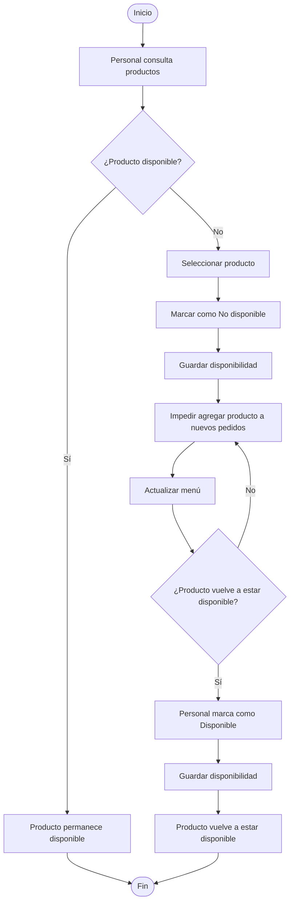

# 2.7.8 — Flujo: Gestionar disponibilidad de productos

## NEGOVA — MVP Restaurante de comida rápida

---

## 1. Objetivo

Definir cómo el restaurante controla la disponibilidad de los productos que ofrece a sus clientes.

El objetivo principal del MVP es evitar que un producto que el restaurante no puede preparar continúe apareciendo como disponible para nuevos pedidos.

NEGOVA utilizará inicialmente un modelo simple de disponibilidad manual.

El sistema NO realizará control automático de ingredientes ni descontará materias primas automáticamente.

---

# 2. Problema que resuelve

En los negocios pequeños es posible que un producto deje de estar disponible durante la operación.

Ejemplo:

```text
El restaurante tiene papa.
El restaurante tiene queso.
El restaurante tiene salsas.

Pero se acaba la salchicha.

Por lo tanto:

Salchipapa → No disponible
```

El problema no es necesariamente que el restaurante conozca exactamente cuántos gramos de cada ingrediente quedan.

El problema operativo es:

> **El restaurante no debe seguir recibiendo pedidos de productos que actualmente no puede preparar.**

---

# 3. Actores

## 3.1 Propietario
Puede:
- Consultar productos.
- Activar productos.
- Desactivar productos.
- Gestionar el menú.

## 3.2 Personal del negocio
Puede:
- Consultar disponibilidad.
- Marcar productos como no disponibles.
- Volver a activar productos cuando estén disponibles.

*(En un negocio pequeño esta función puede ser realizada por cualquier persona autorizada).*

## 3.3 Cliente
Puede:
- Consultar el menú.
- Visualizar productos disponibles.
- Identificar productos que no están disponibles.

*(El cliente no puede modificar directamente la disponibilidad).*

---

# 4. Modelo de disponibilidad

Cada producto debe tener un estado simple de disponibilidad:

```text
DISPONIBLE
NO DISPONIBLE
```

---

# 5. Estado DISPONIBLE

Cuando un producto está disponible:

```text
disponibilidad = disponible
```

El producto puede:
- Aparecer normalmente en el menú digital.
- Ser seleccionado para un pedido.
- Ser registrado por el personal.

---

# 6. Estado NO DISPONIBLE

Cuando el restaurante no puede preparar un producto:

```text
disponibilidad = no_disponible
```

El producto no debe poder ser agregado a nuevos pedidos.

Puede continuar apareciendo en el menú para informar al cliente que temporalmente no está disponible, dependiendo de la interfaz que se defina posteriormente.

---

# 7. Cambio manual

La disponibilidad será modificada manualmente.

Ejemplo:

```text
Salchipapa
     ↓
Disponible
     ↓
Se acaba la salchicha
     ↓
Personal marca:
No disponible
```

Cuando el restaurante vuelve a tener el ingrediente necesario:

```text
No disponible
     ↓
Personal marca:
Disponible
```

---

# 8. No existe inventario automático

El MVP NO debe asumir que NEGOVA conoce:
- Cuántas papas quedan.
- Cuántas salchichas quedan.
- Cuántos kilos de carne quedan.
- Cuántos litros de aceite quedan.
- Cuántas unidades exactas de cada ingrediente existen.

NEGOVA tampoco debe calcular automáticamente:

```text
ingredientes utilizados
-
ingredientes disponibles
=
inventario restante
```

Esta funcionalidad queda fuera del alcance del MVP.

---

# 9. No existen recetas automáticas

En el MVP un producto no tendrá necesariamente una receta estructurada con cantidades exactas de ingredientes.

Por ejemplo, NEGOVA no debe asumir:

```text
Salchipapa
├── 200 g papa
├── 100 g salchicha
├── 50 g queso
└── 30 g salsa
```

porque los negocios objetivo pueden trabajar con porciones determinadas manualmente.

La gestión de recetas y costos por ingredientes podrá evaluarse posteriormente.

---

# 10. Flujo principal

1. El personal consulta el menú.
2. Identifica un producto que no puede prepararse.
3. Selecciona el producto.
4. Cambia su disponibilidad a `No disponible`.
5. NEGOVA guarda el cambio.
6. El producto deja de poder agregarse a nuevos pedidos.
7. El menú refleja la nueva disponibilidad.
8. Cuando el producto vuelve a estar disponible, el personal lo activa nuevamente.
9. NEGOVA cambia su estado a `Disponible`.
10. El producto vuelve a poder utilizarse en nuevos pedidos.

---

# 11. Diagrama de flujo



---

# 12. Relación con el menú digital

La disponibilidad debe afectar directamente la posibilidad de realizar nuevos pedidos.

Ejemplo:

```text
Producto:
Salchipapa

Estado:
NO DISPONIBLE
```

El cliente puede visualizar:

```text
Salchipapa (No disponible)
```

pero no debe poder agregarla a un nuevo pedido.

---

# 13. Relación con pedidos existentes

Cambiar la disponibilidad de un producto NO debe modificar automáticamente los pedidos que ya fueron registrados.

Ejemplo:

```text
10:00
Pedido #001
Salchipapa
Estado: Recibido

10:05
Salchicha agotada

Producto:
Salchipapa → No disponible
```

El pedido #001 no debe eliminarse ni modificarse automáticamente. El personal debe resolver cualquier situación relacionada con ese pedido.

---

# 14. Producto agotado después de recibir un pedido

Puede ocurrir que:
1. Un cliente solicite un producto.
2. El pedido sea registrado.
3. Posteriormente el restaurante descubra que ya no puede preparar el producto.

NEGOVA no debe cancelar automáticamente el pedido. El personal debe gestionar la situación con el cliente.

---

# 15. Reactivación

Cuando el producto vuelve a estar disponible:
1. El personal abre la gestión de productos.
2. Selecciona el producto.
3. Cambia el estado a `Disponible`.
4. NEGOVA guarda el cambio.
5. El producto vuelve a poder agregarse a nuevos pedidos.

---

# 16. Disponibilidad temporal

La disponibilidad puede cambiar varias veces durante un mismo día.

Ejemplo:

```text
12:00 → Disponible
13:30 → No disponible
15:00 → Disponible
18:00 → No disponible
```

NEGOVA debe permitir realizar estos cambios sin necesidad de crear un nuevo producto.

---

# 17. Historial de cambios

El sistema debe registrar quién realizó el cambio de disponibilidad y cuándo.

Conceptualmente:

```text
Producto: Salchipapa

12:00
Disponible
Usuario: Ana

13:30
No disponible
Usuario: Leiner

15:00
Disponible
Usuario: Ana
```

El historial puede utilizarse posteriormente para análisis. No se requiere una interfaz avanzada de auditoría para el MVP, pero la estructura debe permitir registrar estos cambios.

---

# 18. Disponibilidad y canales

La disponibilidad debe aplicarse independientemente del canal.

Si un producto está `NO DISPONIBLE`, no debe poder agregarse mediante:
- Menú digital.
- Registro presencial.
- Registro manual de un nuevo pedido de WhatsApp.

---

# 19. WhatsApp

Los pedidos recibidos por WhatsApp son un caso particular. NEGOVA no controla directamente el mensaje de WhatsApp en el MVP.

Si el cliente solicita por WhatsApp un producto que aparece como no disponible:
1. El personal identifica que el producto no está disponible.
2. Informa al cliente por chat.
3. El producto no se registra en el pedido.
4. El cliente selecciona otra alternativa.

---

# 20. Regla de validación

Antes de agregar un producto a un nuevo pedido, NEGOVA debe verificar:

$$\text{¿Producto disponible?}$$

- Si **Sí** $\rightarrow$ Permitir agregar.
- Si **No** $\rightarrow$ Impedir agregar.

---

# 21. Regla de consistencia

La disponibilidad es una propiedad del producto. No debe existir una disponibilidad independiente por cada pedido.

La disponibilidad afecta principalmente a nuevos pedidos; los pedidos ya existentes conservan sus productos.

---

# 22. Diagrama conceptual

```text
                  PRODUCTO
                     │
                     ↓
              DISPONIBILIDAD
                 /       \
                /         \
               ↓           ↓
        DISPONIBLE    NO DISPONIBLE
             │               │
             ↓               ↓
       Puede venderse    No puede venderse
             │               │
             ↓               ↓
      Nuevos pedidos     Nuevos pedidos
                          bloqueados
```

---

# 23. Resultado

El proceso garantiza que:
- El restaurante puede controlar manualmente la disponibilidad.
- Los productos agotados dejan de poder venderse.
- El menú refleja la disponibilidad en tiempo real.
- Los pedidos existentes no se modifican automáticamente.
- No se requiere inventario automático ni recetas digitales.
- La solución sigue siendo ligera y adecuada para negocios pequeños.

---

# 24. Exclusiones del MVP

Este flujo NO incluye:
- Inventario automático.
- Control de ingredientes por gramaje.
- Recetas ni costos automáticos por ingrediente.
- Descuento automático de inventario.
- Predicción de agotamiento ni alertas automáticas de inventario.
- Compras automáticas ni órdenes de compra a proveedores.
- Inventario por lotes ni vencimiento.
- Código de barras o escáner.
- IA para predecir demanda.

---

# 25. Estado del documento

**Estado:** Completado  
**Fase:** Modelo y análisis  
**Sección:** 2.7 — Flujos detallados  
**Vertical:** Restaurante de comida rápida  
**Versión:** MVP  
**Documento:** 2.7.8 — Gestionar disponibilidad de productos  
