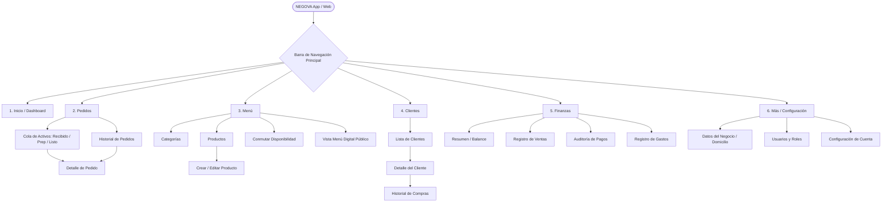

# 3.2 — Mapa de navegación

## NEGOVA — MVP Restaurante de comida rápida

**Versión:** 1.0  
**Estado:** ✅ Completado  
**Fase:** Fase 3 — Arquitectura de información  
**Vertical:** Restaurantes de comida rápida  
**Documento:** 3.2 — Mapa de navegación  


---

## 1. Objetivo

Definir la arquitectura de navegación principal de NEGOVA y la relación entre las diferentes pantallas y áreas operativas de la plataforma.

La navegación está diseñada bajo un enfoque **Mobile-First**, priorizando las operaciones de alta frecuencia del negocio (cola de pedidos, recepción multicanal y disponibilidad) y manteniendo una estructura clara y de mínima fricción para usuarios con poca experiencia digital.

---

## 2. Navegación principal

```text
NEGOVA PLATFORM
│
├── 🏠 Inicio (Dashboard operativo rápido / Métricas del turno)
│
├── 📋 Pedidos (Cola centralizada de trabajo)
│   ├── Activos (Recibido / En preparación / Listo)
│   ├── Detalle del pedido (Productos, notas, flete, estado)
│   └── Historial (Órdenes cerradas / Entregadas / Canceladas)
│
├── 🍔 Menú (Gestión del catálogo de venta)
│   ├── Categorías (Gestión de secciones del menú)
│   ├── Productos (Listado de ítems comercializables)
│   ├── Crear producto (Formulario ágil de alta)
│   ├── Editar producto (Precios, fotos, descripción)
│   ├── Disponibilidad (Conmutación rápida: Disponible / Agotado)
│   └── Menú digital (Vista pública web / Código QR)
│
├── 👤 Clientes (Directorio y recurrencia)
│   ├── Lista de clientes (Búsqueda por nombre o teléfono)
│   ├── Detalle del cliente (Datos de contacto y preferencias)
│   └── Historial de pedidos (Compras históricas asociadas)
│
├── 💰 Finanzas (Control de caja y balances)
│   ├── Resumen (Balance neto: Ventas - Gastos)
│   ├── Ventas (Ingresos por pedidos y métodos de pago)
│   ├── Pagos (Auditoría de efectivo vs. transferencias)
│   └── Gastos (Registro de egresos operativos)
│
└── ⚙️ Más (Administración y configuración general)
    ├── Negocio (Perfil comercial, horarios, tarifas de domicilio)
    ├── Usuarios (Gestión de trabajadores y permisos RBAC)
    └── Configuración (Ajustes de cuenta y preferencias)
```

---

# 3. Flujo de navegación principal



---

# 4. Navegación de pedidos

```text
Pedidos
   │
   ├── Activos
   │     ├── Recibido (Nuevos pedidos en espera)
   │     ├── En preparación (En cocina)
   │     └── Listo (Empacado / Listo para entrega o despacho)
   │
   ├── Seleccionar pedido ──► Detalle del Pedido (Acciones: Cambiar estado, Ver notas, Liquidar pago)
   │
   └── Historial ────────────► Detalle de Venta Histórica (Inmutable)
```

---

# 5. Navegación del menú

```text
Menú
 │
 ├── Categorías ────► Filtrado y organización de la oferta
 │
 ├── Productos ─────► Crear / Editar producto (precio, imagen, descripción)
 │
 ├── Disponibilidad ─► Alternar estado Disponible / No disponible en un toque
 │
 └── Menú digital ───► Enlace público autogestionado para clientes (QR)
```

---

# 6. Navegación de clientes

```text
Clientes
   │
   ├── Lista de clientes ──► Búsqueda rápida
   │     ↓
   ├── Seleccionar cliente ─► Ficha de detalle
   │     ↓
   └── Historial de pedidos asociados
```

---

# 7. Navegación financiera

```text
Finanzas
   │
   ├── Resumen ──► Balance operativo del día / período
   ├── Ventas ───► Registro cronológico de ventas liquidadas
   ├── Pagos ────► Desglose por método (Efectivo vs. Transferencias)
   └── Gastos ───► Registro de egresos (compras de insumos, servicios)
```

> **Regla de separación:** Las operaciones financieras no deben mezclarse con la interfaz de trabajo continuo de cocina y despacho de pedidos.

---

# 8. Navegación administrativa

```text
Más
 │
 ├── Negocio ───────► Nombre comercial, teléfonos, dirección, tarifa base de flete
 ├── Usuarios ──────► Propietario, personal operativo, permisos
 └── Configuración ──► Seguridad y preferencias de cuenta
```

> **Criterio de diseño:** Estas secciones tienen menor frecuencia de uso operativo y por ello no saturan la barra de navegación principal.

---

# 9. Regla de navegación

1. **Acceso directo a alta frecuencia:** La cola de pedidos y el registro de ventas deben ser accesibles en un máximo de 1 toque desde cualquier pantalla operativa.
2. **Separación operativa vs. administrativa:** La configuración y los reportes analíticos están resguardados para evitar clics accidentales durante horas pico.

---

# 10. Principio móvil (Mobile-First)

- La interfaz está diseñada para operarse cómodamente con una sola mano en smartphones de gama baja/media.
- **Patrones de UI soportados:**
  - **Barra de navegación inferior (Bottom Navigation Bar)** para las 4-5 secciones principales (`Inicio`, `Pedidos`, `Menú`, `Finanzas`, `Más`).
  - **Floating Action Buttons (FAB)** o accesos rápidos para "Nuevo Pedido".
  - **Tarjetas táctiles grandes** para transicionar estados de pedidos sin requerir teclados.

---

# 11. Estado del documento

**Estado:** ✅ Completado  
**Fase:** Fase 3 — Arquitectura de información  
**Documento:** 3.2 — Mapa de navegación  
