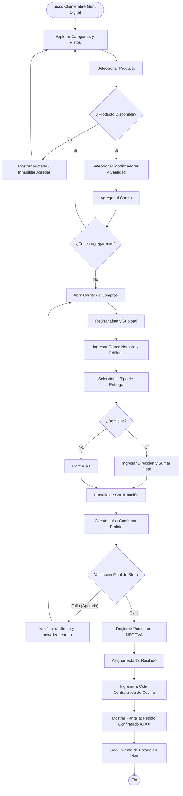

# 3.6 — Arquitectura de navegación del menú digital

## NEGOVA — MVP Restaurante de comida rápida

**Versión:** 1.0  
**Estado:** ✅ Completado  
**Fase:** Fase 3 — Arquitectura de información  
**Vertical:** Restaurantes de comida rápida  
**Documento:** 3.6 — Arquitectura de navegación del menú digital  

---

## 1. Objetivo

Definir la estructura de navegación, pantallas y flujo de compra que utilizará el cliente final para consultar el menú digital y realizar un pedido de comida rápida.

Esta navegación es una aplicación web pública, independiente del panel administrativo de NEGOVA, diseñada para ejecutarse de forma ágil en cualquier navegador móvil sin exigir la descarga de apps ni registro obligatorio.

---

## 2. Entrada al menú digital

El cliente accede mediante un enlace público del negocio o escaneando un código QR colocado en mesas, mostrador o volante físico:

```text
Código QR / Enlace Web Público
              ↓
   Menú Digital del Negocio (Sin Login)
```

---

# 3. Estructura principal de navegación

```text
MENÚ DIGITAL PÚBLICO
│
├── 🍔 Inicio / Menú (Catálogo visual con identidad del restaurante)
│
├── 📂 Categorías (Filtros de platos: Hamburguesas, Salchipapas, Bebidas, etc.)
│   └── Lista de Productos
│
├── 🔍 Detalle del producto (Foto, ingredientes, modificadores "sin cebolla", adiciones)
│
├── 🛒 Carrito de compras (Revisión de ítems, cantidades y subtotales)
│
├── 📝 Datos del pedido y entrega (Nombre, teléfono, tipo de entrega, dirección)
│
├── ✅ Confirmación y desglose (Subtotal comida + Flete domicilio = Total)
│
└── ⏱️ Estado del pedido (Pantalla pública de seguimiento del pedido)
```

---

# 4. Menú principal

La pantalla de inicio del menú presenta:
- **Identidad comercial:** Nombre del restaurante, logo, horario de atención y estado del negocio (Abierto / Cerrado).
- **Barra/Pestañas de categorías:** Desplazamiento horizontal rápido.
- **Grilla de productos:** Tarjetas táctiles con nombre, precio, foto e indicador de disponibilidad.
- **Acceso directo al carrito:** Botón flotante que muestra el total acumulado y contador de productos.

---

# 5. Categorías

Las categorías permiten segmentar la oferta culinaria:
- *Ejemplo:* `Hamburguesas`, `Perros calientes`, `Salchipapas`, `Bebidas`, `Combos`, `Adicionales`.
- Cada negocio configura libremente sus categorías desde el panel administrativo; NEGOVA no impone nombres rígidos.

---

# 6. Detalle del producto y selección

Al pulsar sobre un ítem se despliega su ficha:
- **Foto ampliada** y descripción de ingredientes.
- **Precio unitario base**.
- **Modificadores de preparación:** Opciones de exclusión (ej. *"Sin cebolla"*, *"Salsas aparte"*).
- **Adicionales con costo:** Extras opcionales (ej. *"Doble queso +$3.000"*, *"Tocineta extra +$4.000"*).
- **Selector de cantidad (+ / -)**.
- **Botón de acción:**
  - Si está `Disponible`: `Agregar al pedido — $XX.XXX`.
  - Si está `No disponible (Agotado)`: Botón deshabilitado mostrando `Temporalmente Agotado`.

---

# 7. Carrito de compras

El carrito consolida la selección antes de pasar a la entrega:
- Listado de productos con sus modificaciones seleccionadas.
- Controles táctiles para aumentar, disminuir o eliminar productos.
- Desglose contable preliminar:
  $$\text{Subtotal Productos} = \sum (\text{Precio Base} + \text{Adiciones}) \times \text{Cantidad}$$
- Botón secundario: `Seguir pidiendo`.
- Botón primario: `Continuar con el pedido`.

---

# 8. Datos del pedido

El cliente ingresa la información básica de contacto:
- **Nombre:** Para identificar quién recibe o recoge.
- **Teléfono / WhatsApp:** Para confirmación o aclaraciones de cocina.

---

# 9. Tipo de entrega

El cliente selecciona la modalidad deseada:

```text
¿Cómo recibirás tu pedido?
├── 🏬 Recoger en el local / Mesa (Flete = $0 COP)
└── 🛵 Domicilio (Aplica tarifa de flete configurada)
```

---

# 10. Gestión del domicilio en el menú web

Si el cliente selecciona `Domicilio`:
1. Ingresa la dirección y referencia comunitaria (ej. *"Calle 3 # 4-50, frente al parque"*).
2. El sistema calcula y presenta el valor del flete configurado por el negocio.
3. Se actualiza el total en pantalla:
   $$\text{Total a Pagar} = \text{Subtotal Productos} + \text{Valor Domicilio}$$

---

# 11. Pantalla de confirmación previa

Antes del envío final a cocina, el cliente revisa el resumen integral:
- Lista de platos y modificadores.
- Tipo de entrega y dirección (si aplica).
- Subtotal, flete de domicilio y Total final destacado.
- Método de pago previsto (Efectivo / Transferencia al recibir o por adelantado).
- Botón principal de acción: `Confirmar y Enviar Pedido`.

---

# 12. Validación y registro del pedido en NEGOVA

Al presionar confirmar:
1. **Validación en tiempo real:** NEGOVA comprueba que ninguno de los productos en el carrito haya sido marcado como `Agotado` mientras el cliente navegaba.
2. **Creación transaccional:** Se genera el pedido con su identificador correlativo (#042).
3. **Inyección en cola común:** La orden ingresa inmediatamente a la cola de trabajo del restaurante en estado `Recibido`.

---

# 13. Manejo de producto agotado durante el checkout

Si un plato se agotó en cocina durante la navegación del cliente:
$$\text{Cliente Confirma} \longrightarrow \text{Validación Falla} \longrightarrow \text{Notificación en Pantalla (Toast/Modal)} \longrightarrow \text{Actualización de Carrito}$$
El sistema no crea una orden incompleta a ciegas; le informa al usuario para que sustituya el plato o lo retire del carrito.

---

# 14. Confirmación visual y número de orden

Tras el registro exitoso, la pantalla muestra:
- Mensaje de confirmación: *"¡Tu pedido #042 ha sido recibido!"*.
- Resumen de la orden.
- Indicador de estado inicial: `RECIBIDO`.

---

# 15. Seguimiento del estado del pedido

El cliente puede monitorear en tiempo real la progresión operativa de su comida:
$$\mathbf{RECIBIDO} \longrightarrow \mathbf{EN\ PREPARACIÓN} \longrightarrow \mathbf{LISTO\ (o\ EN\ CAMINO)} \longrightarrow \mathbf{ENTREGADO}$$

> **Regla de seguridad:** El cliente tiene una vista de solo lectura; no puede alterar estados, pedidos ajenos ni precios.

---

# 16. Diagrama de navegación completa



---

# 17. Principios rectores de la experiencia del menú

1. **Simplicidad Absoluta:** Realizar un pedido toma menos de 2 minutos sin requerir contraseñas ni validaciones engorrosas.
2. **Rapidez y Cero Fricción:** Diseñado para conexiones móviles lentas o inestables (3G/4G rural).
3. **Transparencia Total:** El cliente siempre conoce el precio de la comida, el costo del domicilio y el total exacto.
4. **Validación Preventiva:** El sistema garantiza que no se envíen órdenes con insumos agotados.
5. **Independencia Arquitectónica:** Funciona como aplicación desacoplada consumiendo los servicios del CORE y del Vertical Restaurante.

---

# 18. Estado del documento

**Estado:** ✅ Completado  
**Fase:** Fase 3 — Arquitectura de información  
**Vertical:** Restaurantes de comida rápida  
**Documento:** 3.6 — Arquitectura de navegación del menú digital  
