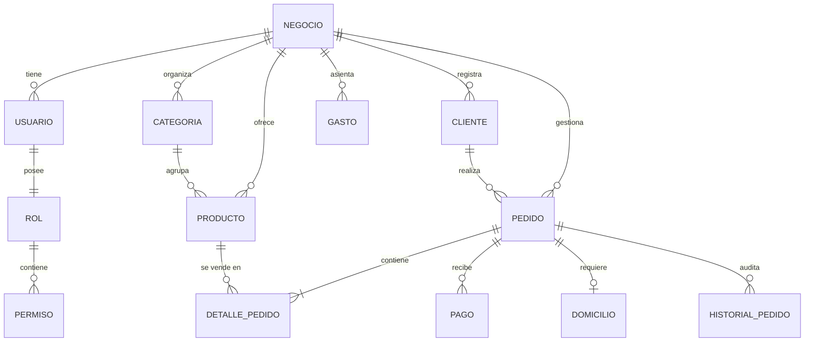

# 4.1 — Modelo de datos conceptual

## NEGOVA — MVP Restaurante de comida rápida

**Versión:** 1.0  
**Estado:** ✅ Completado  
**Fase:** Fase 4 — Modelo de datos  
**Vertical:** Restaurantes de comida rápida  
**Documento:** 4.1 — Modelo de datos conceptual  

---

## 1. Objetivo

Definir las entidades lógicas principales que necesita NEGOVA, sus atributos esenciales y las relaciones estructurales entre ellas antes de construir el esquema físico de base de datos.

Este modelo representa la estructura lógica de dominio y desacopla los conceptos del **CORE** y del **Vertical Restaurante** sin depender de un motor específico de base de datos (PostgreSQL / Supabase / SQLite).

---

## 2. Entidades principales del modelo

El sistema se estructura en torno a las siguientes 13 entidades fundamentales:

```text
┌──────────────────────────────────────────────────────────┐
│                   ENTIDADES DEL SISTEMA                  │
├────────────────────────────┬─────────────────────────────┤
│        NEGOVA CORE         │     VERTICAL RESTAURANTE    │
├────────────────────────────┼─────────────────────────────┤
│  1. Negocio (Tenant)       │  6. Categoría               │
│  2. Usuario                │  7. Producto                │
│  3. Rol                    │  8. Pedido                  │
│  4. Permiso                │  9. DetallePedido           │
│  5. Cliente                │ 10. Pago                    │
│ 11. Gasto                  │ 12. Domicilio (0..1)        │
│                            │ 13. HistorialPedido         │
└────────────────────────────┴─────────────────────────────┘
```

---

# 3. Negocio (Tenant / Comercio)

Representa la cuenta comercial que opera sobre NEGOVA. Es la raíz del aislamiento de datos (Multi-Tenancy).

Un **Negocio** agrupa y es propietario exclusivo de:
- Usuarios y colaboradores autorizados.
- Directorio de clientes recurrentes.
- Categorías y catálogo de productos.
- Pedidos registrados y ventas.
- Transacciones de pago recaudadas.
- Gastos operativos y configuraciones comerciales.

---

# 4. Usuario (Colaborador autenticado)

Representa a una persona con credenciales de acceso administrativo u operativo a la plataforma NEGOVA:
- **Atributos conceptuales:** Identificador único, referencia de autenticación (correo/teléfono/hash), nombre completo, rol asignado, estado (`Activo` / `Inactivo`), fecha de creación.

---

# 5. Rol (Nivel de acceso RBAC)

Define el conjunto de atribuciones y alcance dentro del negocio:
- **Roles predeterminados del MVP:**
  - `PROPIETARIO` (Control total comercial, financiero y administrativo).
  - `PERSONAL` (Operación en turno: cola de pedidos, cocina, disponibilidad y pagos).

---

# 6. Permiso (Acción atómica del sistema)

Representa una capacidad específica que puede concederse a un rol:
- *Ejemplos:* `pedidos.ver`, `pedidos.crear`, `pedidos.cambiar_estado`, `productos.ver`, `productos.crear`, `productos.editar`, `productos.conmutar_disponibilidad`, `finanzas.ver`, `gastos.crear`, `usuarios.gestionar`.

---

# 7. Cliente (Consumidor final)

Representa a una persona que realiza compras en el restaurante:
- **Atributos conceptuales:** Nombre completo, teléfono / WhatsApp, dirección habitual de entrega, notas sobre preferencias.
- **Relación:** Un cliente puede tener múltiples pedidos ($1 \text{ Cliente} \rightarrow N \text{ Pedidos}$).
- > **Regla de flexibilidad:** Un pedido puede registrarse sin exigir la creación previa de una ficha completa de cliente (cliente genérico de mostrador).

---

# 8. Categoría (Agrupador de catálogo)

Organiza los productos y platos del menú del restaurante:
- **Atributos conceptuales:** Nombre (ej. *Hamburguesas*, *Salchipapas*, *Bebidas*), orden de visualización, estado (`Activo` / `Inactivo`).
- **Relación:** Una categoría pertenece a un único negocio y contiene $N$ productos ($1 \text{ Categoría} \rightarrow N \text{ Productos}$).

---

# 9. Producto (Ítem vendible del menú)

Representa un plato, bebida o combo comercializable:
- **Atributos conceptuales:** Nombre, descripción de ingredientes, precio de venta base actual ($ COP), imagen URL, estado de disponibilidad (`Disponible` / `No disponible`), categoría asociada.
- **Relación:** Pertenece a un negocio y categoría; se referencia en los pedidos a través de `DetallePedido`.

---

# 10. Pedido (Transacción comercial / Orden de cocina)

Representa una orden solicitada a través de cualquier canal (WhatsApp, Menú Web o Mostrador):
- **Atributos conceptuales:** Identificador correlativo (#042), canal de origen (`whatsapp` / `digital` / `presencial`), tipo de entrega (`local` / `domicilio`), estado operativo (`Recibido`, `En preparación`, `Listo`, `Entregado`, `Cancelado`), estado de pago (`Pendiente`, `Parcialmente pagado`, `Pagado`), subtotal comida, valor flete domicilio, total final liquidado, fecha y hora de creación.

---

# 11. DetallePedido (Línea de ítem en la comanda)

Representa un producto específico incluido dentro de un pedido con sus cantidades y notas de preparación:
- **Atributos conceptuales:** Referencia al Pedido, Referencia al Producto, Cantidad de unidades, **Precio unitario histórico vendido**, Modificadores/Observaciones ("sin cebolla", "extra queso"), Subtotal de la línea.
- > **Principio de Inmutabilidad:** El precio unitario queda congelado en el momento de la venta; cambios posteriores en el catálogo no alteran ventas históricas.

---

# 12. Pago (Transacción financiera)

Representa un ingreso monetario abonado a un pedido:
- **Atributos conceptuales:** Referencia al Pedido, Concepto (`PRODUCTOS`, `DOMICILIO`, `TOTAL`), Monto pagado ($ COP), Método de pago (`Efectivo`, `Transferencia: Nequi/Daviplata/Bancolombia`), Fecha/Hora, Usuario que registró el cobro.
- **Relación:** Un pedido puede recibir uno o múltiples pagos ($1 \text{ Pedido} \rightarrow N \text{ Pagos}$).

---

# 13. Gasto (Egreso operativo)

Representa una salida de dinero del negocio para costos operativos:
- **Atributos conceptuales:** Concepto (ej. *"Compra de verduras y desechables"*), Monto ($ COP), Categoría de gasto (Insumos, Servicios, Nómina, Mantenimiento), Método de pago, Fecha/Hora, Usuario responsable.
- **Relación:** Pertenece directamente al negocio y es contablemente independiente de los pedidos.

---

# 14. Domicilio (Logística de despacho)

Representa la información complementaria de entrega para pedidos con despacho a domicilio:
- **Atributos conceptuales:** Referencia al Pedido, Dirección o ubicación textual, Referencia comunitaria (ej. *"Casa azul después de la tienda"*), Teléfono de contacto, Valor del flete cobrado, Domiciliario asignado (opcional), Estado de entrega.
- **Relación:** Un pedido tiene exactamente $0$ o $1$ registro de Domicilio ($1 \text{ Pedido} \rightarrow 0..1 \text{ Domicilio}$).

---

# 15. HistorialPedido (Auditoría y trazabilidad)

Registra cronológicamente cada cambio de estado operativo de la orden:
- **Atributos conceptuales:** Referencia al Pedido, Estado anterior, Nuevo estado, Fecha y hora exacta, Usuario responsable del cambio.

---

# 16. Diagrama Entidad-Relación Conceptual



---

# 17. Estructura Jerárquica de Relaciones

```text
NEGOCIO (Tenant Root)
│
├──< USUARIO ── ROL ──< PERMISO
│
├──< CLIENTE
│
├──< CATEGORÍA
│     │
│     └──< PRODUCTO
│
├──< PEDIDO
│     │
│     ├──< DETALLE_PEDIDO >── PRODUCTO (vínculo histórico)
│     │
│     ├──< PAGO
│     │
│     ├── 0..1 DOMICILIO
│     │
│     └──< HISTORIAL_PEDIDO
│
└──< GASTO
```

---

# 18. Regla de Aislamiento Estricto (Multi-Tenant)

> 🔒 **Regla Fundamental:** Toda entidad de negocio contiene obligatoriamente la clave foránea del comercio (`tenant_id` / `negocio_id`).  
> Las consultas en base de datos aplican aislamiento a nivel de consulta y de políticas de seguridad (Row-Level Security / RLS), impidiendo cualquier fuga de datos entre comercios.

---

# 19. Inmutabilidad y Persistencia de la Información Comercial

El modelo garantiza que los datos contables y pedidos históricos son inmutables ante cambios operativos posteriores:

$$\begin{aligned}
\text{Producto en Catálogo (Precio Modificado)} &\neq \text{DetallePedido (Precio Vendido Histórico)} \\
\text{Cliente (Teléfono Actualizado)} &\neq \text{Datos de Contacto en Pedido Histórico}
\end{aligned}$$

---

# 20. Alcance del Modelo Conceptual y Exclusiones Explícitas

El presente modelo define estrictamente el alcance necesario y suficiente para el **MVP del Vertical Restaurante de comida rápida**.

### Exclusiones Explícitas del Modelo en el MVP:
- Entidades de inventario automático, mermas o insumos por gramajes.
- Entidades de recetas digitales o sub-recetas compuestas.
- Módulos de órdenes de compra, facturas de proveedores o cotizaciones.
- Control de lotes y fechas de vencimiento de alimentos.
- Tablas de geolocalización satelital o coordenadas GPS en tiempo real.
- Entidades de facturación electrónica tributaria (DIAN).
- Módulos de comisiones automáticas o pasarelas bancarias complejas.

---

# 21. Estado del Documento

**Estado:** ✅ Completado  
**Fase:** Fase 4 — Modelo de datos  
**Vertical:** Restaurantes de comida rápida  
**Documento:** 4.1 — Modelo de datos conceptual  
