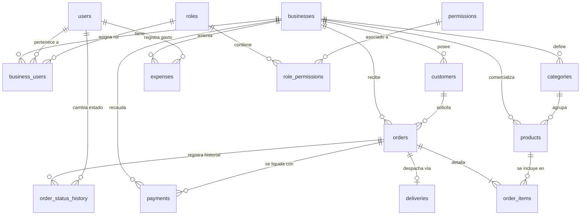

# 4.2 — Modelo de datos lógico

## NEGOVA — MVP Restaurante de comida rápida

**Versión:** 1.0  
**Estado:** ✅ Completado  
**Fase:** Fase 4 — Modelo de datos  
**Vertical:** Restaurantes de comida rápida  
**Documento:** 4.2 — Modelo de datos lógico  

---

## 1. Objetivo

Definir la estructura lógica relacional de la base de datos de NEGOVA a partir del modelo conceptual (4.1).

Este documento especifica formalmente:
- Definición de tablas relacionales.
- Diccionario de campos y tipos de datos lógicos.
- Claves primarias (`PK`) y claves foráneas (`FK`).
- Cardinalidades y reglas de integridad referencial.
- Directrices para la implementación física sobre **Supabase (PostgreSQL)** con **Row-Level Security (RLS)**.

---

## 2. Convenciones generales de diseño

- **Claves Primarias:** Toda tabla posee una clave primaria única inmutable (`id`), preferiblemente UUID v4.
- **Auditoría de Tiempo:** Las tablas transaccionales y de catálogo incluyen campos de timestamp con zona horaria: `created_at` (por defecto `now()`) y `updated_at`.
- **Nombres en snake_case y Plural:** Nombres de tablas en plural minúscula (`businesses`, `orders`, `products`) y columnas en minúscula con guión bajo.
- **Valores de Estado Enumerados:** Todos los campos de estado y tipo utilizan constantes controladas (Enums o Check Constraints), prohibiendo strings arbitrarios.

---

# 3. Tabla: `businesses` (Tenants / Comercios)

Representa la cuenta comercial raíz de aislamiento de datos en NEGOVA.

```text
businesses
├── id: uuid [PK]
├── name: varchar(100) [NOT NULL]
├── slug: varchar(100) [UNIQUE, NOT NULL]
├── description: text
├── logo_url: text
├── phone: varchar(20) [NOT NULL]
├── address: text
├── status: varchar(20) [DEFAULT 'ACTIVE']
├── created_at: timestamptz [DEFAULT now()]
└── updated_at: timestamptz [DEFAULT now()]
```

---

# 4. Tabla: `users` (Perfiles de usuarios administrativos)

Almacena los datos de perfil de los usuarios autenticados a través de Supabase Auth.

```text
users
├── id: uuid [PK, FK -> auth.users.id]
├── full_name: varchar(150) [NOT NULL]
├── email: varchar(255) [UNIQUE, NOT NULL]
├── status: varchar(20) [DEFAULT 'ACTIVE']
├── created_at: timestamptz [DEFAULT now()]
└── updated_at: timestamptz [DEFAULT now()]
```

---

# 5. Tabla: `business_users` (Membresías y roles de usuarios por negocio)

Permite la asociación de usuarios con uno o múltiples negocios con un rol determinado (soporte multi-tenant limpio).

```text
business_users
├── id: uuid [PK]
├── business_id: uuid [FK -> businesses.id, NOT NULL]
├── user_id: uuid [FK -> users.id, NOT NULL]
├── role_id: uuid [FK -> roles.id, NOT NULL]
├── status: varchar(20) [DEFAULT 'ACTIVE']
├── created_at: timestamptz [DEFAULT now()]
└── updated_at: timestamptz [DEFAULT now()]
```
> **Restricción:** Índice único compuesto `UNIQUE(business_id, user_id)` para evitar duplicidad de membresías en un mismo negocio.

---

# 6. Tabla: `roles` (Roles del sistema)

Define los perfiles de acceso administrativo.

```text
roles
├── id: uuid [PK]
├── name: varchar(50) [UNIQUE, NOT NULL]
├── description: text
├── created_at: timestamptz [DEFAULT now()]
└── updated_at: timestamptz [DEFAULT now()]
```
- **Roles predefinidos:** `PROPIETARIO` y `PERSONAL`.

---

# 7. Tabla: `permissions` (Permisos granulares)

Catálogo de acciones atómicas autorizables.

```text
permissions
├── id: uuid [PK]
├── name: varchar(100) [UNIQUE, NOT NULL]
├── description: text
└── created_at: timestamptz [DEFAULT now()]
```
- *Ejemplos:* `orders.view`, `orders.create`, `orders.update_status`, `products.view`, `products.create`, `products.update`, `products.toggle_availability`, `finances.view`, `expenses.create`, `users.manage`, `business.manage`.

---

# 8. Tabla: `role_permissions` (Matriz de roles y permisos)

Tabla asociativa de muchos a muchos.

```text
role_permissions
├── role_id: uuid [FK -> roles.id, NOT NULL]
├── permission_id: uuid [FK -> permissions.id, NOT NULL]
└── PRIMARY KEY (role_id, permission_id)
```

---

# 9. Tabla: `customers` (Directorio de clientes)

Clientes recurrentes o identificados por negocio.

```text
customers
├── id: uuid [PK]
├── business_id: uuid [FK -> businesses.id, NOT NULL]
├── name: varchar(150) [NOT NULL]
├── phone: varchar(20) [NOT NULL]
├── email: varchar(255)
├── address: text
├── notes: text
├── created_at: timestamptz [DEFAULT now()]
└── updated_at: timestamptz [DEFAULT now()]
```
> **Índice:** Búsqueda rápida por `(business_id, phone)`.

---

# 10. Tabla: `categories` (Categorías del menú)

Secciones del catálogo de comidas y bebidas.

```text
categories
├── id: uuid [PK]
├── business_id: uuid [FK -> businesses.id, NOT NULL]
├── name: varchar(100) [NOT NULL]
├── description: text
├── sort_order: integer [DEFAULT 0]
├── status: varchar(20) [DEFAULT 'ACTIVE']
├── created_at: timestamptz [DEFAULT now()]
└── updated_at: timestamptz [DEFAULT now()]
```

---

# 11. Tabla: `products` (Platos y productos del catálogo)

Ítems comercializables del menú.

```text
products
├── id: uuid [PK]
├── business_id: uuid [FK -> businesses.id, NOT NULL]
├── category_id: uuid [FK -> categories.id, NOT NULL]
├── name: varchar(150) [NOT NULL]
├── description: text
├── image_url: text
├── price: numeric(12, 2) [NOT NULL, CHECK (price >= 0)]
├── is_available: boolean [DEFAULT true, NOT NULL]
├── sort_order: integer [DEFAULT 0]
├── created_at: timestamptz [DEFAULT now()]
└── updated_at: timestamptz [DEFAULT now()]
```

---

# 12. Tabla: `orders` (Pedidos y comandas)

Entidad central de la transacción operativa y de cocina.

```text
orders
├── id: uuid [PK]
├── business_id: uuid [FK -> businesses.id, NOT NULL]
├── customer_id: uuid [FK -> customers.id, NULLABLE]
├── order_number: integer [NOT NULL]
├── channel_origin: varchar(20) [NOT NULL] -- 'WHATSAPP', 'DIGITAL', 'IN_PERSON'
├── status: varchar(20) [DEFAULT 'RECEIVED', NOT NULL] -- 'RECEIVED', 'PREPARING', 'READY', 'DELIVERED', 'CANCELLED'
├── order_type: varchar(20) [NOT NULL] -- 'PICKUP', 'DELIVERY'
├── payment_status: varchar(20) [DEFAULT 'PENDING', NOT NULL] -- 'PENDIENTE', 'PARCIALMENTE_PAGADO', 'PAGADO'
├── subtotal: numeric(12, 2) [NOT NULL, DEFAULT 0]
├── delivery_fee: numeric(12, 2) [NOT NULL, DEFAULT 0]
├── total: numeric(12, 2) [NOT NULL, DEFAULT 0]
├── notes: text
├── created_at: timestamptz [DEFAULT now()]
└── updated_at: timestamptz [DEFAULT now()]
```

---

# 13. Tabla: `order_items` (Líneas de pedido con congelamiento histórico)

Detalle de productos incluidos en una orden.

```text
order_items
├── id: uuid [PK]
├── order_id: uuid [FK -> orders.id, NOT NULL]
├── product_id: uuid [FK -> products.id, NULLABLE] -- Permite conservar historial si se borra el producto
├── product_name: varchar(150) [NOT NULL] -- Nombre histórico congelado
├── quantity: integer [NOT NULL, CHECK (quantity > 0)]
├── unit_price: numeric(12, 2) [NOT NULL, CHECK (unit_price >= 0)] -- Precio histórico congelado
├── subtotal: numeric(12, 2) [NOT NULL, CHECK (subtotal >= 0)]
├── modifiers_notes: text -- Notas de preparación ("sin cebolla", adiciones)
└── created_at: timestamptz [DEFAULT now()]
```

> **Principio de Inmutabilidad:** `product_name` y `unit_price` almacenan la copia exacta del momento de la compra. Cambios posteriores en la tabla `products` nunca alteran ventas históricas.

---

# 14. Tabla: `payments` (Transacciones de cobro)

Registro de abonos y pagos monetarios asociados a un pedido.

```text
payments
├── id: uuid [PK]
├── business_id: uuid [FK -> businesses.id, NOT NULL]
├── order_id: uuid [FK -> orders.id, NOT NULL]
├── concept: varchar(30) [DEFAULT 'TOTAL', NOT NULL] -- 'PRODUCTS', 'DELIVERY', 'TOTAL'
├── amount: numeric(12, 2) [NOT NULL, CHECK (amount > 0)]
├── payment_method: varchar(30) [NOT NULL] -- 'CASH', 'TRANSFER', 'CARD', 'OTHER'
├── status: varchar(20) [DEFAULT 'PAID', NOT NULL] -- 'PENDING', 'PAID', 'CANCELLED'
├── paid_at: timestamptz [DEFAULT now()]
└── created_at: timestamptz [DEFAULT now()]
```

---

# 15. Tabla: `deliveries` (Despacho a domicilio 0..1)

Información logística complementaria exclusiva para pedidos con entrega a domicilio.

```text
deliveries
├── id: uuid [PK]
├── order_id: uuid [UNIQUE, FK -> orders.id, NOT NULL]
├── customer_name: varchar(150) [NOT NULL]
├── phone: varchar(20) [NOT NULL]
├── address: text [NOT NULL]
├── additional_reference: text -- "Casa azul después de la tienda"
├── delivery_fee: numeric(12, 2) [NOT NULL, DEFAULT 0]
├── status: varchar(20) [DEFAULT 'PENDING', NOT NULL] -- 'PENDING', 'IN_PROGRESS', 'DELIVERED', 'CANCELLED'
├── created_at: timestamptz [DEFAULT now()]
└── updated_at: timestamptz [DEFAULT now()]
```

---

# 16. Tabla: `order_status_history` (Trazabilidad y auditoría de cocina)

Bitácora de cambios de estado operativo.

```text
order_status_history
├── id: uuid [PK]
├── order_id: uuid [FK -> orders.id, NOT NULL]
├── from_status: varchar(20)
├── to_status: varchar(20) [NOT NULL]
├── changed_by: uuid [FK -> users.id, NULLABLE] -- Null si fue generado por menú web
└── created_at: timestamptz [DEFAULT now()]
```

---

# 17. Tabla: `expenses` (Egresos y gastos operativos)

Registro de salidas de dinero del negocio.

```text
expenses
├── id: uuid [PK]
├── business_id: uuid [FK -> businesses.id, NOT NULL]
├── concept: varchar(255) [NOT NULL]
├── amount: numeric(12, 2) [NOT NULL, CHECK (amount > 0)]
├── category: varchar(50) [NOT NULL] -- 'SUPPLIES', 'SERVICES', 'PAYROLL', 'MAINTENANCE', 'OTHER'
├── description: text
├── expense_date: date [NOT NULL, DEFAULT current_date]
├── created_by: uuid [FK -> users.id, NOT NULL]
├── created_at: timestamptz [DEFAULT now()]
└── updated_at: timestamptz [DEFAULT now()]
```

---

# 18. Diagrama Lógico Relacional Completo



---

# 19. Reglas de integridad y restricciones

1. **Aislamiento Multi-Tenant:** Toda consulta operativa debe filtrar obligatoriamente por `business_id`.
2. **Consistencia de Categorías:** Un producto debe pertenecer a una categoría activa y del mismo `business_id`.
3. **Condición de Domicilio:** Un registro en la tabla `deliveries` solo puede existir si `orders.order_type = 'DELIVERY'`.
4. **Borrado Lógico y Preservación Histórica:** Queda prohibido el borrado físico (`DELETE CASCADE`) sobre productos y categorías con ventas históricas. En su lugar se utiliza `is_available = false` o `status = 'INACTIVE'`.

---

# 20. Directrices de Implementación para Supabase / PostgreSQL

- **Motor:** PostgreSQL 15+.
- **Extensiones:** `pgcrypto` (para `gen_random_uuid()`).
- **Políticas RLS (Row-Level Security):**
  - Todas las tablas tienen RLS activado (`ALTER TABLE ... ENABLE ROW LEVEL SECURITY;`).
  - Políticas de lectura/escritura basadas en `auth.uid()` validando membresía activa en `business_users`.
- **Índices de Rendimiento Obligatorios:**
  - `CREATE INDEX idx_orders_business_status ON orders(business_id, status, created_at DESC);`
  - `CREATE INDEX idx_products_business_avail ON products(business_id, is_available);`
  - `CREATE INDEX idx_customers_business_phone ON customers(business_id, phone);`
  - `CREATE INDEX idx_payments_order ON payments(order_id);`
  - `CREATE INDEX idx_order_items_order ON order_items(order_id);`

---

# 21. Alcance y Exclusiones del MVP

El presente modelo relacional soporta el 100% de los requerimientos y flujos definidos sin incorporar sobreingeniería:
- No incluye tablas de recetas compuestas, gramajes ni descuentos automáticos de inventario.
- No incluye tablas de proveedores, cotizaciones ni órdenes de compra.
- No incluye tablas de facturación electrónica tributaria (DIAN) ni conciliaciones bancarias automáticas.

---

# 22. Estado del Documento

**Estado:** ✅ Completado  
**Fase:** Fase 4 — Modelo de datos  
**Vertical:** Restaurantes de comida rápida  
**Documento:** 4.2 — Modelo de datos lógico  
