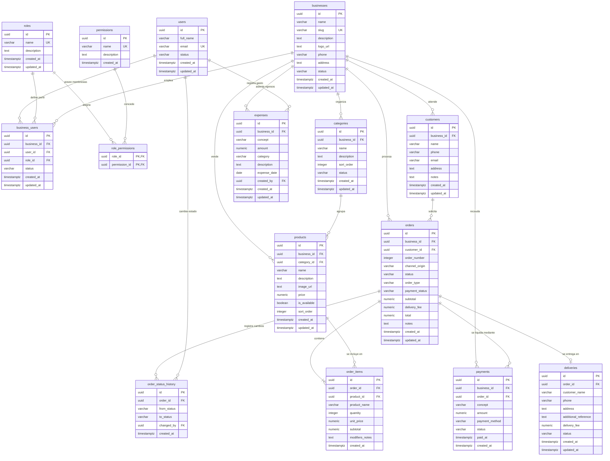

# 4.3 — Diagrama Entidad-Relación (ERD)

## NEGOVA — MVP Restaurante de comida rápida

**Versión:** 1.0  
**Estado:** ✅ Completado  
**Fase:** Fase 4 — Modelo de datos  
**Vertical:** Restaurantes de comida rápida  
**Documento:** 4.3 — Diagrama entidad-relación (ERD)  

---

## 1. Objetivo

Representar visual y formalmente la estructura de datos relacional de NEGOVA y las relaciones exactas entre sus entidades para el MVP del Vertical Restaurante de comida rápida, sirviendo como la fuente de verdad definitiva para el script de migración SQL en Supabase/PostgreSQL.

---

## 2. Inventario de tablas (15 tablas exactas)

El modelo está compuesto estrictamente por las siguientes 15 tablas:

```text
1.  businesses             (Tenant raíz)
2.  users                  (Perfiles autenticados)
3.  business_users         (Membresías y roles de usuarios)
4.  roles                  (Catálogo de roles)
5.  permissions            (Catálogo de permisos)
6.  role_permissions       (Matriz N:M roles-permisos)
7.  customers              (Directorio de clientes)
8.  categories             (Categorías del menú)
9.  products               (Platos y productos)
10. orders                 (Pedidos / Comandas)
11. order_items            (Líneas de pedido históricas)
12. payments               (Transacciones de pago)
13. deliveries             (Despacho de domicilios 0..1)
14. order_status_history   (Trazabilidad de estados de pedido)
15. expenses               (Gastos y egresos operativos)
```

---

# 3. Diccionario técnico de tablas y claves

```text
businesses
├── PK id: uuid
├── name: varchar
├── slug: varchar
├── description: text
├── logo_url: text
├── phone: varchar
├── address: text
├── status: varchar
├── created_at: timestamptz
└── updated_at: timestamptz

users
├── PK id: uuid
├── full_name: varchar
├── email: varchar
├── status: varchar
├── created_at: timestamptz
└── updated_at: timestamptz

business_users
├── PK id: uuid
├── FK business_id: uuid -> businesses.id
├── FK user_id: uuid -> users.id
├── FK role_id: uuid -> roles.id
├── status: varchar
├── created_at: timestamptz
└── updated_at: timestamptz

roles
├── PK id: uuid
├── name: varchar
├── description: text
├── created_at: timestamptz
└── updated_at: timestamptz

permissions
├── PK id: uuid
├── name: varchar
├── description: text
└── created_at: timestamptz

role_permissions
├── PK/FK role_id: uuid -> roles.id
└── PK/FK permission_id: uuid -> permissions.id

customers
├── PK id: uuid
├── FK business_id: uuid -> businesses.id
├── name: varchar
├── phone: varchar
├── email: varchar
├── address: text
├── notes: text
├── created_at: timestamptz
└── updated_at: timestamptz

categories
├── PK id: uuid
├── FK business_id: uuid -> businesses.id
├── name: varchar
├── description: text
├── sort_order: integer
├── status: varchar
├── created_at: timestamptz
└── updated_at: timestamptz

products
├── PK id: uuid
├── FK business_id: uuid -> businesses.id
├── FK category_id: uuid -> categories.id
├── name: varchar
├── description: text
├── image_url: text
├── price: numeric
├── is_available: boolean
├── sort_order: integer
├── created_at: timestamptz
└── updated_at: timestamptz

orders
├── PK id: uuid
├── FK business_id: uuid -> businesses.id
├── FK customer_id: uuid -> customers.id (nullable)
├── order_number: integer
├── channel_origin: varchar
├── status: varchar
├── order_type: varchar
├── payment_status: varchar
├── subtotal: numeric
├── delivery_fee: numeric
├── total: numeric
├── notes: text
├── created_at: timestamptz
└── updated_at: timestamptz

order_items
├── PK id: uuid
├── FK order_id: uuid -> orders.id
├── FK product_id: uuid -> products.id (nullable)
├── product_name: varchar (histórico congelado)
├── quantity: integer
├── unit_price: numeric (histórico congelado)
├── subtotal: numeric
├── modifiers_notes: text
└── created_at: timestamptz

payments
├── PK id: uuid
├── FK business_id: uuid -> businesses.id
├── FK order_id: uuid -> orders.id
├── concept: varchar
├── amount: numeric
├── payment_method: varchar
├── status: varchar
├── paid_at: timestamptz
└── created_at: timestamptz

deliveries
├── PK id: uuid
├── FK order_id: uuid -> orders.id (unique)
├── customer_name: varchar
├── phone: varchar
├── address: text
├── additional_reference: text
├── delivery_fee: numeric
├── status: varchar
├── created_at: timestamptz
└── updated_at: timestamptz

order_status_history
├── PK id: uuid
├── FK order_id: uuid -> orders.id
├── from_status: varchar
├── to_status: varchar
├── FK changed_by: uuid -> users.id (nullable)
└── created_at: timestamptz

expenses
├── PK id: uuid
├── FK business_id: uuid -> businesses.id
├── concept: varchar
├── amount: numeric
├── category: varchar
├── description: text
├── expense_date: date
├── FK created_by: uuid -> users.id
├── created_at: timestamptz
└── updated_at: timestamptz
```

---

# 4. Catálogo de relaciones y cardinalidades

1. **`businesses (1)` $\xrightarrow{1:N}$ `business_users (N)`:** Un negocio tiene múltiples colaboradores autorizados.
2. **`users (1)` $\xrightarrow{1:N}$ `business_users (N)`:** Un usuario puede pertenecer a uno o más comercios.
3. **`roles (1)` $\xrightarrow{1:N}$ `business_users (N)`:** Un rol puede ser asignado a múltiples usuarios.
4. **`roles (N)` $\xleftrightarrow{N:M}$ `permissions (M)`:** Implementado a través de `role_permissions`.
5. **`businesses (1)` $\xrightarrow{1:N}$ `customers (N)`:** Un negocio registra y atiende múltiples clientes.
6. **`businesses (1)` $\xrightarrow{1:N}$ `categories (N)`:** Un negocio organiza su menú en múltiples categorías.
7. **`categories (1)` $\xrightarrow{1:N}$ `products (N)`:** Una categoría contiene múltiples platos/productos.
8. **`businesses (1)` $\xrightarrow{1:N}$ `products (N)`:** Todos los productos pertenecen a un negocio (`tenant_id`).
9. **`businesses (1)` $\xrightarrow{1:N}$ `orders (N)`:** Un negocio recibe y gestiona múltiples pedidos.
10. **`customers (1)` $\xrightarrow{1:0..N}$ `orders (N)`:** Un cliente puede tener múltiples pedidos asociados (opcional para venta mostrador).
11. **`orders (1)` $\xrightarrow{1:1..N}$ `order_items (N)`:** Un pedido contiene obligatoriamente una o más líneas de ítem.
12. **`products (1)` $\xrightarrow{1:0..N}$ `order_items (N)`:** Un producto se referencia en múltiples ventas.
13. **`orders (1)` $\xrightarrow{1:0..N}$ `payments (N)`:** Un pedido puede liquidarse con uno o múltiples abonos/pagos.
14. **`businesses (1)` $\xrightarrow{1:N}$ `payments (N)`:** Todos los pagos registrados pertenecen al negocio.
15. **`orders (1)` $\xrightarrow{1:0..1}$ `deliveries (0..1)`:** Un pedido puede tener a lo sumo un registro de entrega si `order_type = 'DELIVERY'`.
16. **`orders (1)` $\xrightarrow{1:1..N}$ `order_status_history (N)`:** Cada pedido tiene una bitácora cronológica de estados.
17. **`users (1)` $\xrightarrow{1:0..N}$ `order_status_history (N)`:** Un colaborador puede registrar cambios de estado de cocina.
18. **`businesses (1)` $\xrightarrow{1:N}$ `expenses (N)`:** Un negocio registra múltiples gastos operativos.
19. **`users (1)` $\xrightarrow{1:N}$ `expenses (N)`:** Todo gasto registra al usuario responsable de asentarlo.

---

# 5. Diagrama Entidad-Relación Completo (Mermaid ERD)



---

# 6. Reglas de lectura y organización visual

El esquema se divide en tres capas estructuradas de lectura:
1. **Zona Superior (Seguridad y Acceso):** `users`, `business_users`, `roles`, `permissions`, `role_permissions`.
2. **Zona Central (Operación Core y Restaurante):** `businesses` como núcleo de aislamiento, ramificando hacia `customers`, `categories`, `products`, `orders`, `order_items`, `payments`, `deliveries` y `order_status_history`.
3. **Zona Inferior (Finanzas Operativas):** `expenses` vinculada directamente a `businesses` y al `users` que registra el egreso.

---

# 7. Restricciones importantes y exclusiones explícitas

El ERD **NO** incluye tablas para:
- Inventario automático de insumos o mermas por gramajes.
- Recetas digitales o sub-recetas compuestas.
- Compras a proveedores, órdenes de compra ni cotizaciones.
- Rastreo satelital GPS de repartidores.
- Facturación electrónica ni conciliación bancaria automática.

---

# 8. Estado del documento

**Estado:** ✅ Completado  
**Fase:** Fase 4 — Modelo de datos  
**Vertical:** Restaurantes de comida rápida  
**Documento:** 4.3 — Diagrama entidad-relación (ERD)  
