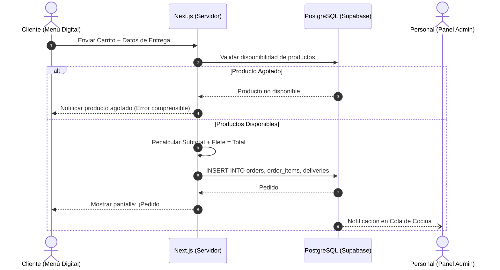
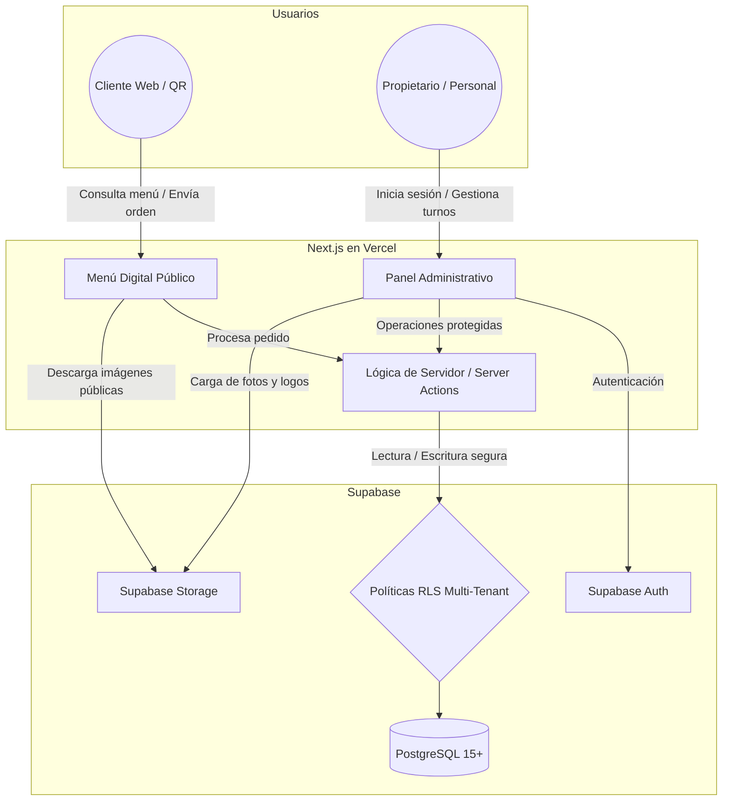

# 5.1 — Arquitectura general del sistema

## NEGOVA — MVP Restaurante de comida rápida

**Versión:** 1.0  
**Estado:** ✅ Completado  
**Fase:** Fase 5 — Arquitectura del sistema  
**Vertical inicial:** Restaurantes de comida rápida  
**Documento:** 5.1 — Arquitectura general del sistema  

---

## 1. Objetivo

Definir la arquitectura tecnológica, estructural y funcional general de NEGOVA, estableciendo cómo interactúan sus componentes frontend, backend, capas de autenticación, base de datos relacional, almacenamiento de archivos y políticas de seguridad.

La arquitectura está concebida para satisfacer al 100% las necesidades operativas del **MVP para pequeños restaurantes de comida rápida**, garantizando al mismo tiempo que el núcleo (**NEGOVA CORE**) sea escalable y desacoplado para incorporar futuros verticales de la economía popular sin tener que reescribir la plataforma.

---

# 2. Visión arquitectónica global

NEGOVA adopta un stack web moderno, monolítico-modular y serverless basado en:

```text
┌─────────────────────────────────────────────────────────────┐
│                      APLICACIÓN NEXT.JS                     │
├──────────────────────────────┬──────────────────────────────┤
│    INTERFAZ PÚBLICA (WEB)    │     PANEL ADMINISTRATIVO     │
│    - Menú Digital / QR       │     - Cola de Pedidos        │
│    - Carrito y Checkout      │     - Catálogo y Finanzas    │
├──────────────────────────────┴──────────────────────────────┤
│           CAPA DE SERVIDOR (Server Actions / APIs)          │
│           - Validación de reglas de negocio Zero-Trust      │
│           - Cálculos autoritarios de totales y fletes       │
└──────────────────────────────┬──────────────────────────────┘
                               │ (Supabase Client / JWT)
                               ▼
┌─────────────────────────────────────────────────────────────┐
│                    PLATAFORMA SUPABASE                      │
├───────────────────┬───────────────────┬─────────────────────┤
│   SUPABASE AUTH   │    POSTGRESQL     │   SUPABASE STORAGE  │
│   - Sesiones JWT  │   - 15 Tablas     │   - Logos           │
│   - RBAC          │   - Políticas RLS │   - Fotos de Platos │
└───────────────────┴───────────────────┴─────────────────────┘
```

---

# 3. Componentes principales

## 3.1 — Frontend (Client-Side & SSR)
- **Tecnologías:** Next.js (App Router), React, TypeScript, Tailwind CSS.
- **Responsabilidades:**
  - Renderizado responsivo Mobile-First optimizado para smartphones de gama de entrada.
  - Renderizado estático y dinámico del Menú Digital público accesible mediante QR.
  - Gestión visual de la Cola de Pedidos de cocina con actualización ágil.
  - Formularios accesibles con validación visual en tiempo real.
  - Presentación de estados de carga (Skeletons) y confirmaciones mediante Modales y Toasts personalizados.
  - > ⚠️ **Regla:** El frontend se enfoca en UX y agilidad operativa; nunca es la autoridad final de seguridad.

---

# 4. Backend y lógica de aplicación

La lógica de negocio se ejecuta en el entorno seguro del servidor mediante **Next.js Server Actions / Route Handlers**:
- Validación de disponibilidad de insumos en tiempo real antes de asentar órdenes.
- Recálculo forzoso de subtotales, adiciones y tarifas de domicilio (prevención de fraude en precios).
- Autorización granular por roles (`PROPIETARIO` / `PERSONAL`) antes de mutar datos.
- Registro transaccional de auditoría en `order_status_history`.

---

# 5. Plataforma Supabase

Supabase actúa como el Backend-as-a-Service (BaaS) principal, proveyendo:
1. **Supabase Auth:** Identidad y gestión de tokens JWT.
2. **Supabase PostgreSQL:** Base de datos relacional ACID.
3. **Supabase Storage:** Repositorio de activos multimedia estructurado por tenant.
4. **Supabase Row Level Security (RLS):** Aislamiento estricto a nivel de motor de datos.

---

# 6. Autenticación y Control de Sesiones

```text
Usuario Operativo (Propietario / Personal)
                 ↓
  Formulario de Inicio de Sesión
                 ↓
  Supabase Auth (Validación de credenciales con hash seguro)
                 ↓
  Emisión de Token JWT con Claims de Sesión
                 ↓
  Next.js Server / Client (Middleware de protección de rutas)
                 ↓
  Acceso al Panel Administrativo
```

> **Seguridad:** Las credenciales y contraseñas nunca se almacenan en texto plano en las tablas de la aplicación.

---

# 7. Base de datos relacional (PostgreSQL)

Almacenamiento estructurado en 15 tablas relacionales organizadas bajo principios de normalización e inmutabilidad comercial:
- `businesses`, `users`, `business_users`, `roles`, `permissions`, `role_permissions`
- `customers`, `categories`, `products`
- `orders`, `order_items`, `payments`, `deliveries`, `order_status_history`
- `expenses`

---

# 8. Row Level Security (RLS) como pilar de aislamiento

El aislamiento Multi-Tenant se garantiza a nivel de base de datos:

$$\text{Petición SQL} \longrightarrow \text{Evaluación de auth.uid()} \longrightarrow \text{Filtro en business\_users} \longrightarrow \text{Solo registros del tenant\_id autorizado}$$

RLS neutraliza vulnerabilidades de acceso directo a datos (IDOR) independientemente de los parámetros enviados por el cliente.

---

# 9. Storage y gestión de archivos

Estructura de almacenamiento aislada jerárquicamente por comercio en Supabase Storage:

```text
bucket: "business-media"
│
└── /businesses/
      ├── {business_id_A}/
      │     ├── logo/
      │     └── products/
      │
      └── {business_id_B}/
            ├── logo/
            └── products/
```

- **Políticas de Storage:** Solo los miembros autenticados con rol `PROPIETARIO` o `PERSONAL` pueden subir/eliminar imágenes en la carpeta de su respectivo `business_id`. Lectura pública habilitada para el Menú Web.

---

# 10. Área pública (Menú Digital Web)

- **Acceso anónimo (Sin Login):** Diseñado para clientes que acceden vía enlace web o código QR.
- **Capacidades:** Exploración del menú por categorías, selección de platos con modificadores ("sin cebolla", adiciones), carrito y confirmación de orden (Local o Domicilio).
- **Seguridad:** Acceso restringido exclusivamente a lectura de platos disponibles (`is_available = true`) e inserción de nuevos pedidos en estado `RECEIVED`.

---

# 11. Área administrativa privada

Panel de control para propietarios y trabajadores:
- **Dashboard:** Métricas del turno y ventas del día.
- **Cola de Cocina / Pedidos:** Gestión visual de comandas ordenadas por tiempo de llegada.
- **Menú y Disponibilidad:** Edición de catálogo y switch rápido de disponibilidad ante escasez de insumos.
- **Clientes y Finanzas:** Directorio de clientes, auditoría de pagos (Efectivo/Transferencia) y registro de gastos.
- **Configuración:** Ajustes comerciales y tarifas de flete.

---

# 12. Flujo transaccional de creación de pedidos



---

# 13. Domicilios como capacidad opcional y desacoplada

El sistema soporta modalidades híbridas sin imponer el servicio de entrega:

```text
Modalidad del Pedido
   ├── PICKUP   ──► Recogida en local / Mesa (Flete = $0 COP, sin tabla deliveries)
   └── DELIVERY ──► Despacho externo (Genera registro en deliveries con flete separado)
```

---

# 14. Flujo operativo de estados de cocina

$$\mathbf{RECIBIDO} \xrightarrow{\text{Iniciar preparación}} \mathbf{EN\ PREPARACIÓN} \xrightarrow{\text{Cocina termina}} \mathbf{LISTO} \xrightarrow{\text{Entrega al cliente}} \mathbf{ENTREGADO}$$

- Transición de cancelación controlada disponible desde `RECIBIDO` o `EN PREPARACIÓN` hacia `CANCELLED`.
- Cada transición queda asentada de forma inmutable en `order_status_history`.

---

# 15. Flujo financiero y control de caja

$$\text{Resultado Operativo del Turno} = \sum \text{Ventas Cobradas (Efectivo + Transferencias)} - \sum \text{Gastos Asentados}$$

- Diferenciación estricta entre métodos de cobro (`Efectivo` en caja vs. `Transferencias: Nequi, Daviplata, Bancolombia`).
- Sin contabilidad fiscal compleja ni facturación electrónica obligatoria en el MVP.

---

# 16. Flujo de administración del menú y disponibilidad

$$\text{Propietario / Personal} \longrightarrow \text{Conmutar Switch de Plato} \longrightarrow \text{is\_available = false} \longrightarrow \text{Bloqueo inmediato en Menú Digital}$$

---

# 17. Autenticación vs. Autorización

```text
AUTENTICACIÓN (Auth)  ──► ¿Quién es el usuario?  ──► Supabase Auth (JWT)
AUTORIZACIÓN (AuthZ)  ──► ¿Qué puede hacer?       ──► business_users + roles + permissions + RLS
```

---

# 18. Arquitectura Multi-Tenant nativa

Aislamiento lógico absoluto entre diferentes negocios sobre una infraestructura unificada:

```text
                      PLATAFORMA NEGOVA
                             │
            ┌────────────────┴────────────────┐
            ▼                                 ▼
   Restaurante A (Camarones)         Restaurante B (Comercio 2)
   ├── business_id: A                ├── business_id: B
   ├── Usuarios de A                 ├── Usuarios de B
   ├── Menú de A                     ├── Menú de B
   └── Pedidos de A                  └── Pedidos de B
```

---

# 19. Desacoplamiento para futuros verticales

El modelo de datos y los servicios del CORE utilizan entidades genéricas (`business`, `product`, `order`, `customer`, `payment`, `expense`). La especialización de comida rápida (menú con modificadores, cola de cocina, fletes) reside en el **Vertical Restaurante**, permitiendo incorporar en el futuro verticales como Barberías o Tiendas sin alterar el CORE.

---

# 20. Integraciones externas desacopladas

Las integraciones externas (WhatsApp Web, pasarelas de pago, servicios de mensajería) se comunican mediante adaptadores independientes, evitando que fallos de APIs externas bloqueen la operación local del restaurante.

---

# 21. Seguridad en profundidad (Defense in Depth)

```text
1. Transporte Cifrado: HTTPS / TLS 1.3
2. Control de Acceso: Tokens JWT con expiración
3. Autorización de Rutas: Next.js Middleware por Roles
4. Validación de Payloads: Esquemas de validación (Zod / TypeScript) en servidor
5. Aislamiento de Datos: Row Level Security (RLS) en PostgreSQL
6. Almacenamiento Seguro: Hashing de credenciales y buckets privados
```

---

# 22. Manejo resiliente de errores

- **Frontend:** Mensajes amigables y orientados a la solución, preservando datos en formularios.
- **Backend:** Registro interno de errores y respuestas HTTP estándar (`400 Bad Request`, `401 Unauthorized`, `403 Forbidden`, `404 Not Found`).
- **Base de Datos:** Restricciones de integridad referencial y transacciones ACID (`ROLLBACK` automático ante fallos).

---

# 23. Topología de despliegue en producción

```text
    Usuario / Cliente
           │
           ▼
    Edge Network (Vercel)
           │
           ▼
    Next.js Web Application (SSR / Serverless API)
           │
           ▼
    Supabase Cloud (PostgreSQL 15+ / Auth / Storage)
```

---

# 24. Matriz de responsabilidades tecnológicas

| Servicio / Herramienta | Rol Arquitectónico |
| :--- | :--- |
| **Next.js (App Router)** | Aplicación web, SSR, Server Actions y APIs seguras. |
| **React + Tailwind CSS** | Interfaz táctil reactiva optimizada para móviles. |
| **TypeScript** | Tipado estático y robustez en contratos de datos. |
| **Supabase Auth** | Autenticación de usuarios administrativos y emisión de JWT. |
| **PostgreSQL 15+** | Persistencia relacional, integridad referencial y triggers. |
| **Supabase RLS** | Políticas de seguridad y aislamiento Multi-Tenant. |
| **Supabase Storage** | Almacenamiento de logotipos y fotografías de platos. |
| **Vercel** | Hosting global, CI/CD y entrega en el edge. |

---

# 25. Principios arquitectónicos rectores

1. **Simplicidad:** Cero infraestructura innecesaria; máxima velocidad de entrega y bajo costo operativo.
2. **Modularidad:** Separación estricta entre el CORE y el Vertical Restaurante.
3. **Seguridad por Diseño:** Aislamiento multi-tenant implementado desde el día cero en base de datos.
4. **Mobile-First:** Interfaz pensada prioritariamente para smartphones.
5. **Resiliencia Operativa:** Capacidad de operar fluidamente bajo condiciones de conectividad variable.

---

# 26. Diagrama arquitectónico general



---

# 27. Restricciones y exclusiones técnicas explícitas

Para el MVP de NEGOVA **NO se utilizará**:
- ORMs pesados como Prisma (se utiliza el cliente oficial de Supabase con TypeScript).
- Servidores Node.js / Express independientes separados del monolito Next.js.
- Bases de datos externas no administradas.
- Microservicios ni arquitecturas distribuidas complejas (Kubernetes, Kafka).
- Inteligencia artificial para cocina, rastreo GPS ni facturación electrónica DIAN.

---

# 28. Estado del Documento

**Estado:** ✅ Completado  
**Fase:** Fase 5 — Arquitectura del sistema  
**Vertical inicial:** Restaurantes de comida rápida  
**Documento:** 5.1 — Arquitectura general del sistema  
