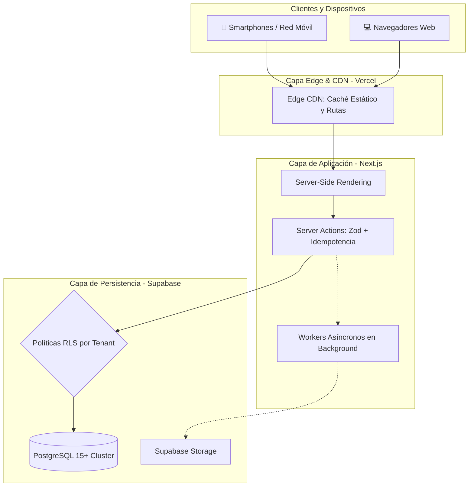

# 5.10 — Arquitectura de escalabilidad, rendimiento y disponibilidad

## NEGOVA — MVP Restaurante de comida rápida

**Versión:** 1.0  
**Estado:** ✅ Completado  
**Fase:** Fase 5 — Arquitectura del sistema  
**Vertical inicial:** Restaurantes de comida rápida  
**Documento:** 5.10 — Arquitectura de escalabilidad, rendimiento y disponibilidad  

---

## 1. Objetivo

Definir las directrices arquitectónicas, patrones de diseño y estrategias técnicas que garantizan que NEGOVA comience de forma simple y económica para pequeños restaurantes de comida rápida (mercado inicial: Camarones, La Guajira), pero con la capacidad innata de escalar horizontalmente a miles de comercios, millones de transacciones y múltiples verticales sin tener que rediseñar el núcleo ni la base de datos.

---

# 2. Escalabilidad horizontal Multi-Tenant

La arquitectura escala sin fricción conforme se incorporan nuevos clientes comerciales:

$$\text{1 Comercio Piloto} \longrightarrow \text{10 Comercios} \longrightarrow \text{100 Comercios} \longrightarrow \text{1.000+ Comercios}$$

```text
                                PLATAFORMA NEGOVA
                                        │
           ┌────────────────────────────┼────────────────────────────┐
           ▼                            ▼                            ▼
      Tenant A                     Tenant B                     Tenant N
 (Restaurante Camarones)       (Comercio Riohacha)          (Barbería / Tienda)
 ├── Clientes de A             ├── Clientes de B            ├── Clientes de N
 ├── Catálogo de A             ├── Catálogo de B            ├── Catálogo de N
 └── Pedidos de A              └── Pedidos de B             └── Pedidos de N
```

- **Modelo de Datos Unificado:** El motor PostgreSQL aloja todos los tenants bajo el mismo esquema, aplicando aislamiento lógico estricto por `business_id` y **Row Level Security (RLS)**.

---

# 3. Separación de patrones de lectura y escritura

```text
┌─────────────────────────────────────────────────────────────┐
│ FLUJO DE LECTURA (Optimizado para Velocidad y Caché)        │
│ UI ──► Server Component ──► Supabase Client ──► Read RLS    │
├─────────────────────────────────────────────────────────────┤
│ FLUJO DE ESCRITURA (Optimizado para Integridad y Bloqueo)   │
│ UI ──► Server Action ──► Zod ──► Transacción ACID ──► Write │
└─────────────────────────────────────────────────────────────┘
```

---

# 4. Estrategia de índices de alto rendimiento

Los índices B-Tree responden directamente a los patrones de acceso más frecuentes en turnos de alta demanda:

| Tabla | Columnas Indexadas | Propósito Operativo |
| :--- | :--- | :--- |
| `orders` | `(business_id, status, created_at DESC)` | Carga instantánea de la cola de pedidos activos en cocina. |
| `orders` | `(business_id, created_at DESC)` | Consultas rápidas para reportes y cierre de caja diario. |
| `products` | `(business_id, is_available)` | Filtrado de platos disponibles para el Menú Web público. |
| `products` | `(category_id, sort_order ASC)` | Ordenamiento visual de la carta del restaurante. |
| `customers` | `(business_id, phone)` | Búsqueda instantánea de clientes al recibir llamadas/WhatsApp. |
| `payments` | `(business_id, created_at DESC)` | Auditoría de cobros e ingresos del turno. |
| `expenses` | `(business_id, expense_date DESC)` | Listado cronológico de egresos. |

---

# 5. Paginación y control de volumen de datos

Las listas de datos masivos nunca se transfieren completas al navegador:
- **Paginación Basada en Cursores/Offset:** Consultas con límites controlados (ej. `LIMIT 25 OFFSET 0` o cursor por `created_at`).
- **Aplica a:** Historial de comandas, directorio de clientes, auditoría de pagos y bitácora `audit_logs`.

---

# 6. Carga bajo demanda y Code Splitting

Next.js implementa división automática de código (*Code Splitting*):
- La pantalla pública del Menú Digital solo descarga el código JavaScript indispensable para el cliente, logrando cargas en menos de 1.5 segundos en redes móviles 3G/4G rurales.
- Los módulos administrativos pesados (Gestión de Equipo, Finanzas, Reportes) se cargan de forma diferida (*Lazy Loading*) solo cuando el Propietario navega hacia ellos.

---

# 7. Estrategia de caché multicapa

```text
┌────────────────────────────────────────────────────────────┐
│ 1. EDGE CACHE (Vercel CDN):                                │
│    - Activos estáticos, imágenes optimizadas, fuentes.     │
├────────────────────────────────────────────────────────────┤
│ 2. DATA CACHE (Next.js SWR / React Query):                 │
│    - Catálogo público, planes, categorías (revalidación).  │
├────────────────────────────────────────────────────────────┤
│ 3. DATOS EN VIVO (Bypass de Caché / Realtime):             │
│    - Cola de cocina, estados de comanda, balance de caja.  │
└────────────────────────────────────────────────────────────┘
```

---

# 8. Procesamiento asíncrono y colas en background

Las operaciones accesorias no bloquean la experiencia del usuario:

$$\text{Cliente pulsa Confirmar} \longrightarrow \text{Comanda Creada en BD (150ms)} \longrightarrow \text{Respuesta Inmediata al Cliente}$$
$$\text{Procesamiento en Background} \longrightarrow \text{Env\text{í}o de WhatsApp} + \text{Alerta In-App} + \text{Auditor\text{í}a}$$

---

# 9. Idempotencia y prevención de transacciones duplicadas

Para evitar cobros dobles o comandas duplicadas por fallos de conectividad o doble clic del usuario:
- **Tokens de Idempotencia:** Las mutaciones críticas de pago y checkout envían una clave única (`idempotency_key` / UUID). Si el servidor recibe una solicitud idéntica en un lapso corto, retorna el resultado original sin crear un segundo registro.

---

# 10. Alta disponibilidad y degradación elegante (Graceful Degradation)

> 🛡️ **Principio de Resiliencia:** Si un servicio externo colapsa, el núcleo del restaurante **sigue funcionando al 100%**.

```text
┌───────────────────────────┬───────────────────────────────────────────┐
│ Evento Externo            │ Comportamiento de NEGOVA                  │
├───────────────────────────┼───────────────────────────────────────────┤
│ API de WhatsApp caída     │ La comanda se registra y cocina la ve en  │
│                           │ pantalla; la notificación queda en cola.  │
├───────────────────────────┼───────────────────────────────────────────┤
│ Pasarela de pagos externa │ El sistema conmuta automáticamente a pago │
│ con fallos de conexión    │ en efectivo o transferencia directa.      │
├───────────────────────────┼───────────────────────────────────────────┤
│ Red móvil inestable       │ La app conserva los datos del formulario  │
│                           │ y permite reintentar sin borrar campos.   │
└───────────────────────────┴───────────────────────────────────────────┘
```

---

# 11. Monitoreo, observabilidad y manejo de errores

- **Manejo Controlado en UI:** Errores presentados en lenguaje comprensible sin filtrar trazas técnicas internas.
- **Registro Centralizado:** Captura de excepciones en el servidor para diagnóstico técnico oportuno.

---

# 12. Hoja de ruta para crecimiento futuro

El diseño arquitectónico permite incorporar módulos avanzados en fases posteriores sin romper el núcleo:

```text
       NÚCLEO ESTABLE (Fase 5)                FUTURAS EXTENSIONES MODULARES
┌───────────────────────────────────┐    ┌───────────────────────────────────┐
│ • Multi-Tenancy nativo            │    │ • Módulo de Inventario y Mermas   │
│ • Autenticación y RBAC            │    │ • Facturación Electrónica DIAN    │
│ • Catálogo y Comandas             │ ──►│ • Agenda de Citas para Barberías  │
│ • Caja, Pagos y Gastos            │    │ • Inteligencia Artificial (IA)    │
│ • Domicilios desacoplados         │    │ • App Móvil Nativa (React Native) │
└───────────────────────────────────┘    └───────────────────────────────────┘
```

---

# 13. Diagrama general de escalabilidad y rendimiento



---

# 14. Resumen consolidado de la Fase 5: Arquitectura del Sistema

Con este documento culmina con éxito la **Fase 5: Arquitectura del Sistema**:

```text
5.1  Arquitectura general del sistema                  ✅ Completado
5.2  Arquitectura de módulos del sistema               ✅ Completado
5.3  Arquitectura Multi-Tenant y aislamiento de datos  ✅ Completado
5.4  Arquitectura de autenticación y autorización      ✅ Completado
5.5  Arquitectura de navegación y contexto del negocio ✅ Completado
5.6  Arquitectura de comunicación entre capas          ✅ Completado
5.7  Arquitectura de módulos y dependencias internas   ✅ Completado
5.8  Arquitectura de servicios e integraciones         ✅ Completado
5.9  Arquitectura de seguridad y protección            ✅ Completado
5.10 Arquitectura de escalabilidad y disponibilidad    ✅ Completado
```

---

# 15. Estado del Documento

**Estado:** ✅ Completado  
**Fase:** Fase 5 — Arquitectura del sistema  
**Vertical inicial:** Restaurantes de comida rápida  
**Documento:** 5.10 — Arquitectura de escalabilidad, rendimiento y disponibilidad  
