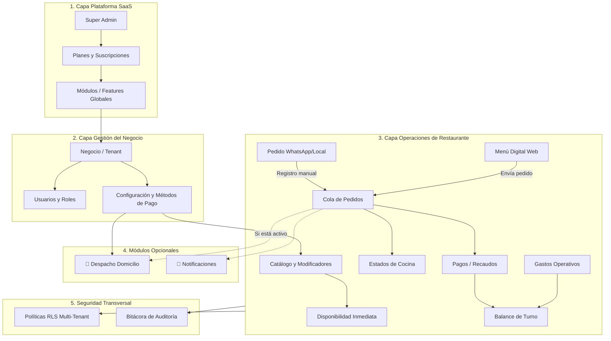

# 5.2 — Arquitectura de módulos del sistema

## NEGOVA — MVP Restaurante de comida rápida

**Versión:** 1.0  
**Estado:** ✅ Completado  
**Fase:** Fase 5 — Arquitectura del sistema  
**Vertical inicial:** Restaurantes de comida rápida  
**Documento:** 5.2 — Arquitectura de módulos del sistema  

---

## 1. Objetivo

Definir la arquitectura funcional modular de NEGOVA, delimitando los límites de responsabilidad, las dependencias y la comunicación entre los diferentes componentes del sistema.

Esta arquitectura establece una separación estricta entre la **Capa de Plataforma (SaaS Global)**, la **Capa de Gestión del Negocio (Tenant)**, las **Operaciones Diarias**, los **Módulos Opcionales** (como Domicilios) y la **Seguridad Transversal**, sirviendo de guía directa para la organización del código fuente en Next.js.

---

# 2. Organización estructural de módulos

```text
┌─────────────────────────────────────────────────────────────────────────────┐
│                          1. NEGOVA PLATFORM LAYER                           │
│  [Plataforma SaaS] ── [Planes] ── [Suscripciones] ── [Features] ── [Global] │
└──────────────────────────────────────┬──────────────────────────────────────┘
                                       │
                                       ▼
┌─────────────────────────────────────────────────────────────────────────────┐
│                        2. BUSINESS MANAGEMENT LAYER                         │
│  [Dashboard] ── [Perfil Negocio] ── [Equipo / Roles] ── [Configuraciones]   │
├─────────────────────────────────────────────────────────────────────────────┤
│                        3. BUSINESS OPERATIONS LAYER                         │
│  [Clientes] ── [Catálogo / Menú] ── [Pedidos / Cocina] ── [Pagos / Gastos]  │
├─────────────────────────────────────────────────────────────────────────────┤
│                        4. OPTIONAL MODULES (Toggles)                        │
│  [🛵 Domicilios*] ── [🔔 Notificaciones] ── [📁 Gestión de Archivos]        │
├─────────────────────────────────────────────────────────────────────────────┤
│                   5. CROSS-CUTTING SECURITY & AUDIT LAYER                   │
│  [Autenticación Supabase] ── [RBAC Permisos] ── [RLS] ── [Audit Logs]       │
└─────────────────────────────────────────────────────────────────────────────┘
* Domicilios es una capacidad opcional activable por cada comercio.
```

---

# 3. Capa 1: NEGOVA Platform (Administración SaaS Global)

Gestiona la infraestructura compartida, planes comerciales y control global de la plataforma (acceso exclusivo para administradores de plataforma):

### 3.1 Usuarios de Plataforma
- Gestión de cuentas con ámbito `platform` (`super_admin`).
- Administración global de acceso sin exponer datos privados de los tenants.

### 3.2 Gestión de Comercios (Tenants)
- Alta, suspensión y control del ciclo de vida de negocios (`businesses`).
- Monitoreo del estado de comercios (`active`, `inactive`, `suspended`, `trial`).

### 3.3 Planes y Límites Comerciales
- Catálogo de planes SaaS (`plans`: Starter, Pro, Enterprise).
- Asignación de cuotas y límites operativos (`limits` en formato JSONB).

### 3.4 Suscripciones y Facturación
- Control del estado de membresía SaaS (`subscriptions`: trialing, active, past_due, cancelled).
- Historial y emisión de facturas de suscripción (`subscription_invoices`).

### 3.5 Catálogo de Módulos (Feature Toggles Globales)
- Definición de funcionalidades habilitadas por plan (`features`, `plan_features`).

### 3.6 Configuración Global de Plataforma
- Parámetros del sistema, pasarelas de pago de la plataforma y mantenimiento (`platform_settings`).

---

# 4. Capa 2: Business Management (Gestión del Negocio)

Administración interna de cada comercio por parte del `Propietario`:

### 4.1 Dashboard Operativo y Financiero
- Visión general del turno: ventas del día, pedidos activos en cola y balance de caja.

### 4.2 Perfil Comercial del Establecimiento
- Nombre comercial, slug para enlace público, logotipo, dirección física y teléfonos (`businesses`, `business_settings`).

### 4.3 Equipo, Membresías y Roles
- Invitación y gestión de colaboradores (`business_users`).
- Asignación de roles locales (`PROPIETARIO`, `PERSONAL`).

### 4.4 Configuración de Métodos de Cobro
- Métodos de pago aceptados para los clientes (`business_payment_methods`: Efectivo, Transferencia, Tarjeta).

---

# 5. Capa 3: Business Operations (Operaciones del Negocio)

Módulos de alta interacción diaria utilizados por el propietario y su personal operativo:

### 5.1 Directorio de Clientes
- Registro de clientes recurrentes, teléfonos de contacto y notas internas (`customers`).
- Soporte para múltiples direcciones y referencias comunitarias (`customer_addresses`).

### 5.2 Catálogo y Categorías
- Organización y ordenamiento del menú por secciones (`categories`: Hamburguesas, Salchipapas, Bebidas).

### 5.3 Productos, Modificadores y Disponibilidad
- Catálogo de platos con fotos, descripciones y precios base (`products`).
- Grupos de opciones y modificadores (`product_option_groups`: "Salsas", "Término de cocción", "Adiciones con costo").
- **Conmutador de Disponibilidad Inmediata:** Switch `is_available = false` para suspender platos agotados en tiempo real.

### 5.4 Motor de Pedidos y Cola de Cocina
- Recepción multicanal: WhatsApp (manual), Menú Digital Web (QR) y Mostrador (`orders`).
- Detalle de ítems con **congelamiento histórico de precios** (`order_items`, `order_item_options`).
- Transiciones operativas de cocina: `RECEIVED` $\rightarrow$ `PREPARING` $\rightarrow$ `READY` $\rightarrow$ `DELIVERED`.
- Bitácora de trazabilidad de estados (`order_status_history`).

### 5.5 Recaudos y Pagos
- Registro de pagos totales o parciales asociados al pedido (`payments`).
- Cuadre por método de cobro (`CASH` vs. `TRANSFER: Nequi, Daviplata, Bancolombia`).

### 5.6 Finanzas y Gastos Operativos
- Categorización de salidas de dinero (`expense_categories`: Insumos, Servicios, Nómina).
- Registro diario de egresos para cálculo del resultado operativo (`expenses`).

---

# 6. Capa 4: Módulos Opcionales y Desacoplados (Feature Toggles)

Capacidades que el negocio puede habilitar o inhabilitar según su modelo operativo:

```text
                                BUSINESS SETTINGS
                                        │
             ┌──────────────────────────┼──────────────────────────┐
             ▼                          ▼                          ▼
      [🛵 DOMICILIOS]           [🔔 NOTIFICACIONES]        [📁 ARCHIVOS/STORAGE]
      - Tarifa de flete         - Avisos de nuevos pedidos - Fotos de platos y logos
      - Datos de entrega        - Alertas por WhatsApp     - Separación por bucket
      - Estado de despacho      - Mensajes in-app          - Control de peso/formato
```

> 📌 **Regla Arquitectónica de Domicilios:** NEGOVA no obliga a ningún negocio a utilizar domicilios. Si un comercio solo atiende en mesa o mostrador (`PICKUP`), el módulo de domicilios se desactiva y los pedidos operan con flete $0 COP sin exigir registros en `deliveries`.

---

# 7. Capa 5: Seguridad, Autorización y Auditoría Transversal

### 7.1 Autenticación y Control de Acceso (RBAC)
- Identidad centralizada mediante Supabase Auth y sincronización en `public.users`.
- Permisos granulares (`permissions`, `role_permissions`) evaluados en servidor.

### 7.2 Aislamiento Multi-Tenant Estricto (Row Level Security)
- 100% de tablas protegidas con RLS en PostgreSQL, impidiendo acceso entre comercios.

### 7.3 Registro Inmutable de Auditoría
- Bitácora de modificaciones sensibles (`audit_logs`): quién realizó el cambio, sobre qué entidad y diferencias de datos (`old_data` vs. `new_data`).

---

# 8. Mapa de Relaciones y Flujo entre Módulos



---

# 9. Correspondencia con la estructura de código fuente (Next.js)

La organización de carpetas del proyecto en código refleja fielmente esta arquitectura modular:

```text
src/
├── app/
│   ├── (platform)/                  # Capa 1: Panel Super Admin
│   │   └── admin/
│   │       ├── businesses/
│   │       └── plans/
│   ├── (auth)/                      # Capa 5: Autenticación
│   │   ├── login/
│   │   └── recover/
│   ├── (tenant)/                    # Capa 2 y 3: Panel Administrativo del Negocio
│   │   └── [businessSlug]/dashboard/
│   │       ├── orders/              # Cola de cocina y comandas
│   │       ├── menu/                # Catálogo, categorías y disponibilidad
│   │       ├── customers/           # Clientes y direcciones
│   │       ├── finances/            # Ventas, pagos y gastos
│   │       ├── deliveries/          # Módulo opcional de entregas
│   │       └── settings/            # Configuración, equipo y perfil
│   └── (public)/                    # Capa 3: Menú Digital Público (Sin Login)
│       └── m/[businessSlug]/
│           ├── page.tsx             # Catálogo público y categorías
│           ├── [productId]/         # Modal de modificadores
│           └── checkout/            # Carrito y confirmación
├── modules/                         # Lógica de dominio y servicios del backend
│   ├── platform/
│   ├── businesses/
│   ├── catalog/
│   ├── orders/
│   ├── payments/
│   ├── deliveries/
│   ├── expenses/
│   └── audit/
└── shared/                          # Componentes UI, Tailwind, Modales y Toasts
```

---

# 10. Principio de Extensibilidad para Nuevos Verticales

```text
       NÚCLEO NEGOVA (CORE)                  ESPECIALIZACIÓN POR VERTICAL
┌───────────────────────────────────┐    ┌───────────────────────────────────┐
│ • Negocios (Tenants)              │    │ 🍔 Vertical Restaurante (MVP):    │
│ • Usuarios y Membresías (RBAC)    │ ──►│    - Menú y modificadores         │
│ • Clientes y Direcciones          │    │    - Cola de cocina y comandas    │
│ • Catálogo base y Precios         │    │    - Despachos y fletes           │
│ • Transacciones y Pagos           │    ├───────────────────────────────────┤
│ • Gastos y Balances               │    │ 💈 Futuro Vertical Barbería:      │
│ • Aislamiento RLS y Auditoría     │ ──►│    - Agenda de turnos / Citas     │
│ • Almacenamiento y Notificaciones │    │    - Catálogo de servicios        │
└───────────────────────────────────┘    └───────────────────────────────────┘
```

El núcleo permanece inalterado; cada nuevo vertical se conecta consumiendo los módulos existentes y agregando únicamente la lógica específica de su industria.

---

# 11. Estado del Documento

**Estado:** ✅ Completado  
**Fase:** Fase 5 — Arquitectura del sistema  
**Vertical inicial:** Restaurantes de comida rápida  
**Documento:** 5.2 — Arquitectura de módulos del sistema  
