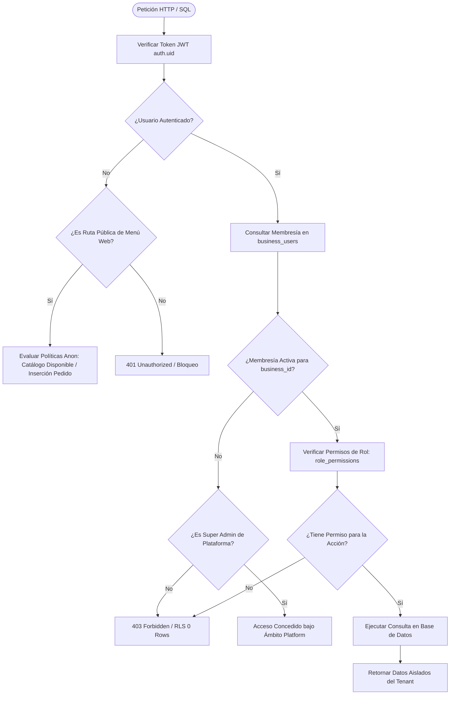

# 5.3 — Arquitectura Multi-Tenant y aislamiento de datos

## NEGOVA — MVP Restaurante de comida rápida

**Versión:** 1.0  
**Estado:** ✅ Completado  
**Fase:** Fase 5 — Arquitectura del sistema  
**Vertical inicial:** Restaurantes de comida rápida  
**Documento:** 5.3 — Arquitectura Multi-Tenant y aislamiento de datos  

---

## 1. Objetivo

Definir la arquitectura de multi-tenancy y las directrices técnicas de aislamiento lógico, referencial y de seguridad que permiten a NEGOVA alojar miles de negocios independientes sobre una infraestructura compartida, garantizando que los datos de un comercio jamás sean visibles, modificables o contaminados por otro.

---

# 2. ¿Qué significa Multi-Tenant en NEGOVA?

NEGOVA opera bajo un modelo **Multi-Tenant con Base de Datos Compartida y Esquema Unificado**:

```text
                         PLATAFORMA NEGOVA
                                 │
           ┌─────────────────────┴─────────────────────┐
           │                                           │
      Negocio A                                   Negocio B
  (Restaurante Camarones)                     (Tienda de Barrio)
           │                                           │
     ┌─────┼─────┐                               ┌─────┼─────┐
     │     │     │                               │     │     │
 Clientes Pedidos Gastos                     Clientes Pedidos Gastos
```

- **Cero duplicación de infraestructura:** No se despliega una aplicación ni una base de datos física separada por cada comercio.
- **Aislamiento lógico garantizado:** Todos los registros residen en el mismo cluster de PostgreSQL pero están encapsulados lógicamente por `business_id` y resguardados por **Row Level Security (RLS)**.

---

# 3. `businesses` es el Tenant Raíz

En la arquitectura de NEGOVA:
$$\mathbf{businesses} = \mathbf{tenants}$$

Cada registro en la tabla `businesses` representa una cuenta comercial autónoma:
- Tiene su propia configuración (`business_settings`) y módulos activos (`business_features`).
- Es propietario exclusivo de sus clientes, productos, comandas, pagos, facturas, archivos y bitácoras de auditoría.

---

# 4. Desacoplamiento de Usuarios y Membresías

Un usuario no pertenece de forma rígida a un único negocio. La plataforma separa la **Identidad Global** de la **Membresía Local**:

```text
                     USUARIO GLOBAL (public.users)
                           │ (Juan Pérez)
             ┌─────────────┴─────────────┐
             ▼                           ▼
    MEMBRESÍA NEGOCIO A         MEMBRESÍA NEGOCIO B
 (business_users: Negocio A) (business_users: Negocio B)
             │                           │
    Rol: PROPIETARIO            Rol: PERSONAL
```

### Beneficios del Modelo:
- **Multi-Negocio Real:** Un emprendedor que opera un restaurante en el día y una tienda en la noche gestiona ambos comercios desde una sola cuenta de usuario.
- **Roles Contextuales:** El usuario tiene atribuciones de `PROPIETARIO` en el Comercio A y de `PERSONAL` operativo en el Comercio B, sin colisión de permisos.

---

# 5. El aislamiento lo garantiza Row Level Security (RLS)

> 🔒 **Regla de Oro:** La seguridad no reside en *"el frontend sabe qué negocio está seleccionado"*. El aislamiento se evalúa forzosamente en el motor de base de datos PostgreSQL.

Flujo de evaluación en cada consulta SQL:

```text
  Token JWT del Usuario (auth.uid())
                │
                ▼
  Función is_member_of(business_id)
                │
                ▼
  ¿Existe registro activo en business_users para ese tenant?
        ┌───────┴───────┐
       SÍ               NO
        │               │
        ▼               ▼
  Evaluar Permiso     Bloquear Operación (0 filas / Error 403)
  y conceder fila
```

---

# 6. Unicidad e Independencia de Consecutivos

Cada negocio maneja sus propios identificadores visibles sin interferir con los demás:
- El *Restaurante A* tiene su propio `Pedido #001`.
- El *Restaurante B* tiene su propio `Pedido #001`.

Esto se implementa mediante restricciones compuestas en base de datos:
$$\text{UNIQUE}(\text{business\_id}, \text{order\_number})$$

---

# 7. Alcance Universal del Aislamiento

El aislamiento multi-tenant aplica obligatoriamente al 100% de las tablas operativas:

```text
business_id
    ├── customers               (Clientes propios)
    ├── customer_addresses      (Direcciones asociadas)
    ├── categories              (Menú del negocio)
    ├── products                (Platos del negocio)
    ├── product_option_groups   (Modificadores del negocio)
    ├── product_options         (Opciones del negocio)
    ├── orders                  (Comandas del negocio)
    ├── order_items             (Líneas de comanda)
    ├── deliveries              (Logística de flete)
    ├── payments                (Recaudos en caja)
    ├── expenses                (Salidas de dinero)
    ├── files                   (Archivos en storage)
    ├── notifications           (Avisos internos)
    └── audit_logs              (Trazabilidad de cambios)
```

---

# 8. Las Dos Capas del Multi-Tenancy

El acceso seguro requiere la combinación de dos factores:

```text
┌────────────────────────────────────────────────────────────┐
│ CAPA 1: Identificación del Tenant (business_id)            │
│ ¿A qué negocio pertenece este registro?                    │
├────────────────────────────────────────────────────────────┤
│ CAPA 2: Autorización y Membresía (RBAC + RLS)              │
│ ¿Este usuario pertenece al negocio y tiene permiso activo? │
└────────────────────────────────────────────────────────────┘
```

$$\text{Acceso Válido} = \text{Tenant Correcto} \land \text{Membresía Activa} \land \text{Permiso Otorgado}$$

---

# 9. Integridad Relacional Compuesta (Cero Contaminación Cruzada)

No basta con filtrar por `business_id` en la tabla principal; debe impedirse que entidades de comercios diferentes se relacionen entre sí.

### Ejemplo de Violación Prevenida:
$$\text{Pedido del Negocio A} + \text{Producto del Negocio B} \quad \mathbf{\times\ (PROHIBIDO)}$$

### Mecanismo de Defensa Física (Composite Foreign Keys):
```sql
-- La comanda solo puede incluir productos del MISMO negocio
CONSTRAINT fk_order_items_product_business 
FOREIGN KEY (product_id, business_id) 
REFERENCES public.products(id, business_id)
```
Si un payload malicioso intenta asociar un `product_id` de otro comercio, PostgreSQL rechaza la transacción a nivel de motor.

---

# 10. Principio Zero-Trust: El Frontend no es la Capa de Seguridad

El cliente web o app móvil envía el contexto del negocio seleccionado, pero el backend y Supabase validan de forma autoritaria:

```text
Petición del Cliente ──► Envía: { business_id: "Negocio-B", order_id: "..." }
                               │
                               ▼
Servidor / RLS ────────► Comprueba: auth.uid() en business_users para "Negocio-B"
                               │
                               ├─► Si NO es miembro: BLOQUEO INMEDIATO
                               └─► Si ES miembro: Procesa con permisos de su rol
```

---

# 11. Ciclo de Vida del Cambio de Contexto de Tenant

Cuando un usuario con múltiples membresías cambia de comercio en la interfaz:
1. **Selección en UI:** El usuario escoge cambiar a *Comercio B*.
2. **Actualización de Contexto:** La URL y el estado de la aplicación mutan a `/[businessSlugB]/dashboard`.
3. **Re-evaluación en Servidor:** Cada llamada a Server Actions o consultas Supabase pasa por las políticas RLS evaluando el nuevo `business_id`.
4. **Cero persistencia de permisos ajenos:** El frontend no hereda permisos del negocio anterior.

---

# 12. Gobernanza y Seguridad del Super Administrador

El rol `super_admin` opera en el ámbito de **Plataforma**:

```text
                        PLATAFORMA NEGOVA
                                │
             ┌──────────────────┴──────────────────┐
             │                                     │
      ÁMBITO PLATAFORMA                     ÁMBITO TENANTS
             │                                     │
        Super Admin                           Negocios A, B, C
   - Crea planes y módulos               - Gestionan sus turnos
   - Suspende comercios morosos          - Operan con RLS estricto
   - Auditoría global de sistema
```

> **Regla de Seguridad:** El Super Administrador no navega los datos operativos de los negocios mediante bypasses visuales en frontend; sus operaciones globales se ejecutan a través de funciones protegidas `SECURITY DEFINER` y endpoints específicos de plataforma.

---

# 13. Diagrama Arquitectónico de Aislamiento y Decisión RLS



---

# 14. La Regla Fundamental de Aislamiento de NEGOVA

> 🛡️ **Principio Inquebrantable:**  
> *"Todo usuario debe acceder única y exclusivamente a los datos de los negocios a los que pertenece con una membresía activa, y toda operación debe estar validada de forma autoritaria tanto por el contexto del tenant como por los permisos específicos de su rol en base de datos."*

Esta arquitectura garantiza la escalabilidad fluida desde 1 negocio piloto en Camarones hasta 10.000 comercios en toda la región sin riesgo de fuga de información.

---

# 15. Estado del Documento

**Estado:** ✅ Completado  
**Fase:** Fase 5 — Arquitectura del sistema  
**Vertical inicial:** Restaurantes de comida rápida  
**Documento:** 5.3 — Arquitectura Multi-Tenant y aislamiento de datos  
