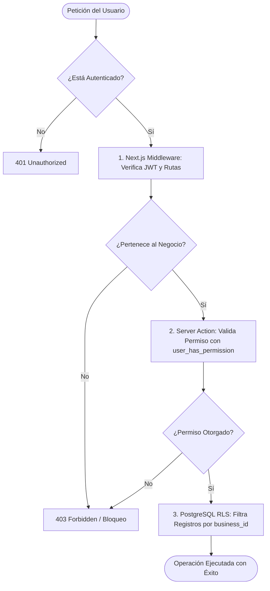
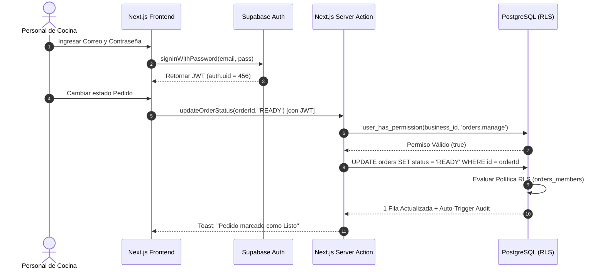

# 5.4 — Arquitectura de autenticación y autorización

## NEGOVA — MVP Restaurante de comida rápida

**Versión:** 1.0  
**Estado:** ✅ Completado  
**Fase:** Fase 5 — Arquitectura del sistema  
**Vertical inicial:** Restaurantes de comida rápida  
**Documento:** 5.4 — Arquitectura de autenticación y autorización  

---

## 1. Objetivo

Definir la arquitectura integral de seguridad de NEGOVA para la identificación confiable de usuarios (**Autenticación**) y el control granular de sus atribuciones y accesos (**Autorización**), garantizando que ningún usuario ejecute operaciones fuera de su rol o fuera del comercio al que pertenece.

---

# 2. Separación conceptual: Autenticación vs. Autorización

```text
┌──────────────────────────────────────────────┐   ┌──────────────────────────────────────────────┐
│             AUTENTICACIÓN (AuthN)            │   │             AUTORIZACIÓN (AuthZ)             │
├──────────────────────────────────────────────┤   ├──────────────────────────────────────────────┤
│  ¿Quién es el usuario?                       │   │  ¿Qué puede hacer y en qué negocio?          │
│  - Verificación de credenciales              │   │  - Validación de membresía (business_users)  │
│  - Emisión de Token JWT firmado              │   │  - Evaluación de Rol y Permisos (RBAC)       │
│  - Gestionado por Supabase Auth              │   │  - Forzado por Next.js Server Actions y RLS  │
└──────────────────────────────────────────────┘   └──────────────────────────────────────────────┘
```

---

# 3. Capa de Autenticación (Supabase Auth)

NEGOVA delega la gestión de credenciales e identidad a **Supabase Auth**:
- **Mecanismos soportados:** Inicio de sesión con correo/contraseña y recuperación segura mediante enlace por correo electrónico.
- **Tokens de Sesión (JWT):** Tras el login exitoso, el cliente recibe un `access_token` JWT con expiración corta y un `refresh_token` almacenado en cookies HTTP-only seguras.
- **Sincronización Transaccional Automática:**  
  Un trigger de base de datos (`trg_on_auth_user_created`) crea automáticamente el perfil de usuario en `public.users` al registrarse en `auth.users`, manteniendo la sincronía sin código manual en frontend.

---

# 4. Desacoplamiento: Identidad Global vs. Membresía Local

Un usuario tiene una única cuenta global, pero sus permisos dependen de su membresía en cada negocio:

$$\mathbf{auth.users}\ (Auth) \longrightarrow \mathbf{public.users}\ (Perfil) \longrightarrow \mathbf{public.business\_users}\ (Membres\text{í}a) \longrightarrow \mathbf{businesses}\ (Tenant)$$

### Ejemplo Multi-Negocio:
- **Usuario:** Juan Pérez (`user_id = 123`)
  - En *Restaurante El Piloto (Camarones)* $\longrightarrow$ Rol: `owner` (Propietario / Control total).
  - En *Tienda La Esquina* $\longrightarrow$ Rol: `staff` (Personal operativo / Solo pedidos y catálogo).

El rol **no es una propiedad estática del usuario**, sino un atributo dinámico de su membresía en cada comercio.

---

# 5. Modelo de Autorización RBAC (Role-Based Access Control)

### 5.1 Ámbitos de Rol (`role_scope`)
La plataforma segmenta los roles en dos ámbitos independientes:
1. **Ámbito de Plataforma (`scope = 'platform'`):** Administradores globales de NEGOVA (`super_admin`).
2. **Ámbito de Comercio (`scope = 'business'`):** Colaboradores y administradores locales del tenant.

### 5.2 Roles Predefinidos del Sistema

| Rol | Ámbito | Descripción y Alcance |
| :--- | :---: | :--- |
| **`super_admin`** | Platform | Gestión global de la plataforma, planes, altas y auditoría de tenants. |
| **`owner` (Propietario)** | Business | Control total administrativo, comercial, de equipo y financiero dentro de su negocio. |
| **`staff` (Personal)** | Business | Operación de turnos: cola de cocina, pedidos, disponibilidad de platos y registro de cobros. |

### 5.3 Catálogo de Permisos Granulares por Módulo

```text
MÓDULO             PERMISOS ASOCIADOS
─────────────────────────────────────────────────────────────────────────────
Negocio (Tenant)   business.view, business.update
Usuarios y Equipo  users.view, users.manage
Roles y Permisos   roles.view, roles.manage
Catálogo / Menú    products.view, products.manage
Clientes           customers.view, customers.manage
Pedidos / Cocina   orders.view, orders.manage
Pagos / Caja       payments.view, payments.manage
Domicilios         deliveries.view, deliveries.manage
Gastos             expenses.view, expenses.manage
Finanzas           finance.view
Configuración      settings.view, settings.manage
Archivos / Storage files.view, files.manage
Auditoría          audit.view
```

---

# 6. Flujo de Decisión de Autorización en Multi-Capa

La autorización opera en tres capas defensivas sucesivas:



---

# 7. Frontend Reactivo vs. Autoridad del Servidor

El frontend adapta dinámicamente la interfaz para no saturar al usuario, pero **no es una barrera de seguridad**:

- **En la Interfaz:**
  - El `Personal` solo ve en su menú: *Dashboard*, *Cola de Pedidos*, *Catálogo* y *Clientes*.
  - Las pestañas de *Finanzas*, *Gastos*, *Usuarios* y *Configuración* permanecen ocultas.
- **En el Servidor y Base de Datos:**
  - Si un usuario `staff` intenta emitir una mutación para registrar un gasto o ver balances bancarios, **la Server Action y las políticas RLS rechazan la operación** retornando un error `403 Permission Denied`.

---

# 8. Seguridad del Consumidor Público (Menú Digital Web / QR)

Los clientes que realizan pedidos a través del Menú Web público interactúan bajo el rol anónimo (`anon`):
- **Lectura Estrictamente Filtrada:** Solo pueden consultar comercios activos (`status IN ('active', 'trial')`) y productos activos que estén disponibles (`status = 'active' AND is_available = true`).
- **Inserción Controlada:** Solo pueden insertar pedidos en estado inicial `received`, ítems asociados y datos de entrega si seleccionaron domicilio.
- **Aislamiento Total:** El cliente público no puede consultar pedidos de otros compradores, gastos, configuraciones internas ni datos de los empleados.

---

# 9. Diagrama de Secuencia: Login y Ejecución de Comanda



---

# 10. La Fórmula Integral de Seguridad de NEGOVA

La arquitectura de seguridad de NEGOVA se resume en la siguiente composición:

$$\mathbf{Seguridad} = \text{AuthN (JWT)} + \text{Tenant ID} + \text{Membres\text{í}a Activa} + \text{Rol Local} + \text{Permiso Espec\text{í}fico} + \mathbf{RLS}$$

Esta fórmula garantiza que la plataforma escale a miles de comercios manteniendo un rendimiento óptimo y un aislamiento impenetrable.

---

# 11. Estado del Documento

**Estado:** ✅ Completado  
**Fase:** Fase 5 — Arquitectura del sistema  
**Vertical inicial:** Restaurantes de comida rápida  
**Documento:** 5.4 — Arquitectura de autenticación y autorización  
