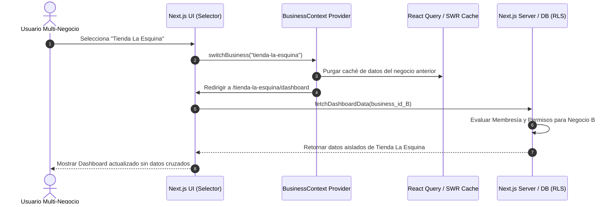
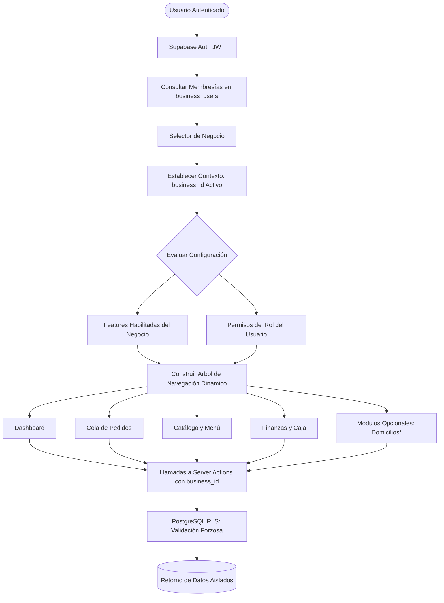

# 5.5 — Arquitectura de navegación y contexto del negocio

## NEGOVA — MVP Restaurante de comida rápida

**Versión:** 1.0  
**Estado:** ✅ Completado  
**Fase:** Fase 5 — Arquitectura del sistema  
**Vertical inicial:** Restaurantes de comida rápida  
**Documento:** 5.5 — Arquitectura de navegación y contexto del negocio  

---

## 1. Objetivo

Definir cómo navega el usuario dentro de la plataforma NEGOVA, cómo se gestiona y propaga el **Contexto del Negocio Activo** (`business_id` / `business_slug`), cómo interactúa el selector de comercios (*Tenant Switcher*) y cómo se condicionan las vistas según los permisos del rol y los módulos habilitados.

---

# 2. Los dos niveles de navegación

```text
┌────────────────────────────────────────────────────────┐
│ 1. ÁMBITO DE PLATAFORMA (Global SaaS)                  │
│    - Panel Super Admin (/admin/businesses, /admin/plans)│
├────────────────────────────────────────────────────────┤
│ 2. ÁMBITO DE NEGOCIO (Tenant Operativo)                │
│    - Panel Administrativo (/[businessSlug]/dashboard)  │
│    - Menú Digital Público (/m/[businessSlug])          │
└────────────────────────────────────────────────────────┘
```

---

# 3. Ciclo de entrada y determinación del negocio activo

Al iniciar sesión, la aplicación determina automáticamente qué comercio abrir:

```text
Usuario ingresa credenciales
             ↓
Supabase Auth valida sesión JWT
             ↓
Consulta en business_users los negocios donde user_id = auth.uid() y status = 'active'
             ↓
┌──────────────────────────────────────────────┐
│ ¿Cuántos negocios activos tiene el usuario?   │
└──────────────────────┬───────────────────────┘
                       │
       ┌───────────────┴───────────────┐
       ▼                               ▼
 [1 Solo Negocio]             [Múltiples Negocios]
       │                               │
       ▼                               ▼
 Carga directa del Dashboard    Muestra Selector de Negocio
 del negocio asignado           o abre el último negocio activo
```

---

# 4. El Contexto del Negocio (`BusinessContext`)

El contexto del negocio representa el comercio sobre el cual opera el usuario en una sesión activa:

```text
Usuario: Juan Pérez
├── Negocios disponibles: [Restaurante El Piloto, Tienda La Esquina]
│
└── Negocio Activo Seleccionado: "Restaurante El Piloto"
    ├── business_id   = bbbbbbbb-bbbb-bbbb-bbbb-bbbbbbbbbbbb
    ├── business_slug = "el-piloto-camarones"
    ├── role          = "owner"
    └── features      = [orders, catalog, customers, payments, expenses, delivery]
```

Todas las llamadas a Server Actions, mutaciones y consultas consumen este contexto de forma explícita.

---

# 5. Selector de Negocio en la Interfaz (Tenant Switcher)

Para usuarios que administran o trabajan en más de un establecimiento, la barra superior incluye un selector accesible:

```text
┌───────────────────────────────────────────────────────────────┐
│  NEGOVA    [ Restaurante El Piloto Camarones  ▼ ]   (Juan P.) │
├───────────────────────────────────────────────────────────────┤
│  Al pulsar el selector se despliega:                          │
│  • Restaurante El Piloto Camarones  (Propietario)  [Activo ✓] │
│  • Tienda La Esquina                (Personal)                │
│  • + Registrar nuevo negocio                                  │
└───────────────────────────────────────────────────────────────┘
```

Al seleccionar otro comercio, la aplicación purga el estado de memoria anterior y redirige al dashboard del nuevo negocio.

---

# 6. Regla de Oro: El Contexto NO es un Permiso

> ⚠️ **Principio de Seguridad:** Seleccionar un comercio en la interfaz indica *dónde quiero trabajar*, pero **no otorga autorizaciones mágicas**.

$$\text{Contexto} = \text{¿Dónde estoy trabajando?} \quad\neq\quad \text{Permisos} = \text{¿Qué puedo hacer allí?}$$

Cada petición valida de forma independiente si el usuario tiene una membresía activa y los permisos específicos de su rol en ese `business_id`.

---

# 7. Estructura de Navegación del Negocio

```text
NEGOVA (Panel del Comercio)
│
├── 📊 Dashboard (Resumen del turno y ventas del día)
│
├── 🛎️ Operación
│   ├── Cola de Pedidos (Comandas en tiempo real)
│   ├── Catálogo / Menú (Platos, modificadores y disponibilidad)
│   └── Directorio de Clientes (Teléfonos y direcciones)
│
├── 💰 Finanzas
│   ├── Recaudos y Pagos (Efectivo vs. Transferencias)
│   └── Gastos Operativos (Registro de salidas de caja)
│
├── 🛵 Domicilios* (Módulo opcional de logística y entregas)
│
├── 🔔 Notificaciones (Avisos de nuevos pedidos y alertas)
│
├── 📁 Archivos (Galería de fotos de platos y logos)
│
└── ⚙️ Configuración
    ├── Perfil del Negocio (Horarios, teléfonos, flete)
    ├── Equipo y Usuarios (Invitaciones y roles)
    └── Métodos de Pago
```

---

# 8. Navegación Dinámica Condicionada por Permisos y Features

El menú lateral se adapta reactivamente combinando **Módulos Habilitados (Features)** y **Permisos del Rol**:

```text
┌───────────────────────────┬───────────────────────────┐
│     VISTA PROPIETARIO     │      VISTA PERSONAL       │
├───────────────────────────┼───────────────────────────┤
│ • Dashboard               │ • Dashboard               │
│ • Pedidos                 │ • Pedidos                 │
│ • Catálogo / Menú         │ • Catálogo (Disponibilidad│
│ • Clientes                │ • Clientes                │
│ • Finanzas y Pagos        │ • Domicilios*             │
│ • Gastos Operativos       │                           │
│ • Domicilios*             │ (Oculto: Finanzas, Gastos,│
│ • Usuarios y Equipo       │  Usuarios y Configuración)│
│ • Configuración           │                           │
└───────────────────────────┴───────────────────────────┘
```

---

# 9. Estrategia de Enrutamiento en Next.js (App Router)

NEGOVA utiliza rutas explícitas basadas en el `slug` del comercio para garantizar transparencia y bookmarking:

```text
RUTAS PÚBLICAS:
  /m/[businessSlug]               --> Catálogo público del menú digital
  /m/[businessSlug]/checkout      --> Carrito y confirmación de comanda
  /m/[businessSlug]/order/[id]    --> Seguimiento de estado en vivo

RUTAS PRIVADAS (ADMINISTRATIVAS):
  /[businessSlug]/dashboard       --> Resumen del negocio activo
  /[businessSlug]/orders          --> Cola de cocina y despacho
  /[businessSlug]/menu            --> Gestión de catálogo y modificadores
  /[businessSlug]/customers       --> Directorio de clientes
  /[businessSlug]/finances        --> Reportes de ventas y pagos
  /[businessSlug]/expenses        --> Registro de egresos
  /[businessSlug]/deliveries      --> Módulo opcional de domicilios
  /[businessSlug]/settings        --> Configuración del local y equipo
```

---

# 10. Ciclo Transaccional del Cambio de Negocio (Switch Tenant)



---

# 11. Diagrama de Navegación y Aislamiento de Contexto



---

# 12. La Regla Fundamental de Navegación Multi-Tenant

> 📌 **Regla Arquitectónica:**  
> La navegación y el flujo de datos siempre deben seguir la jerarquía:
>
> $$\mathbf{Usuario} \longrightarrow \mathbf{Negocio\ Activo} \longrightarrow \mathbf{Permisos\ de\ Rol} \longrightarrow \mathbf{Features\ Activas} \longrightarrow \mathbf{M\acute{o}dulo} \longrightarrow \mathbf{Datos\ Aislados}$$
>
> **Nunca** permitir el acceso directo $\text{Usuario} \rightarrow \text{Módulo} \rightarrow \text{Todos los Datos}$, ya que destruiría el modelo SaaS multi-tenant.

---

# 13. Estado del Documento

**Estado:** ✅ Completado  
**Fase:** Fase 5 — Arquitectura del sistema  
**Vertical inicial:** Restaurantes de comida rápida  
**Documento:** 5.5 — Arquitectura de navegación y contexto del negocio  
