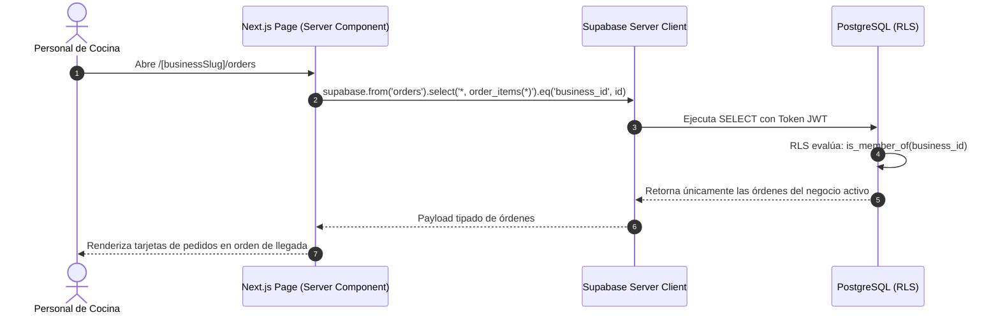
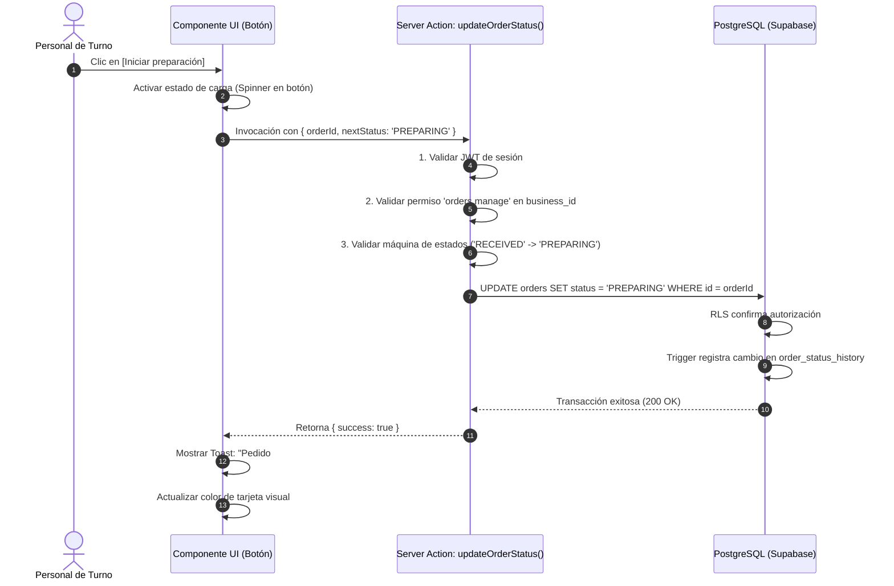
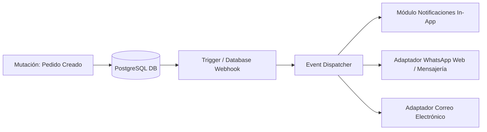

# 5.6 — Arquitectura de comunicación entre capas

## NEGOVA — MVP Restaurante de comida rápida

**Versión:** 1.0  
**Estado:** ✅ Completado  
**Fase:** Fase 5 — Arquitectura del sistema  
**Vertical inicial:** Restaurantes de comida rápida  
**Documento:** 5.6 — Arquitectura de comunicación entre capas  

---

## 1. Objetivo

Definir el flujo de comunicación unidireccional y las fronteras de responsabilidad entre las capas del sistema, desde la interacción del usuario en la interfaz visual hasta la persistencia y validación en la base de datos PostgreSQL, garantizando mantenibilidad, tipado estricto y seguridad por diseño.

---

# 2. Topología arquitectónica en 4 capas

```text
┌─────────────────────────────────────────────────────────────┐
│                    1. CAPA DE CLIENTE / UI                  │
│    Next.js Pages (App Router) • React Components • Forms    │
└──────────────────────────────┬──────────────────────────────┘
                               │ (Invocación de Acciones / Props)
                               ▼
┌─────────────────────────────────────────────────────────────┐
│                 2. CAPA DE APLICACIÓN Y DOMINIO             │
│   Next.js Server Actions • Route Handlers • Esquemas Zod    │
│   - Validación de sesión JWT (Auth)                         │
│   - Verificación de permisos y contexto del negocio         │
│   - Reglas de negocio (cálculo de totales, stock, fletes)   │
└──────────────────────────────┬──────────────────────────────┘
                               │ (Consultas y Mutaciones Tipadas)
                               ▼
┌─────────────────────────────────────────────────────────────┐
│                 3. CAPA DE ACCESO A DATOS (DAL)             │
│   Supabase Server Client • Repositorios y Servicios         │
└──────────────────────────────┬──────────────────────────────┘
                               │ (Conexión segura SSL / JWT)
                               ▼
┌─────────────────────────────────────────────────────────────┐
│                 4. PLATAFORMA SUPABASE / DATOS              │
│   PostgreSQL 15+ • Row Level Security (RLS) • Storage       │
│   Triggers • Restricciones de Integridad • Audit Logs       │
└─────────────────────────────────────────────────────────────┘
```

---

# 3. Capa 1: Presentación e Interfaz de Usuario (UI)

- **Tecnologías:** React, Next.js (Client & Server Components), Tailwind CSS.
- **Responsabilidades:**
  - Renderizado táctil Mobile-First y respuesta ágil ante interacciones.
  - Validación preliminar de experiencia de usuario (campos requeridos, formato visual).
  - Manejo de estados de carga (Skeletons) y feedback de confirmación (Modales personalizados y Toasts).
  - Captura de eventos del operador y delegación inmediata a la capa de aplicación.
  - > ⚠️ **Regla:** Ningún componente de interfaz ejecuta consultas directas SQL ni manipula lógica sensible de negocio.

---

# 4. Capa 2: Aplicación y Lógica de Dominio (Server-Side)

Constituye la frontera segura que se ejecuta exclusivamente en el servidor mediante **Next.js Server Actions y Route Handlers**:
- **Validación de Payloads (Esquemas Zod / TypeScript):** Comprueba que los tipos, cantidades y precios sean válidos antes de tocar la base de datos.
- **Verificación de Autorización y Contexto:**
  - Extrae la identidad del usuario desde el JWT (`auth.uid()`).
  - Verifica membresía activa en `business_users` para el `business_id` objetivo.
  - Evalúa permisos granulares (`orders.manage`, `products.manage`, `expenses.manage`).
- **Reglas Autoritarias de Negocio:**
  - Recalcula los totales de la comanda en servidor ($\text{Subtotal} + \text{Flete} = \text{Total}$).
  - Verifica disponibilidad de insumos en tiempo real (`is_available = true`).
  - Asigna consecutivo único de comanda (`order_number`).

---

# 5. Capa 3: Acceso a Datos (Data Access Layer - DAL)

Encapsula la comunicación con la infraestructura de persistencia utilizando el cliente oficial `@supabase/ssr` / `@supabase/supabase-js`:
- **Instancias Seguras:** Crea clientes de Supabase específicos con el contexto de cookies seguras para propagar el token JWT del usuario a PostgreSQL.
- **Contratos de Datos Tipados:** Utiliza las definiciones generadas automáticamente por Supabase CLI (`Database` types) para garantizar cero errores de tipado entre frontend y base de datos.

---

# 6. Capa 4: Persistencia y Seguridad (Supabase / PostgreSQL)

- **Autoridad Final de Aislamiento:** Aplica **Row Level Security (RLS)** a nivel de motor para garantizar que solo se retornen o modifiquen filas del `business_id` autorizado.
- **Automatizaciones Transaccionales:** Triggers de auditoría (`order_status_history`), actualización de marcas temporales (`set_updated_at`) y restricciones compuestas (`FOREIGN KEY ... REFERENCES parent(id, business_id)`).

---

# 7. Flujo Unidireccional de Lectura (Query Flow)

Ejemplo: El personal abre la pantalla de **Cola de Pedidos**:



---

# 8. Flujo Transaccional de Escritura / Mutación (Mutation Flow)

Ejemplo: El operador pulsa **`[Iniciar preparación]`** sobre la comanda #042:



---

# 9. Principio de Separación de Responsabilidades

```text
┌─────────────────────────────────────────────────────────────┐
│ ❌ PATRÓN ANTIGUO / PROHIBIDO:                              │
│ Componente UI ──► Consulta SQL directa / Lógica acoplada    │
│ (Difícil de mantener, vulnerable y sin tipado seguro)       │
├─────────────────────────────────────────────────────────────┤
│ ✅ PATRÓN NEGOVA (Recomendado):                             │
│ Componente UI ──► Server Action ──► DAL ──► PostgreSQL/RLS  │
│ (Modular, testeable, seguro y reutilizable)                 │
└─────────────────────────────────────────────────────────────┘
```

---

# 10. Arquitectura de Integraciones Externas mediante Eventos

Las integraciones hacia servicios de terceros (WhatsApp API, pasarelas de pago, notificaciones por email) se conectan como **consumidores desacoplados** de eventos:



> **Beneficio:** Si la API externa de WhatsApp experimenta lentitud o caídas, la comanda en cocina se crea y procesa instantáneamente sin bloquear al restaurante.

---

# 11. La Regla de Comunicación de NEGOVA

> 📌 **Regla Arquitectónica:**  
> Toda interacción dentro de NEGOVA debe viajar siempre en sentido descendente de capas:
>
> $$\mathbf{UI\ (Presentaci\acute{o}n)} \longrightarrow \mathbf{Aplicaci\acute{o}n\ (Servidor/Zod)} \longrightarrow \mathbf{Acceso\ a\ Datos\ (DAL)} \longrightarrow \mathbf{Supabase\ (RLS/DB)}$$
>
> y la respuesta en sentido ascendente:
>
> $$\mathbf{PostgreSQL\ (Datos)} \longrightarrow \mathbf{DAL\ (Tipado)} \longrightarrow \mathbf{Aplicaci\acute{o}n\ (Resultado)} \longrightarrow \mathbf{UI\ (Feedback\ Reactivo)}$$

Queda terminantemente prohibido el acceso directo o desordenado que salte capas intermedias.

---

# 12. Estado del Documento

**Estado:** ✅ Completado  
**Fase:** Fase 5 — Arquitectura del sistema  
**Vertical inicial:** Restaurantes de comida rápida  
**Documento:** 5.6 — Arquitectura de comunicación entre capas  
