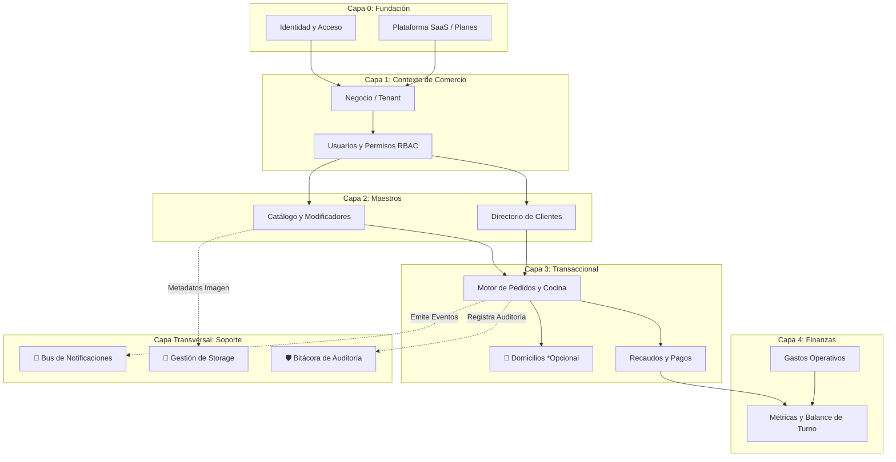

# 5.7 — Arquitectura de módulos y dependencias internas

## NEGOVA — MVP Restaurante de comida rápida

**Versión:** 1.0  
**Estado:** ✅ Completado  
**Fase:** Fase 5 — Arquitectura del sistema  
**Vertical inicial:** Restaurantes de comida rápida  
**Documento:** 5.7 — Arquitectura de módulos y dependencias internas  

---

## 1. Objetivo

Definir la organización interna de los módulos funcionales de NEGOVA, sus contratos de comunicación, la jerarquía de dependencias y el desacoplamiento estructural, evitando acoplamientos rígidos entre tablas internas y permitiendo que cada módulo evolucione o se extienda a nuevos verticales sin romper el núcleo de la plataforma.

---

# 2. Mapa global de módulos funcionales (13 Módulos)

```text
NEGOVA PLATFORM
│
├── 1. Plataforma SaaS (Planes, features globales, límites)
├── 2. Identidad y Acceso (Autenticación JWT, sesiones)
├── 3. Negocios / Tenants (Perfiles comerciales, configuración)
├── 4. Usuarios y Permisos (Membresías business_users, RBAC)
│
├── 5. Catálogo de Productos (Categorías, platos, modificadores, disponibilidad)
├── 6. Clientes (Directorio, notas, múltiples direcciones)
├── 7. Pedidos / Comandas (Recepción multicanal, máquina de estados)
├── 8. Domicilios (Logística de despacho, fletes — *Módulo Opcional*)
├── 9. Pagos y Recaudos (Efectivo, transferencias, control de cobros)
├── 10. Finanzas y Gastos (Egresos operativos, cuadre de caja)
│
├── 11. Notificaciones (Eventos multicanal: In-App, WhatsApp, Email)
├── 12. Archivos / Storage (Metadatos y gestión de imágenes)
└── 13. Auditoría (Bitácora inmutable de eventos sensibles)
```

---

# 3. Jerarquía y niveles de dependencia

Para evitar dependencias circulares, los módulos se organizan en 5 niveles estrictos:

```text
NIVEL 0: FUNDACIÓN      ──►  [Identidad y Acceso] ── [Plataforma SaaS]
                                        │
NIVEL 1: TENANT          ──►  [Negocios] ── [Usuarios y Permisos]
                                        │
NIVEL 2: MAESTROS        ──►  [Catálogo] ─────── [Clientes]
                                   │                  │
NIVEL 3: TRANSACCIONAL   ──►       └──► [PEDIDOS] ◄───┘
                                           │
                                  ┌────────┴────────┐
                                  ▼                 ▼
NIVEL 4: CIERRE          ──► [Domicilios*]    [Pagos] ──► [Finanzas / Gastos]
                                  │                 │
TRANSVERSALES            ──► [Notificaciones] ── [Archivos] ── [Auditoría]
```

---

# 4. Módulo de Catálogo: Inmutabilidad e Independencia

- **Responsabilidades:** Gestión de categorías, productos, grupos de opciones/adiciones y switch de disponibilidad (`is_available = false`).
- **Contrato de Independencia:**  
  El catálogo expone precios y nombres actuales, pero el módulo de pedidos **nunca depende en vivo del catálogo para órdenes pasadas**.
  $$\text{Catálogo Actual (Precio Modificado)} \centernot\longrightarrow \text{Venta Histórica (Precio Congelado en order\_items)}$$

---

# 5. Módulo de Clientes: Flexibilidad y Resiliencia

- **Responsabilidades:** Directorio de compradores, historial de compras y libreta de direcciones con referencias textuales comunitarias.
- **Contrato de Resiliencia:**  
  Un pedido puede crearse para un cliente no registrado previamente (mostrador). Si un cliente es archivado o eliminado lógicamente, **sus pedidos históricos permanecen íntegros e inmutables** en la base de datos.

---

# 6. Módulo Central de Pedidos: Composición Desacoplada

El módulo de pedidos orquesta la transacción comercial pero no manipula las tablas internas de sus dependencias:
- Consume datos del **Catálogo** para validar disponibilidad y nombres.
- Asocia opcionalmente un registro de **Clientes** para contacto.
- Dispara la creación de un registro en **Domicilios** solo si `order_type = 'delivery'`.
- Notifica al módulo de **Pagos** para iniciar la liquidación.
- Emite un evento de dominio (`order.created`, `order.status_changed`) hacia el bus de eventos.

---

# 7. Módulo de Finanzas: Consolidación No Destructiva

- **Responsabilidades:** Centralizar la contabilidad operativa del turno ($\text{Ingresos de Pagos} - \text{Egresos de Gastos} = \text{Balance Operativo}$).
- **Desacoplamiento:**  
  Finanzas no modifica los pedidos ni los gastos; actúa como un consumidor de solo lectura de las transacciones ya asentadas.

---

# 8. Módulo de Notificaciones: Arquitectura Basada en Eventos

Las notificaciones no se ejecutan dentro del código transaccional de los pedidos:

```text
┌─────────────────────────────────────────────────────────────┐
│ ❌ ACOPLAMIENTO PROHIBIDO:                                  │
│ updateOrder() ──► Enviar WhatsApp ──► Enviar Email          │
│ (Si falla la API de WhatsApp, la comanda en cocina se cae)  │
├─────────────────────────────────────────────────────────────┤
│ ✅ PATRÓN BASADO EN EVENTOS (Recomendado):                  │
│ updateOrder() ──► Emite Evento: 'order.status_changed'      │
│                     │                                       │
│                     ├──► Handler In-App Notification        │
│                     ├──► Handler WhatsApp WebHook           │
│                     └──► Handler Email Dispatcher           │
└─────────────────────────────────────────────────────────────┘
```

---

# 9. Módulo de Auditoría Transversal

- **Responsabilidad:** Capturar quién, cuándo y qué se modificó en el sistema.
- **Operación Desacoplada:** Se ejecuta mediante triggers en base de datos (`handle_order_status_audit`) y funciones utilitarias en la capa de aplicación, garantizando que el registro de auditoría ocurra de forma atómica y sin impactar la experiencia visual del operador.

---

# 10. Regla de Dependencias: Contratos de Servicio e Interfaces

> 🔒 **Regla Fundamental:** Ningún módulo interactúa directamente con el esquema o tablas privadas de otro módulo; toda comunicación se realiza mediante **Servicios de Dominio o Interfaces Tipadas**:

```text
MÓDULO PEDIDOS                       MÓDULO CATÁLOGO
┌──────────────────────────┐         ┌──────────────────────────┐
│ import {                 │         │ export async function    │
│   validateProductStock   │ ──────► │   validateProductStock(  │
│ } from '@/modules/catalog│         │     productId, qty       │
│                          │         │   ): Promise<StockResult>│
└──────────────────────────┘         └──────────────────────────┘
```

---

# 11. Diagrama de Relaciones y Dependencias entre Módulos



---

# 12. Principio de Reutilización para Futuros Verticales

La separación modular garantiza que el núcleo de NEGOVA se mantenga genérico:
- **Módulos Reutilizables al 100%:** Identidad, Negocios, Usuarios/Permisos, Clientes, Pagos, Finanzas, Gastos, Notificaciones, Archivos y Auditoría.
- **Módulos con Especialización de Vertical:** Catálogo (platos vs. servicios de barbería vs. abarrotes de tienda) y Transacciones (comandas con modificadores vs. agenda de turnos).

---

# 13. Estado del Documento

**Estado:** ✅ Completado  
**Fase:** Fase 5 — Arquitectura del sistema  
**Vertical inicial:** Restaurantes de comida rápida  
**Documento:** 5.7 — Arquitectura de módulos y dependencias internas  
