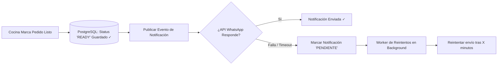
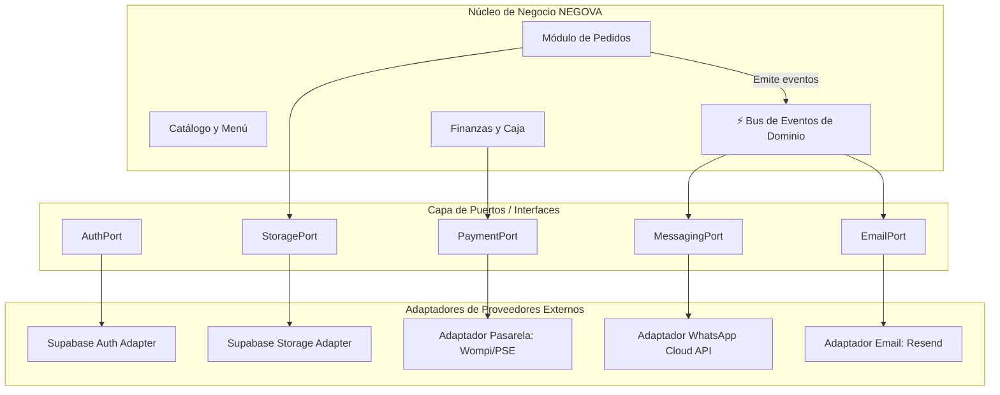

# 5.8 — Arquitectura de servicios e integraciones

## NEGOVA — MVP Restaurante de comida rápida

**Versión:** 1.0  
**Estado:** ✅ Completado  
**Fase:** Fase 5 — Arquitectura del sistema  
**Vertical inicial:** Restaurantes de comida rápida  
**Documento:** 5.8 — Arquitectura de servicios e integraciones  

---

## 1. Objetivo

Definir la arquitectura de servicios externos e integraciones de NEGOVA, estableciendo las interfaces y adaptadores necesarios para aislar la lógica de dominio del sistema de los proveedores de infraestructura y APIs de terceros (Supabase, WhatsApp, Pasarelas de Pago, Proveedores de Correo).

Esta arquitectura garantiza que cualquier proveedor externo pueda ser sustituido en el futuro sin necesidad de reescribir las reglas de negocio de NEGOVA (**Patrón Puertos y Adaptadores / Arquitectura Hexagonal**).

---

# 2. Soberanía tecnológica: Núcleo vs. Servicios Externos

```text
┌─────────────────────────────────────────────────────────────┐
│                  NÚCLEO SOBERANO DE NEGOVA                  │
│   Pedidos • Clientes • Catálogo • Caja • Finanzas • RBAC    │
│   (Lógica pura de negocio independiente de proveedores)     │
└──────────────────────────────┬──────────────────────────────┘
                               │ (Contratos de Servicio / Interfaces)
                               ▼
┌─────────────────────────────────────────────────────────────┐
│                 CAPA DE ADAPTADORES / PUERTOS               │
│   AuthPort • StoragePort • PaymentPort • MessagingPort      │
└──────────────┬───────────────┬───────────────┬──────────────┘
               │               │               │
               ▼               ▼               ▼
┌──────────────────┐  ┌──────────────────┐  ┌──────────────────┐
│  SUPABASE STACK  │  │    MENSAJERÍA    │  │  PASARELAS / API │
│  - Auth (JWT)    │  │  - WhatsApp API  │  │  - Wompi / Bold  │
│  - Storage       │  │  - Resend Email  │  │  - Pasarelas Col │
└──────────────────┘  └──────────────────┘  └──────────────────┘
```

---

# 3. Núcleo Interno de NEGOVA

El núcleo concentra la verdad operativa y el modelo de datos del negocio:
- Creación y ciclo de vida de comandas (`orders`).
- Fórmulas de cálculo de subtotales, fletes y descuentos.
- Aislamiento multi-tenant y membresías de usuario.
- Historial inmutable de estados de cocina y auditoría.

> 🔒 **Regla de Soberanía:** Ninguna API o proveedor externo dicta el esquema o las reglas del núcleo interno.

---

# 4. Capa de Adaptadores e Integraciones Externas

Cada servicio externo se implementa detrás de una interfaz tipada TypeScript (**Port**). La aplicación interactúa exclusivamente con el puerto, mientras que el **Adaptador** resuelve los detalles técnicos del proveedor:

---

# 5. Servicio de Autenticación (`AuthPort`)

- **Interfaz:** `signIn()`, `signUp()`, `signOut()`, `resetPassword()`, `getSession()`.
- **Adaptador Actual:** `SupabaseAuthAdapter` (gestiona tokens JWT y cookies seguras).
- **Extensibilidad:** Permite incorporar en el futuro proveedores como Auth0, Firebase Auth o login con OTP sin alterar los controladores de la aplicación.

---

# 6. Servicio de Almacenamiento Multimedia (`StoragePort`)

- **Interfaz:** `uploadFile(businessId, file, path)`, `getPublicUrl(path)`, `deleteFile(path)`.
- **Adaptador Actual:** `SupabaseStorageAdapter` (organiza carpetas por `business_id`).
- **Extensibilidad:** Puede migrarse a Cloudflare R2 o Amazon S3 cambiando únicamente el adaptador.

---

# 7. Servicio de Pagos y Pasarelas (`PaymentGatewayPort`)

Diferenciación estricta entre pagos operativos manuales y transacciones electrónicas:
- **Gestión Operativa MVP:** Pagos directos en el local (`CASH`) o transferencias verificadas manualmente por el personal (`TRANSFER: Nequi, Daviplata, Bancolombia`).
- **Adaptador Futuro:** `WompiPaymentAdapter` / `BoldPaymentAdapter` para cobros con tarjeta o botón PSE.
- **Máquina de Estados de Pago:**  
  $$\text{INICIADO} \longrightarrow \text{APROBADO} \lor \text{RECHAZADO} \lor \text{REEMBOLSADO}$$
- **Aislamiento Contable:** La pasarela externa no es la base de datos de NEGOVA; el resultado de la transacción se asienta en la tabla `payments` del comercio.

---

# 8. Servicio de Mensajería y WhatsApp (`MessagingPort`)

- **Interfaz:** `sendOrderConfirmation(phone, data)`, `sendStatusUpdate(phone, status)`.
- **Adaptador:** Desacoplado mediante Webhooks y colas de mensajes (Meta Cloud API / Proveedor BSP).
- **Plantillas Estándar:**
  - *Notificación 1:* *"¡Hola [Cliente]! Tu pedido #[Número] fue recibido por [Restaurante]."*
  - *Notificación 2:* *"¡Tu comida está lista y en camino a [Dirección]!"*

---

# 9. Servicio de Correo Transaccional (`EmailPort`)

- **Interfaz:** `sendWelcomeEmail()`, `sendPasswordReset()`, `sendSubscriptionInvoice()`.
- **Adaptador Actual:** `ResendEmailAdapter` / `PostmarkAdapter`.
- **Centralización:** Cero lógica de construcción de correos SMTP dispersa en componentes visuales.

---

# 10. Bus de Eventos de Dominio (Pub/Sub Interno)

La comunicación inter-servicios se rige por la emisión de eventos atómicos:

```text
               COMANDO OPERATIVO: "Marcar Pedido como Listo"
                                    │
                                    ▼
                         [Dominio Pedidos: orders]
                                    │
                       Emite Evento: 'order.ready'
                                    │
         ┌──────────────────────────┼──────────────────────────┐
         ▼                          ▼                          ▼
[Handler: Notificación]    [Handler: WhatsApp]       [Handler: Auditoría]
Crea alerta in-app en      Envía mensaje automático  Asienta evento en
pantalla de despacho       al número del cliente     tabla audit_logs
```

---

# 11. Patrón de Tolerancia a Fallos (Outbox & Retry Pattern)

> 🛡️ **Principio de Resiliencia:** El fallo de una API externa **nunca debe romper una transacción operativa en el restaurante**.

Si el servicio externo de WhatsApp o Email experimenta interrupciones:



**Resultado:** La cocina continúa trabajando sin bloqueos y el cliente recibe su comida a tiempo.

---

# 12. Diagrama Arquitectónico de Servicios e Integraciones



---

# 13. El Principio Fundamental de Soberanía Tecnológica

> 📌 **Regla Arquitectónica:**  
> *"NEGOVA es el dueño absoluto de su lógica de negocio y de sus datos operacionales. Los servicios externos proporcionan capacidades accesorias, pero jamás dictan ni condicionan la arquitectura interna del sistema."*

---

# 14. Estado del Documento

**Estado:** ✅ Completado  
**Fase:** Fase 5 — Arquitectura del sistema  
**Vertical inicial:** Restaurantes de comida rápida  
**Documento:** 5.8 — Arquitectura de servicios e integraciones  
