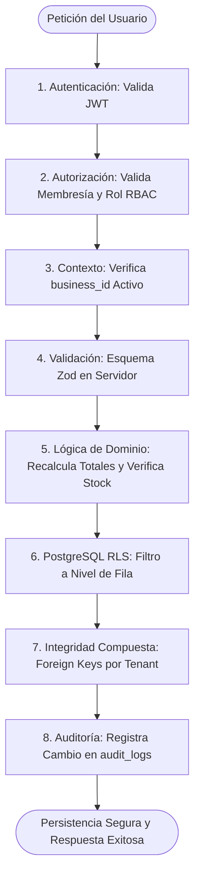

# 5.9 — Arquitectura de seguridad y protección

## NEGOVA — MVP Restaurante de comida rápida

**Versión:** 1.0  
**Estado:** ✅ Completado  
**Fase:** Fase 5 — Arquitectura del sistema  
**Vertical inicial:** Restaurantes de comida rápida  
**Documento:** 5.9 — Arquitectura de seguridad y protección  

---

## 1. Objetivo

Definir la arquitectura integral de seguridad, protección de datos y defensa en profundidad de NEGOVA.

> **Principio Rector:** La seguridad en NEGOVA opera en **múltiples capas concéntricas**. Ninguna funcionalidad depende de una sola regla o de validaciones exclusivas en el navegador. Si una capa defensiva es eludida o presenta fallos, la siguiente capa bloquea automáticamente el acceso.

---

# 2. Modelo de defensa en profundidad (8 Capas Defensivas)

```text
┌─────────────────────────────────────────────────────────────┐
│ 1. AUTENTICACIÓN (Supabase Auth / JWT)                      │
├─────────────────────────────────────────────────────────────┤
│ 2. AUTORIZACIÓN (Membresías business_users + Roles RBAC)    │
├─────────────────────────────────────────────────────────────┤
│ 3. CONTEXTO DEL NEGOCIO (business_id activo)                │
├─────────────────────────────────────────────────────────────┤
│ 4. VALIDACIÓN E HIGIENIZACIÓN (Esquemas Zod en Servidor)    │
├─────────────────────────────────────────────────────────────┤
│ 5. LÓGICA DE NEGOCIO (Cálculos autoritarios Zero-Trust)     │
├─────────────────────────────────────────────────────────────┤
│ 6. ROW LEVEL SECURITY (RLS en PostgreSQL a nivel de fila)   │
├─────────────────────────────────────────────────────────────┤
│ 7. BASE DE DATOS E INTEGRIDAD COMPUESTA (Foreign Keys)      │
├─────────────────────────────────────────────────────────────┤
│ 8. AUDITORÍA INMUTABLE (audit_logs y trazabilidad de comanda)│
└─────────────────────────────────────────────────────────────┘
```

---

# 3. Capa 1: Autenticación y Control de Sesiones

- **Gestor:** Supabase Auth.
- **Mecanismos:** Cifrado de contraseñas con algoritmos modernos (`bcrypt` / `Argon2`).
- **Control de Acceso:** Tokens JWT de corta duración y cookies de sesión HTTP-only seguras (`SameSite=Lax`, `Secure`).
- **Política:** Toda petición a rutas administrativas sin token JWT válido es rechazada inmediatamente con error `401 Unauthorized`.

---

# 4. Capa 2: Autorización Granular y Control RBAC

Tras verificar la identidad del usuario, el sistema evalúa sus atribuciones:
$$\text{Usuario Autenticado} \longrightarrow \text{Membresía Activa} \longrightarrow \text{Rol Local} \longrightarrow \text{Permisos Granulares}$$

- Un colaborador con rol `staff` (Personal) puede ver comandas (`orders.view`), pero tiene denegada la gestión de usuarios (`users.manage`) o la eliminación de platos (`products.manage`).

---

# 5. Capa 3: Contexto Aislado del Negocio (`business_id`)

Cada operación está explícitamente contextualizada en el comercio correspondiente.
- El usuario solo puede interactuar con los datos del `business_id` donde posee membresía activa.
- Queda prohibida cualquier consulta global no acotada por tenant.

---

# 6. Capa 4: Validación e Higienización de Entradas (Zod)

Toda información proveniente del cliente (formularios, JSON, parámetros de URL) se somete a validación estricta en el servidor mediante esquemas **Zod / TypeScript**:
- Verificación de tipos de datos, longitudes máximas y formatos.
- Tipado monetario estricto (rechazo de montos negativos).
- Sanitización de texto para prevenir inyecciones de código (XSS).

---

# 7. Capa 5: Lógica de Dominio y Verificación Zero-Trust

El servidor nunca asume como válidos los importes enviados por el frontend:
- **Recálculo Forzoso de Totales:**  
  $$\text{Total} = \sum (\text{Cantidad} \times \text{Precio Base en BD} + \text{Adicionales en BD}) + \text{Flete Domicilio en BD}$$
- **Verificación de Stock en Vivo:** Comprueba que ningún producto haya pasado a `is_available = false` antes de registrar la comanda.

---

# 8. Capa 6: Row Level Security (RLS) como Barrera Defensiva Final

RLS es la salvaguarda de última milla ejecutada directamente en el motor PostgreSQL:

```text
Intento de Ataque IDOR (Usuario altera business_id en petición HTTP)
                             │
                             ▼
Next.js Server ejecuta la consulta SQL hacia Supabase
                             │
                             ▼
PostgreSQL evalúa RLS: is_member_of(business_id) = FALSE
                             │
                             ▼
BLOQUEO INMEDIATO: 0 Filas Retornadas / Error 403 Forbidden
```

---

# 9. Capa 7: Integridad Relacional y Claves Foráneas Compuestas

Para prevenir contaminación cruzada accidental o maliciosa entre datos de comercios distintos:
```sql
-- Impide asociar un ítem a un producto de otro negocio
CONSTRAINT fk_order_items_product_business 
FOREIGN KEY (product_id, business_id) 
REFERENCES public.products(id, business_id)
```
La base de datos rechaza cualquier inserción que intente vincular un pedido del *Restaurante A* con un producto de la *Tienda B*.

---

# 10. Capa 8: Trazabilidad y Bitácora de Auditoría Inmutable

Toda mutación de impacto sensible genera un registro en `public.audit_logs`:
- **Atributos Registrados:** `user_id` (actor), `business_id`, `action` (`create`, `update`, `delete`, `status_change`), `entity_type`, `entity_id`, instantánea de datos anteriores (`old_data`) y datos nuevos (`new_data`), dirección IP y marca temporal `created_at`.
- **Inmutabilidad:** La tabla de auditoría es *Append-Only* (prohibidas las operaciones `UPDATE` y `DELETE`).

---

# 11. Protección de Secretos y Separación Cliente/Servidor

```text
┌─────────────────────────────────────────────────────────────┐
│ ❌ NUNCA EN EL CLIENTE / NAVEGADOR:                         │
│ • SUPABASE_SERVICE_ROLE_KEY (Bypass de RLS)                 │
│ • API Keys privadas de pasarelas de pago o WhatsApp         │
│ • Secretos de cifrado o credenciales de base de datos       │
├─────────────────────────────────────────────────────────────┤
│ ✅ EN EL CLIENTE / NAVEGADOR:                               │
│ • NEXT_PUBLIC_SUPABASE_URL                                  │
│ • NEXT_PUBLIC_SUPABASE_ANON_KEY (Sujeto estrictamente a RLS)│
└─────────────────────────────────────────────────────────────┘
```

---

# 12. Seguridad del Almacenamiento Multimedia (Storage)

Las imágenes y logotipos en Supabase Storage respetan el mismo aislamiento:
- **Estructura:** `/businesses/{business_id}/...`
- **Políticas de Storage:** Solo los miembros autenticados del negocio pueden subir o borrar archivos en su propio directorio. Los clientes públicos del Menú Web solo tienen permiso de lectura sobre imágenes de productos.

---

# 13. Gobernanza y Seguridad del Super Administrador

```text
                      PLATAFORMA NEGOVA
                              │
           ┌──────────────────┴──────────────────┐
           │                                     │
    ÁMBITO PLATAFORMA                     ÁMBITO TENANTS
           │                                     │
      Super Admin                           Negocios A, B, C
 - Rutas protegidas /admin/*            - Operaciones ordinarias
 - Funciones SECURITY DEFINER           - RLS estricto por tenant
 - Cero navegación arbitraria
   desde UI ordinaria
```

---

# 14. Matriz de Mitigación contra Amenazas (OWASP Top 10)

| Vulnerabilidad OWASP | Mecanismo de Defensa en NEGOVA |
| :--- | :--- |
| **A01: Broken Access Control (IDOR)** | Row Level Security (RLS) en el 100% de tablas + verificación de membresía. |
| **A02: Cryptographic Failures** | Cifrado en tránsito TLS 1.3 (HTTPS) y hash seguro en Supabase Auth. |
| **A03: Injection (SQLi / XSS)** | Consultas parametrizadas por Supabase SDK + validación de tipos con Zod. |
| **A04: Insecure Design** | Arquitectura multi-tenant de 8 capas y principio de mínimo privilegio (PoLP). |
| **A05: Security Misconfiguration** | Políticas RLS por defecto denegadas; claves de servicio ocultas en servidor. |
| **A07: Identification and Auth Failures** | Tokens JWT con expiración corta y rotación de refresh tokens. |
| **A08: Software and Data Integrity** | Claves foráneas compuestas que impiden contaminación cruzada de datos. |
| **A09: Security Logging and Monitoring** | Bitácora de auditoría inmutable en `audit_logs` y `order_status_history`. |

---

# 15. Diagrama Arquitectónico de las 8 Capas de Seguridad



---

# 16. Estado del Documento

**Estado:** ✅ Completado  
**Fase:** Fase 5 — Arquitectura del sistema  
**Vertical inicial:** Restaurantes de comida rápida  
**Documento:** 5.9 — Arquitectura de seguridad y protección  
