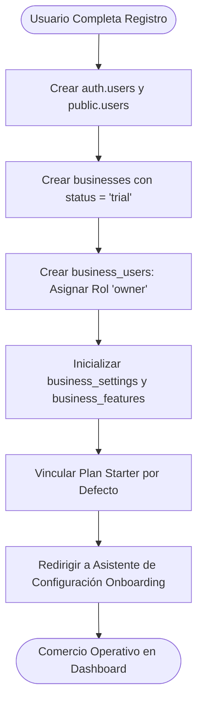
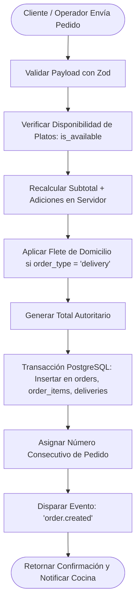
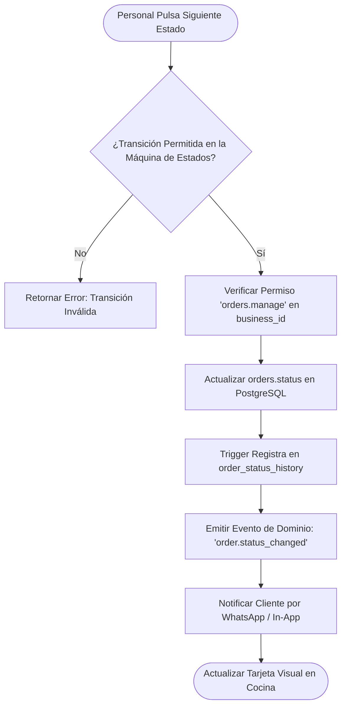

# 6.12 — Flujos de negocio críticos

## NEGOVA — MVP Restaurante de comida rápida

**Versión:** 1.0  
**Estado:** ✅ Completado  
**Fase:** Fase 6 — Arquitectura técnica y de código  
**Vertical inicial:** Restaurantes de comida rápida  
**Documento:** 6.12 — Flujos de negocio críticos  

---

## 1. Objetivo

Documentar los diagramas y especificaciones de los tres flujos operacionales más críticos de la plataforma: **Alta y Onboarding de Negocio**, **Creación Transaccional de Pedido** y **Transición de Estados de Comanda**.

---

# 2. Flujo 1: Alta y Onboarding de Comercio

---

# 3. Flujo 2: Creación Transaccional de Pedido

---

# 4. Flujo 3: Transición de Estados de Comanda

---

# 5. Estado del Documento

**Estado:** ✅ Completado  
**Fase:** Fase 6 — Arquitectura técnica y de código  
**Vertical inicial:** Restaurantes de comida rápida  
**Documento:** 6.12 — Flujos de negocio críticos  
