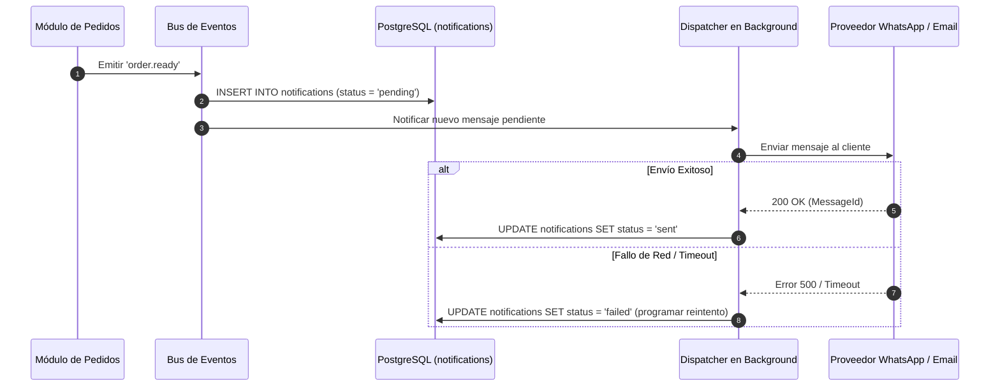

# 6.13 — Sistema de notificaciones

## NEGOVA — MVP Restaurante de comida rápida

**Versión:** 1.0  
**Estado:** ✅ Completado  
**Fase:** Fase 6 — Arquitectura técnica y de código  
**Vertical inicial:** Restaurantes de comida rápida  
**Documento:** 6.13 — Sistema de notificaciones  

---

## 1. Objetivo

Definir la arquitectura centralizada del sistema de notificaciones de NEGOVA, desacoplando los generadores de eventos de los canales de entrega (**In-App**, **WhatsApp** y **Email**) mediante un bus de eventos asíncrono.

---

# 2. Catálogo de Eventos Notificables

```text
EVENTO DE DOMINIO           DESTINATARIO    CANAL PRINCIPAL
─────────────────────────────────────────────────────────────────────────────
order.received              Cocina          In-App (Alerta Sonora)
order.confirmed             Cliente         WhatsApp / Webhook
order.ready                 Cliente / Rep.  WhatsApp / In-App
order.delivered             Cliente         WhatsApp
payment.received            Propietario     In-App
user.invited                Colaborador     Email
subscription.expiring_soon  Propietario     Email / In-App
```

---

# 3. Canales y Estados de Notificación

```text
                                 EVENTO DE DOMINIO
                                         │
                                         ▼
                             [public.notifications]
                                         │
                   ┌─────────────────────┼─────────────────────┐
                   ▼                     ▼                     ▼
             [ 🔔 IN-APP ]         [ 💬 WHATSAPP ]        [ 📧 EMAIL ]
```

### Estados de la Notificación (`notifications.status`):
- `pending`: En cola para ser despachada.
- `sent`: Entregada exitosamente al proveedor de mensajería.
- `failed`: Error en la entrega externa (sujeto a reintentos).
- `read`: Marcada como leída por el usuario en la interfaz.

---

# 4. Diagrama del Pipeline de Notificaciones



---

# 5. Estado del Documento

**Estado:** ✅ Completado  
**Fase:** Fase 6 — Arquitectura técnica y de código  
**Vertical inicial:** Restaurantes de comida rápida  
**Documento:** 6.13 — Sistema de notificaciones  
