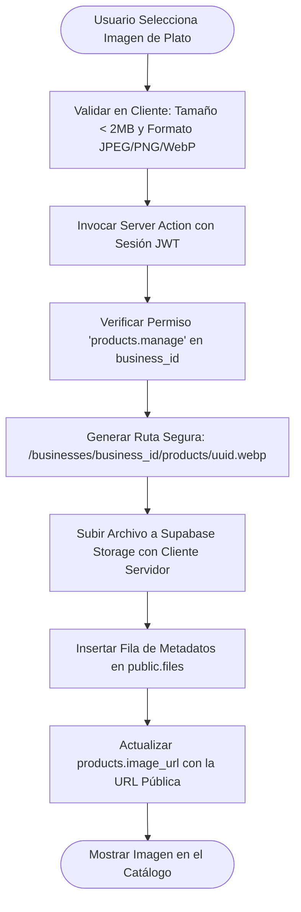

# 6.14 — Sistema de archivos y Storage

## NEGOVA — MVP Restaurante de comida rápida

**Versión:** 1.0  
**Estado:** ✅ Completado  
**Fase:** Fase 6 — Arquitectura técnica y de código  
**Vertical inicial:** Restaurantes de comida rápida  
**Documento:** 6.14 — Sistema de archivos y Storage  

---

## 1. Objetivo

Definir la arquitectura de almacenamiento multimedia y gestión de archivos de NEGOVA sobre **Supabase Storage**, asegurando la compartimentación de carpetas por `business_id`, límites de tamaño, validación MIME y políticas RLS de acceso.

---

# 2. Estructura de Directorios Aislada por Tenant

```text
Supabase Storage (Bucket: 'business-assets')
│
├── businesses/[business_id_A]/
│   ├── logo/             --> Logotipo comercial
│   ├── products/         --> Imágenes de platos y combos
│   └── documents/        --> Soportes tributarios / RUT
│
└── businesses/[business_id_B]/
    ├── logo/
    └── products/
```

---

# 3. Metadatos Centralizados en Base de Datos (`public.files`)

Cada archivo cargado registra sus metadatos en la tabla `public.files`:
- `business_id`: Tenant propietario del archivo.
- `uploaded_by`: Usuario que realizó la carga.
- `type`: `logo` | `product_image` | `document` | `attachment` | `other`.
- `bucket`, `path`, `original_name`, `mime_type`, `size_bytes`.

---

# 4. Pipeline Seguro de Carga de Archivos



> 🔒 **Regla de Seguridad:** Las políticas de Storage prohíben que un usuario del Comercio A pueda escribir o eliminar archivos dentro de la carpeta del Comercio B.

---

# 5. Estado del Documento

**Estado:** ✅ Completado  
**Fase:** Fase 6 — Arquitectura técnica y de código  
**Vertical inicial:** Restaurantes de comida rápida  
**Documento:** 6.14 — Sistema de archivos y Storage  
