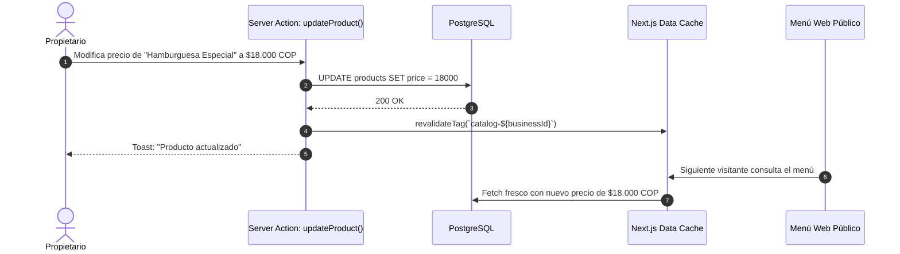

# 6.18 — Caché y rendimiento

## NEGOVA — MVP Restaurante de comida rápida

**Versión:** 1.0  
**Estado:** ✅ Completado  
**Fase:** Fase 6 — Arquitectura técnica y de código  
**Vertical inicial:** Restaurantes de comida rápida  
**Documento:** 6.18 — Caché y rendimiento  

---

## 1. Objetivo

Definir la arquitectura de caché en memoria y CDN para acelerar la carga de vistas de alta frecuencia, reduciendo el costo de cómputo en base de datos y manteniendo la coherencia inmediata de datos dinámicos.

---

# 2. Segmentación de Datos para Estrategia de Caché

```text
DATOS DE BAJA MUTABILIDAD (Caché Agresiva / ISR):
  - Catálogo público de platos y categorías (/m/[businessSlug])
  - Configuración y perfil del negocio (logo, nombre, dirección)
  - Catálogo global de planes y features
  --> Mecanismo: Next.js Data Cache con revalidateTag('catalog-[businessSlug]')

DATOS DINÁMICOS EN TIEMPO REAL (Bypass de Caché / Realtime):
  - Cola de pedidos en cocina (/orders)
  - Estados de comanda y alertas de despacho
  - Balance de caja y pagos del turno
  --> Mecanismo: Consultas directas no cacheadas + Supabase Realtime Channels
```

---

# 3. Flujo de Invalidación Dirigida (Revalidation Flow)



---

# 4. Estado del Documento

**Estado:** ✅ Completado  
**Fase:** Fase 6 — Arquitectura técnica y de código  
**Vertical inicial:** Restaurantes de comida rápida  
**Documento:** 6.18 — Caché y rendimiento  
