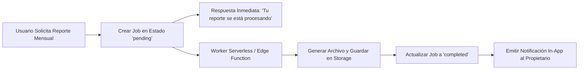

# 6.19 — Jobs y procesos asíncronos

## NEGOVA — MVP Restaurante de comida rápida

**Versión:** 1.0  
**Estado:** ✅ Completado  
**Fase:** Fase 6 — Arquitectura técnica y de código  
**Vertical inicial:** Restaurantes de comida rápida  
**Documento:** 6.19 — Jobs y procesos asíncronos  

---

## 1. Objetivo

Definir la arquitectura de ejecución de tareas en segundo plano (*Background Jobs*) para procesar operaciones pesadas o llamadas a APIs externas sin bloquear la experiencia táctil inmediata del usuario.

---

# 2. Catálogo de Tareas Asíncronas y Estados

```text
TAREAS PROCESADAS EN BACKGROUND:
  1. Despacho de notificaciones por WhatsApp / Email.
  2. Generación y exportación de reportes financieros a PDF / Excel.
  3. Redimensionamiento y optimización WebP de imágenes de platos.
  4. Conciliación y reintentos de webhooks de pasarelas de pago.
  5. Purga de tokens expirados y registros temporales.
```

### Máquina de Estados de un Job:
```text
  [ pending ] ──► [ processing ] ──► [ completed ]
                         │
                         ▼ (Error)
                    [ failed ] ──► [ retry ] (Hasta 3 intentos)
```

---

# 3. Flujo de Ejecución en Background



---

# 4. Estado del Documento

**Estado:** ✅ Completado  
**Fase:** Fase 6 — Arquitectura técnica y de código  
**Vertical inicial:** Restaurantes de comida rápida  
**Documento:** 6.19 — Jobs y procesos asíncronos  
