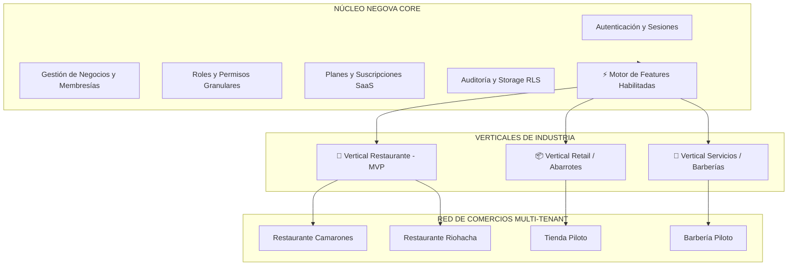

# 6.26 — Preparación para nuevos verticales

## NEGOVA — MVP Restaurante de comida rápida

**Versión:** 1.0  
**Estado:** ✅ Completado  
**Fase:** Fase 6 — Arquitectura técnica y de código  
**Vertical inicial:** Restaurantes de comida rápida  
**Documento:** 6.26 — Preparación para nuevos verticales  

---

## 1. Objetivo

Definir la arquitectura de desacoplamiento entre el **Núcleo de NEGOVA (CORE)** y los **Verticales de Industria**, asegurando que la plataforma pueda expandirse a nuevos sectores comerciales (Retail, Servicios, Barberías, Talleres) sin modificar el núcleo ni sembrar condicionales dispersos en el código fuente.

---

# 2. Desacoplamiento Arquitectónico: CORE vs. Verticales

```text
                         PLATAFORMA NEGOVA
                                 │
           ┌─────────────────────┴─────────────────────┐
           │                                           │
      NÚCLEO (CORE)                               VERTICALES
           │                                           │
 ┌─────────┼─────────┐                     ┌───────────┼───────────┐
 ↓         ↓         ↓                     ↓           ↓           ↓
Auth    Billing   Security            Restaurante    Retail    Servicios
                                      (MVP Actual)  (Futuro)    (Futuro)
```

### 2.1 El Núcleo Reutilizable (CORE)
- Autenticación e Identidad global (`users`).
- Gestión de Comercios y Membresías (`businesses`, `business_users`).
- Roles y Permisos RBAC (`roles`, `permissions`, `role_permissions`).
- Planes, Límites y Suscripciones (`plans`, `subscriptions`).
- Almacenamiento multimedia, Notificaciones y Bitácora de Auditoría.

### 2.2 Especializaciones de Vertical

| Vertical | Módulos Especializados de Dominio |
| :--- | :--- |
| **🍔 Restaurantes (MVP)** | Catálogo con modificadores, Switch de disponibilidad inmediata, Cola de cocina, Domicilios opcionales con flete. |
| **📦 Retail / Tiendas (Futuro)** | Control de stock e inventario, compras a proveedores, código de barras. |
| **💈 Servicios / Barberías (Futuro)**| Catálogo de servicios por duración, agenda de turnos, asignación de profesionales. |

---

# 3. La Regla de Oro contra la Contaminación de Código

> 🚫 **Antipatrón Prohibido:**  
> Llenar la aplicación de condicionales dispersos como `if (business_type === 'restaurant')`.

### ✅ Patrón Correcto Basado en Features Habilitadas:
```text
business_type (restaurant)
       ↓
Asigna Conjunto de Features (orders, kitchen_queue, modifiers, delivery)
       ↓
El componente o acción evalúa:
isFeatureEnabled(businessId, 'kitchen_queue')
```

---

# 4. Diagrama Arquitectónico Final de NEGOVA



---

# 5. Resumen Consolidado de la Fase 6: Arquitectura Técnica y de Código

Con este documento concluye oficialmente la **Fase 6 en su totalidad (26 de 26 documentos completados)**:

```text
6.1  Stack tecnológico definitivo                      ✅ Completado
6.2  Estructura del proyecto                           ✅ Completado
6.3  Arquitectura de módulos de código                 ✅ Completado
6.4  Arquitectura de autenticación                     ✅ Completado
6.5  Arquitectura de autorización                      ✅ Completado
6.6  Contexto global de NEGOVA                         ✅ Completado
6.7  Arquitectura de navegación y rutas                ✅ Completado
6.8  Server Actions / API                              ✅ Completado
6.9  Validaciones y esquemas                           ✅ Completado
6.10 Manejo de errores                                 ✅ Completado
6.11 Estados de las entidades                          ✅ Completado
6.12 Flujos de negocio críticos                        ✅ Completado
6.13 Sistema de notificaciones                         ✅ Completado
6.14 Sistema de archivos y Storage                     ✅ Completado
6.15 Integraciones externas                            ✅ Completado
6.16 Sistema de auditoría                              ✅ Completado
6.17 Logs y observabilidad                             ✅ Completado
6.18 Caché y rendimiento                               ✅ Completado
6.19 Jobs y procesos asíncronos                        ✅ Completado
6.20 Backups y recuperación ante fallos                ✅ Completado
6.21 Seguridad de aplicación                           ✅ Completado
6.22 Seguridad de autenticación y sesiones             ✅ Completado
6.23 Protección contra ataques                         ✅ Completado
6.24 Gestión de secretos y variables de entorno        ✅ Completado
6.25 Estrategia de pruebas                             ✅ Completado
6.26 Preparación para nuevos verticales                ✅ Completado
```

---

# 6. Estado del Documento

**Estado:** ✅ Completado  
**Fase:** Fase 6 — Arquitectura técnica y de código  
**Vertical inicial:** Restaurantes de comida rápida  
**Documento:** 6.26 — Preparación para nuevos verticales  
