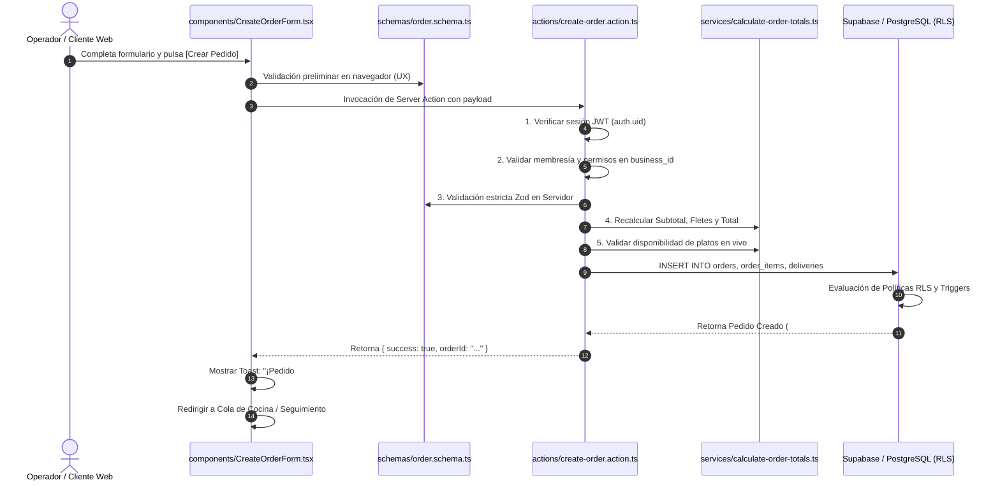

# 6.3 — Arquitectura de módulos de código

## NEGOVA — MVP Restaurante de comida rápida

**Versión:** 1.0  
**Estado:** ✅ Completado  
**Fase:** Fase 6 — Arquitectura técnica y de código  
**Vertical inicial:** Restaurantes de comida rápida  
**Documento:** 6.3 — Arquitectura de módulos de código  

---

## 1. Objetivo

Definir el estándar de arquitectura interna para cada módulo de código dentro de la carpeta `src/features/`.

Cada módulo opera de forma altamente cohesiva y desacoplada, encapsulando su propia interfaz, esquemas de validación Zod, mutaciones (Server Actions), consultas (Queries), servicios de dominio y contratos de tipos TypeScript.

---

# 2. Estructura Estándar de un Módulo Feature

```text
src/features/[module-name]/
│
├── components/                   # Componentes visuales específicos del módulo
│   ├── OrderCard.tsx
│   ├── OrderStatusBadge.tsx
│   ├── OrderDetailModal.tsx
│   └── CreateOrderForm.tsx
│
├── actions/                      # Server Actions (Mutaciones de escritura: INSERT, UPDATE, DELETE)
│   ├── create-order.action.ts
│   ├── update-order-status.action.ts
│   └── cancel-order.action.ts
│
├── queries/                      # Consultas de lectura optimizadas (SELECT)
│   ├── get-active-orders.query.ts
│   ├── get-order-by-id.query.ts
│   └── get-orders-history.query.ts
│
├── schemas/                      # Esquemas de validación Zod (Frontend y Backend)
│   └── order.schema.ts
│
├── services/                     # Lógica de dominio específica o cálculos complejos
│   ├── calculate-order-totals.service.ts
│   └── validate-stock-availability.service.ts
│
├── types/                        # Tipos e interfaces TypeScript del módulo
│   └── index.ts
│
└── utils/                        # Funciones utilitarias internas del módulo
    └── format-order-number.ts
```

---

# 3. Flujo Transaccional de Ejemplo: Creación de Pedido



---

# 4. Beneficios del Diseño Feature-Driven

1. **Alta Cohesión:** Todo lo relacionado con un módulo (ej. `orders`) reside en un solo lugar.
2. **Facilidad de Refactorización:** Modificar o extender un módulo no genera efectos colaterales en módulos ajenos.
3. **Escalabilidad del Equipo:** Múltiples desarrolladores pueden trabajar en características distintas en paralelo sin colisiones de código.

---

# 5. Estado del Documento

**Estado:** ✅ Completado  
**Fase:** Fase 6 — Arquitectura técnica y de código  
**Vertical inicial:** Restaurantes de comida rápida  
**Documento:** 6.3 — Arquitectura de módulos de código  
