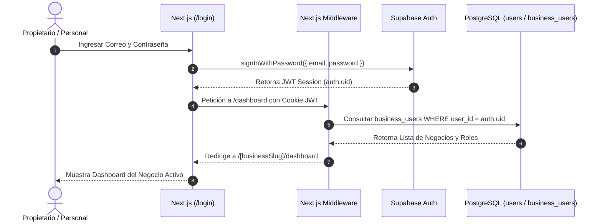

# 6.4 — Arquitectura de autenticación

## NEGOVA — MVP Restaurante de comida rápida

**Versión:** 1.0  
**Estado:** ✅ Completado  
**Fase:** Fase 6 — Arquitectura técnica y de código  
**Vertical inicial:** Restaurantes de comida rápida  
**Documento:** 6.4 — Arquitectura de autenticación  

---

## 1. Objetivo

Definir la arquitectura de autenticación de NEGOVA, detallando los flujos de registro, inicio de sesión, conmutación multi-negocio y cierre de sesión seguro mediante **Supabase Auth** y **Next.js Middleware**.

---

# 2. Flujo Principal de Autenticación y Contexto

```text
Usuario ingresa credenciales
             ↓
Supabase Auth valida hash seguro
             ↓
Emisión de Sesión JWT en Cookie HTTP-Only
             ↓
Lectura del Perfil Global en public.users
             ↓
Consulta de Membresías en public.business_users
             ↓
Determinación del Negocio Activo (business_id)
             ↓
Carga del Rol y Permisos en ese contexto
             ↓
Acceso al Dashboard Operativo
```

---

# 3. Flujos Detallados de Autenticación

### 3.1 Flujo de Registro (Sign Up)
1. El usuario se registra con correo y contraseña.
2. Supabase Auth genera la identidad en `auth.users`.
3. Un trigger en PostgreSQL (`trg_on_auth_user_created`) crea automáticamente la fila en `public.users`.
4. El sistema crea o vincula al usuario como `PROPIETARIO` en su nuevo registro de `businesses` y membresía en `business_users`.
5. Redirección automática al asistente de configuración inicial del comercio.

### 3.2 Flujo de Inicio de Sesión (Sign In)
1. El usuario envía formulario en `/login`.
2. Supabase Auth valida credenciales y entrega el token JWT.
3. El middleware de Next.js (`src/lib/supabase/middleware.ts`) refresca la sesión en servidor.
4. Se consultan los negocios asociados al usuario en `business_users`.
5. Si tiene un solo comercio, redirige a `/[businessSlug]/dashboard`. Si administra varios, abre el selector de negocios.

### 3.3 Flujo de Usuario Multi-Negocio (Tenant Switcher)
1. El usuario pulsa el selector en la cabecera y escoge *Negocio B*.
2. La aplicación actualiza el contexto de cliente (`BusinessContext`).
3. Se purga la memoria caché (React Query / SWR) para evitar mostrar datos del comercio anterior.
4. La navegación conmuta a `/[businessSlugB]/dashboard`.
5. Todas las consultas posteriores se evalúan con el nuevo `business_id` bajo RLS.

### 3.4 Flujo de Cierre de Sesión (Sign Out)
1. El usuario pulsa `[Cerrar Sesión]`.
2. Se invoca `supabase.auth.signOut()`, invalidando el refresh token en el servidor.
3. Se eliminan las cookies de sesión del navegador.
4. Se destruye el contexto en memoria y se redirige a `/login`.

---

# 4. Diagrama de Autenticación y Carga de Contexto



---

# 5. Estado del Documento

**Estado:** ✅ Completado  
**Fase:** Fase 6 — Arquitectura técnica y de código  
**Vertical inicial:** Restaurantes de comida rápida  
**Documento:** 6.4 — Arquitectura de autenticación  
