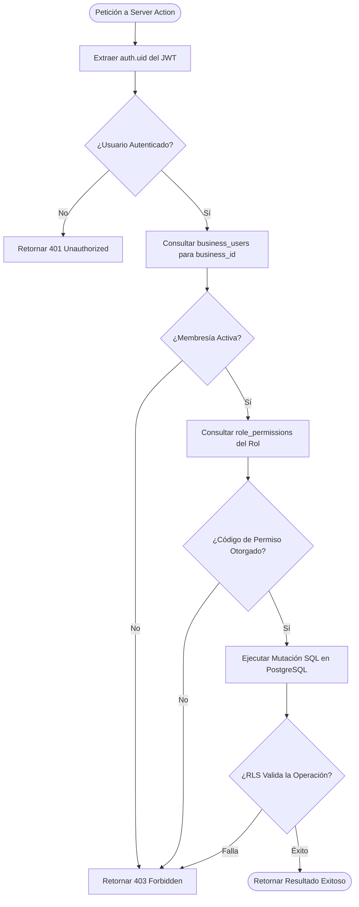

# 6.5 — Arquitectura de autorización

## NEGOVA — MVP Restaurante de comida rápida

**Versión:** 1.0  
**Estado:** ✅ Completado  
**Fase:** Fase 6 — Arquitectura técnica y de código  
**Vertical inicial:** Restaurantes de comida rápida  
**Documento:** 6.5 — Arquitectura de autorización  

---

## 1. Objetivo

Definir la arquitectura de autorización de NEGOVA, estableciendo cómo el sistema valida los permisos granulares de cada usuario en el contexto específico de un comercio, protegiendo las rutas, mutaciones y datos mediante una estrategia de autorización en múltiples capas (**RBAC + Server Actions + PostgreSQL RLS**).

---

# 2. La Cadena de Autorización Obligatoria

Toda operación empresarial en NEGOVA debe evaluarse obligatoriamente a través de esta cadena contextual:

$$\mathbf{auth.uid()}\ (\text{Identidad}) \longrightarrow \mathbf{business\_id}\ (\text{Comercio}) \longrightarrow \mathbf{membership}\ (\text{Membres\text{í}a}) \longrightarrow \mathbf{role}\ (\text{Rol}) \longrightarrow \mathbf{permission}\ (\text{Permiso}) \longrightarrow \mathbf{RLS}$$

---

# 3. Comparativa de Roles del MVP

```text
┌──────────────────────────────────────┬──────────────────────────────────────┐
│       ROL: PROPIETARIO (Owner)       │         ROL: PERSONAL (Staff)        │
├──────────────────────────────────────┼──────────────────────────────────────┤
│ • Control total del negocio          │ • Operación de turno                 │
│ • Permisos:                          │ • Permisos:                          │
│   - business.view, business.update   │   - orders.view, orders.manage       │
│   - users.view, users.manage         │   - products.view                    │
│   - roles.view, roles.manage         │   - customers.view                   │
│   - products.view, products.manage   │   - deliveries.view, deliveries.man. │
│   - customers.view, customers.manage │   - payments.view, payments.manage   │
│   - orders.view, orders.manage       │                                      │
│   - payments.view, payments.manage   │ (Denegado: users.manage, expenses,   │
│   - expenses.view, expenses.manage   │  finanzas y configuración)           │
│   - finance.view, settings.manage    │                                      │
└──────────────────────────────────────┴──────────────────────────────────────┘
```

---

# 4. Autorización en Múltiples Capas Defensivas

```text
┌─────────────────────────────────────────────────────────────┐
│ 1. CAPA DE INTERFAZ (Frontend UX)                           │
│    Oculta o deshabilita botones y secciones según permisos  │
│    (ej. el personal no ve la pestaña de Finanzas)           │
├─────────────────────────────────────────────────────────────┤
│ 2. CAPA DE APLICACIÓN (Next.js Server Actions)              │
│    Invoca función utilitaria: checkPermission(permiso)      │
│    Si no tiene permiso, lanza error '403 Forbidden'         │
├─────────────────────────────────────────────────────────────┤
│ 3. CAPA DE MOTOR DE BASE DE DATOS (PostgreSQL RLS)          │
│    Evalúa user_has_permission() a nivel de fila             │
│    Si RLS falla, bloquea la consulta (0 filas retornadas)   │
└─────────────────────────────────────────────────────────────┘
```

---

# 5. Ejemplo de Código: Verificación Segura en Server Actions

```typescript
// src/features/products/actions/create-product.action.ts
'use server';

import { createServerClient } from '@/lib/supabase/server';
import { checkPermission } from '@/lib/permissions/check-permission';
import { createProductSchema } from '../schemas/product.schema';

export async function createProductAction(businessId: string, rawData: unknown) {
  // 1. Validar autorización y contexto en el servidor
  await checkPermission(businessId, 'products.manage');

  // 2. Validar payload con esquema Zod
  const validatedData = createProductSchema.parse(rawData);

  // 3. Ejecutar mutación segura en Supabase
  const supabase = createServerClient();
  const { data, error } = await supabase
    .from('products')
    .insert({ ...validatedData, business_id: businessId })
    .select()
    .single();

  if (error) throw new Error(error.message);
  return { success: true, product: data };
}
```

---

# 6. Diagrama de Decisión de Autorización



---

# 7. Estado del Documento

**Estado:** ✅ Completado  
**Fase:** Fase 6 — Arquitectura técnica y de código  
**Vertical inicial:** Restaurantes de comida rápida  
**Documento:** 6.5 — Arquitectura de autorización  
