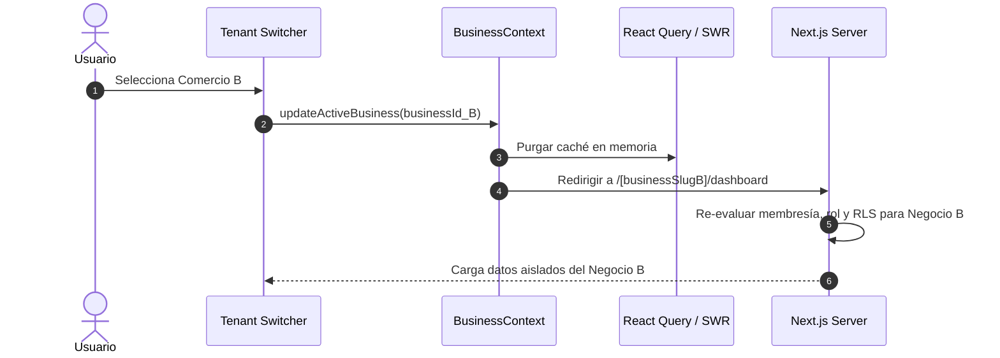

# 6.6 — Contexto global de NEGOVA

## NEGOVA — MVP Restaurante de comida rápida

**Versión:** 1.0  
**Estado:** ✅ Completado  
**Fase:** Fase 6 — Arquitectura técnica y de código  
**Vertical inicial:** Restaurantes de comida rápida  
**Documento:** 6.6 — Contexto global de NEGOVA  

---

## 1. Objetivo

Definir la arquitectura del contexto global de la aplicación, estableciendo cómo el estado en cliente y servidor mantiene la identidad del usuario autenticado, el negocio activo seleccionado y sus permisos, diferenciando nítidamente entre el **Contexto de Plataforma (SaaS)** y el **Contexto de Negocio (Tenant)**.

---

# 2. Estructura Jerárquica del Contexto Global

```text
Usuario Autenticado (auth.uid)
        ↓
Negocios Disponibles (business_users)
        ↓
Negocio Activo Seleccionado (business_id / businessSlug)
        ↓
Membresía del Usuario (status = 'active')
        ↓
Rol Asignado (owner / staff)
        ↓
Permisos Granulares Concedidos (role_permissions)
        ↓
Features / Módulos Habilitados (business_features)
        ↓
Configuración del Comercio (business_settings)
```

---

# 3. Separación de Contextos: Plataforma vs. Negocio

```text
┌─────────────────────────────────────────────────────────────┐
│ 1. CONTEXTO DE PLATAFORMA (Global SaaS)                     │
│    - Ámbito: Platform / Super Admin                         │
│    - Datos: Planes, Features globales, Suscripciones        │
├─────────────────────────────────────────────────────────────┤
│ 2. CONTEXTO DE NEGOCIO (Tenant Local)                       │
│    - Ámbito: Business / Owner & Staff                       │
│    - Datos: Comandas, Catálogo, Clientes, Pagos, Gastos     │
└─────────────────────────────────────────────────────────────┘
```

> 🔒 **Regla Fundamental:** Ningún módulo o acción del sistema debe asumir que un usuario opera sobre un comercio solo por tener una sesión abierta. Toda operación privada debe requerir y validar un `business_id` activo.

---

# 4. Transición de Contexto (Switch Tenant)



---

# 5. Estado del Documento

**Estado:** ✅ Completado  
**Fase:** Fase 6 — Arquitectura técnica y de código  
**Vertical inicial:** Restaurantes de comida rápida  
**Documento:** 6.6 — Contexto global de NEGOVA  
