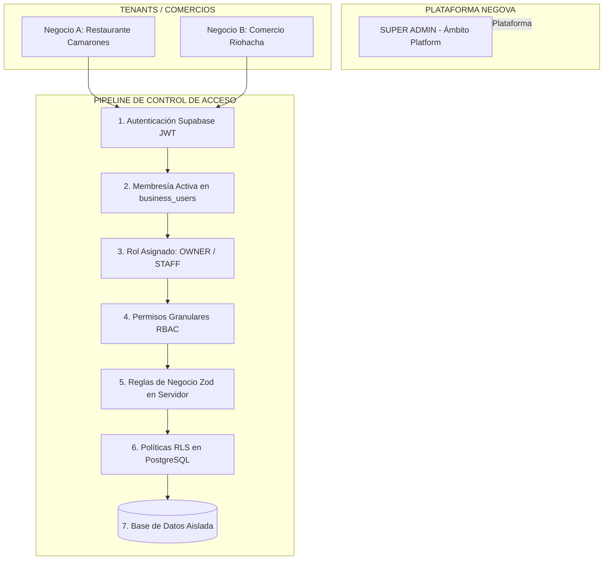

# 7.18 — Regla maestra de autorización

## NEGOVA — MVP Restaurante de comida rápida

**Versión:** 1.0  
**Estado:** ✅ Completado  
**Fase:** Fase 7 — Seguridad y control de acceso  
**Vertical inicial:** Restaurantes de comida rápida  
**Documento:** 7.18 — Regla maestra de autorización  

---

## 1. Objetivo

Consolidar la **Regla Maestra de Autorización** de NEGOVA que rige sin excepción todas las operaciones privadas del sistema, unificando los principios definidos a lo largo de la Fase 7.

---

# 2. La Ecuación Maestra de Autorización

$$\mathbf{Acceso\ Concedido} \iff \begin{pmatrix} \text{AUTHENTICATED} \\ \land\ \text{BUSINESS\_ACCESS} \\ \land\ \text{REQUIRED\_PERMISSION} \\ \land\ \text{BUSINESS\_VALIDATION} \\ \land\ \mathbf{RLS\_POLICY} \end{pmatrix}$$

> 🛡️ **Cláusula de Cierre:** Si una sola de estas cinco condiciones no se satisface al 100%, la operación es **rechazada de forma atómica y categórica (`DENY`)**, impidiendo la ejecución de la consulta o mutación en la base de datos.

---

# 3. Diagrama Arquitectónico Final de Seguridad (Fase 7)



---

# 4. Resumen Consolidado de la Fase 7: Seguridad y Control de Acceso

Con este documento concluye oficialmente la **Fase 7 en su totalidad (18 de 18 documentos completados)**:

```text
7.1  Modelo de seguridad                               ✅ Completado
7.2  Autenticación                                     ✅ Completado
7.3  Identidad del usuario                             ✅ Completado
7.4  Contexto del negocio                              ✅ Completado
7.5  Roles                                             ✅ Completado
7.6  Permisos                                          ✅ Completado
7.7  Autorización                                      ✅ Completado
7.8  Multi-Tenant Security                             ✅ Completado
7.9  Row Level Security (RLS)                          ✅ Completado
7.10 Integridad entre tenants                          ✅ Completado
7.11 Protección del Super Admin                        ✅ Completado
7.12 Auditoría de seguridad                            ✅ Completado
7.13 Sesiones y cierre de acceso                       ✅ Completado
7.14 Principio de mínimo privilegio                    ✅ Completado
7.15 Seguridad del servidor                            ✅ Completado
7.16 Seguridad de datos sensibles                      ✅ Completado
7.17 Estados de acceso                                 ✅ Completado
7.18 Regla maestra de autorización                     ✅ Completado
```

---

# 5. Estado del Documento

**Estado:** ✅ Completado  
**Fase:** Fase 7 — Seguridad y control de acceso  
**Vertical inicial:** Restaurantes de comida rápida  
**Documento:** 7.18 — Regla maestra de autorización  
