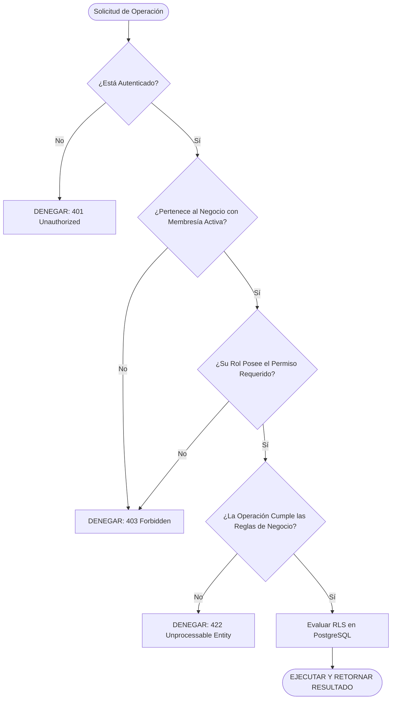

# 7.7 — Autorización

## NEGOVA — MVP Restaurante de comida rápida

**Versión:** 1.0  
**Estado:** ✅ Completado  
**Fase:** Fase 7 — Seguridad y control de acceso  
**Vertical inicial:** Restaurantes de comida rápida  
**Documento:** 7.7 — Autorización  

---

## 1. Objetivo

Definir el flujo secuencial de autorización que valida de forma autoritaria si un usuario tiene la facultad de ejecutar una acción específica sobre un recurso dentro del comercio activo.

---

# 2. Flujo de Decisión de Autorización

---

# 3. Estado del Documento

**Estado:** ✅ Completado  
**Fase:** Fase 7 — Seguridad y control de acceso  
**Vertical inicial:** Restaurantes de comida rápida  
**Documento:** 7.7 — Autorización  
