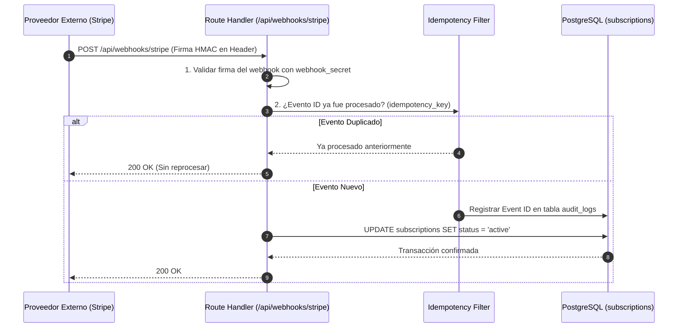

# 8.1 — Integraciones y servicios externos

## NEGOVA — MVP Restaurante de comida rápida

**Versión:** 1.0  
**Estado:** ✅ Completado  
**Fase:** Fase 8 — Integraciones y servicios  
**Vertical inicial:** Restaurantes de comida rápida  
**Documento:** 8.1 — Integraciones y servicios externos  

---

## 1. Objetivo y Principio de Integración

Definir la arquitectura de comunicación con servicios externos y subsistemas complementarios de NEGOVA.

> 🔒 **Principio de Aislamiento:** Ningún módulo de la aplicación debe acoplarse directamente a un proveedor externo. Toda llamada a APIs de terceros se ejecuta a través de la **Capa de Servicios (`src/services/`)**, permitiendo sustituir proveedores en el futuro sin modificar la lógica de negocio ni la base de datos (**Patrón Puertos y Adaptadores / Arquitectura Hexagonal**).

```text
                         PLATAFORMA NEGOVA
                                 │
                     [ Integration Layer ]
                                 │
        ┌───────────┬────────────┼────────────┬───────────┐
        ▼           ▼            ▼            ▼           ▼
   [ Payments ] [ WhatsApp ] [ Email ]   [ Storage ]   [ Maps ]
     (Stripe)     (Meta API)  (Resend)    (Supabase)  (Mapbox/OSM)
```

---

# 2. Catálogo de Servicios e Integraciones Previstas

| Servicio | Propósito y Alcance | Proveedor Inicial | Mecanismo de Comunicación |
| :--- | :--- | :--- | :--- |
| **Infraestructura Base** | Autenticación, PostgreSQL, RLS, Storage y Triggers. | **Supabase** | SDK `@supabase/ssr` / `@supabase/supabase-js` |
| **Facturación SaaS** | Cobro recurrente de planes y suscripciones a negocios. | **Stripe** | Stripe SDK + Webhooks autenticados |
| **Mensajería Clientes** | Confirmación de pedidos, avisos de despacho y cocina. | **WhatsApp Cloud API** | REST API + Webhooks de estado |
| **Correo Transaccional**| Bienvenida, recuperación de claves, facturación. | **Resend / Postmark** | REST API tipada con React Email |
| **Geolocalización** | Normalización de direcciones y cálculo de fletes. | **OpenStreetMap / Mapbox** | REST Geocoding API (Opcional) |

---

# 3. Arquitectura de Webhooks e Idempotencia

Para integraciones asíncronas críticas (como la confirmación de pagos de suscripción en Stripe o actualizaciones de WhatsApp):



---

# 4. Organización del Almacenamiento (Supabase Storage)

Las rutas de archivos se compartimentan obligatoriamente por `business_id`:

```text
business-assets/
└── businesses/{business_id}/
    ├── logo/             --> Logotipo comercial
    ├── products/         --> Fotografías de platos y combos
    ├── documents/        --> Soportes tributarios
    └── attachments/      --> Comprobantes de transferencia
```

> 🛡️ **Seguridad:** Las políticas de Storage prohíben que un comercio pueda leer o alterar archivos privados de otro tenant.

---

# 5. Resiliencia y Tolerancia a Fallos (Disponibilidad Continua)

> ⚠️ **Principio de Disponibilidad:** La caída temporal de un servicio externo **nunca debe detener la operación interna del restaurante**.

```text
┌─────────────────────────────────────────────────────────────┐
│ • Si WhatsApp se cae:                                       │
│   La comanda se crea y se muestra en la pantalla de cocina; │
│   la notificación queda en estado 'pending' con reintentos. │
├─────────────────────────────────────────────────────────────┤
│ • Si el servicio de mapas no responde:                      │
│   El sistema solicita la dirección en texto y referencia    │
│   comunitaria tradicional ("Frente al parque").             │
└─────────────────────────────────────────────────────────────┘
```

---

# 6. Custodia de Secretos y Credenciales de Integración

- **Cero secretos en el cliente:** Las claves `STRIPE_SECRET_KEY`, `WHATSAPP_TOKEN`, `RESEND_API_KEY` y `SUPABASE_SERVICE_ROLE_KEY` residen exclusivamente en variables de entorno del servidor.
- **Configuración multi-tenant:** Si un negocio configura su propio número de WhatsApp o pasarela propia, las credenciales se almacenan cifradas en `business_settings`.

---

# 7. Resumen de la Fase 8: Integraciones y Servicios (23 Puntos)

```text
8.1  Principio de integración (Puertos y Adaptadores)  ✅
8.2  Servicios externos previstos (Supabase, Stripe...) ✅
8.3  Supabase como infraestructura, no lógica de negocio✅
8.4  Stripe para facturación SaaS                      ✅
8.5  Webhooks seguros con validación de firma HMAC     ✅
8.6  Idempotencia para evitar cobros dobles            ✅
8.7  WhatsApp para notificaciones de comanda           ✅
8.8  Email transaccional desacoplado                   ✅
8.9  Notificaciones multicanal con tabla de auditoría  ✅
8.10 Supabase Storage con aislamiento por negocio      ✅
8.11 Estructura consistente de carpetas de Storage     ✅
8.12 Geolocalización opcional y no bloqueante          ✅
8.13 Preparación para integraciones futuras            ✅
8.14 Capa de servicios encapsulada (src/services/)     ✅
8.15 Configuración independiente por negocio           ✅
8.16 Credenciales y secretos protegidos en servidor    ✅
8.17 Clasificación y manejo de errores de integración  ✅
8.18 Políticas de reintentos controlados               ✅
8.19 Registro de auditoría para eventos externos       ✅
8.20 Desacoplamiento total del núcleo                  ✅
8.21 Alta disponibilidad y tolerancia a fallos         ✅
8.22 Seguridad y validación en 100% de integraciones   ✅
8.23 Arquitectura final unificada de integración       ✅
```

---

# 8. Estado del Documento

**Estado:** ✅ Completado  
**Fase:** Fase 8 — Integraciones y servicios  
**Vertical inicial:** Restaurantes de comida rápida  
**Documento:** 8.1 — Integraciones y servicios externos  
