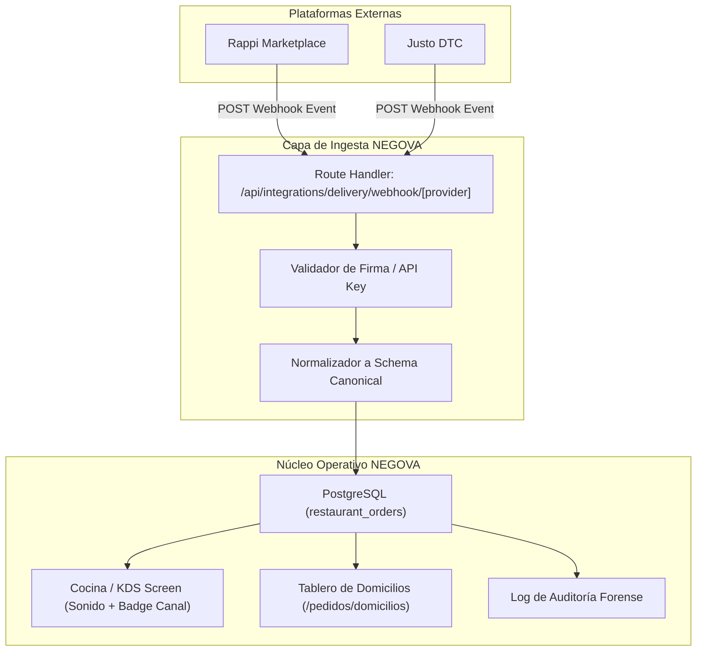

# 8.2 — Evaluación Técnica y Comercial de Integraciones de Delivery Externo (Rappi / Justo)

**Código de Tarea:** [DOM-005]  
**Decisión de Arquitectura Asociada:** [DEC-007]  
**Módulo:** Domicilios y Pedidos  
**Versión:** 1.0  
**Fecha:** Noviembre 2026  

---

## 1. Resumen Ejecutivo y Decisión Estratégica

La operación de restaurantes y comercios gastronómicos en Colombia y Latinoamérica enfrenta una disyuntiva crítica en sus canales de venta a domicilio:

1. **Marketplaces Masivos (ej. Rappi):** Ofrecen alta visibilidad y acceso a millones de comensales, pero imponen **comisiones elevadas (18% al 25% + IVA por pedido)**, retienen los datos de los clientes y exigen cumplimiento estricto de SLAs de preparación.
2. **Canales Propios Digitales (Direct-to-Consumer / DTC - ej. Justo):** Proveen una tienda web personalizada con comisiones intermedias (**7% al 12% por pedido** o tarifa de tecnología fija), permitiendo retener la base de datos de clientes, pero exigen que el restaurante genere su propio tráfico.
3. **Plataforma Integral NEGOVA (Menú QR + Reparto Propio):** Proporciona **0% de comisiones por pedido**, control total de la base de clientes, seguimiento en tiempo real con código PIN seguro y liquidación directa en caja sin intermediarios.

### Decisión de Arquitectura (DEC-007)
> **RESOLUCIÓN:** NEGOVA adopta una **arquitectura de canal híbrido abierto (Hub Integrador)**.  
> - **Canal Primario y Recomendado:** El canal directo propio (Menú QR / Web NEGOVA a 0% comisión) para fidelización, pedidos recurrentes y maximización del margen comercial.
> - **Canales Secundarios Soportados:** Integración estandarizada mediante Webhooks con **Rappi** y **Justo**, orientada a la adquisición de clientes nuevos, con sincronización automática de pedidos hacia la pantalla de cocina (KDS) y el tablero de despachos.

---

## 2. Matriz Comparativa Comercial y Financiera

| Criterio | Rappi Partners | Justo Delivery | Canal Propio NEGOVA |
| :--- | :--- | :--- | :--- |
| **Comisión por Venta** | **18% - 25% + IVA** | **7% - 12% + IVA** | **0% Comisión** (Incluido en SaaS) |
| **Costo por Envío (Logística)** | Cobrado al usuario o ~$7.000 - $9.000 COP (Rappi Cargo) | Cobrado al usuario o red externa de riders | Repartidor propio o tarifa plana por zona |
| **Propiedad de los Datos del Cliente** | ❌ No (Rappi enmascara teléfono y datos) | ✅ Sí (Acceso a base de clientes) | ✅ Sí (100% integrado a clientes y CRM) |
| **Tiempo de Liquidación** | Semanal o quincenal (menos retenciones) | Semanal / Quincenal | Inmediato (Efectivo, Datafono, Transferencia) |
| **Sincronización de Catálogo** | API Menú JSON v2 (Aprobación requerida) | Open REST API (Instantánea) | Tiempo real en base de datos PostgreSQL |
| **Manejo de Precios** | Se acostumbra sobreprecio (+15% a 25%) | Precios de carta o descuento | Precios estándar de carta |
| **Propósito Estratégico** | **Adquisición masiva de clientes nuevos** | **Tienda web de marca blanca** | **Retención, fidelización y máxima rentabilidad** |

### Análisis de Rentabilidad (Ejemplo sobre Pedido de $50.000 COP)

```
┌──────────────────────────────┬────────────────┬────────────────┬────────────────┐
│ Concepto                     │ Rappi (22%)    │ Justo (9%)     │ NEGOVA (0%)    │
├──────────────────────────────┼────────────────┼────────────────┼────────────────┤
│ Subtotal del Pedido          │ $50.000 COP    │ $50.000 COP    │ $50.000 COP    │
│ Costo de Insumos / Receta    │ $20.000 COP    │ $20.000 COP    │ $20.000 COP    │
│ Comisión de Plataforma       │ -$11.000 COP   │ -$4.500 COP    │ $0 COP         │
│ IVA de la Comisión (19%)     │ -$2.090 COP    │ -$855 COP      │ $0 COP         │
│ Margen Neto del Comercio     │ $16.910 COP    │ $24.645 COP    │ $30.000 COP    │
│ % Margen sobre Venta         │ 33.8%          │ 49.3%          │ 60.0%          │
└──────────────────────────────┴────────────────┴────────────────┴────────────────┘
```
> **Conclusión Comercial:** Migrar el 40% de los pedidos recurrentes de Rappi hacia el canal directo de NEGOVA incrementa el margen operativo neto del restaurante en un **+77%**.

---

## 3. Especificaciones Técnicas de Integración

### 3.1. Integración con Rappi (Rappi Partners POS API)

#### Requisitos Técnicos
- **Protocolo:** RESTful API sobre HTTPS con TLS 1.3.
- **Autenticación:** OAuth 2.0 (Client Credentials Flow).
  - Header: `Authorization: Bearer <access_token>`.
  - Expiración de token: 3600 segundos (renovación mediante endpoint `/oauth/token`).
- **Endpoint Webhook Receptor en NEGOVA:**
  - `POST /api/integrations/delivery/webhook/rappi`
  - Verificación de firma: HMAC-SHA256 en header `X-Rappi-Signature`.

#### Eventos Soportados por Rappi
1. `orders.created`: Pedido recibido y confirmado en marketplace.
2. `orders.status_changed`: Cambios de estado en la cadena (rider asignado, en tienda, etc.).
3. `orders.canceled`: Notificación de cancelación por cliente o plataforma.

#### Mapeo de Estados Rappi -> NEGOVA
| Estado Rappi | Estado en NEGOVA (`restaurant_orders`) | Acción Operativa |
| :--- | :--- | :--- |
| `ORDER_PLACED` | `status: 'received'`, `delivery_status: 'pending'` | Entrada a pantalla KDS con timbre |
| `IN_KITCHEN` | `status: 'preparing'` | En preparación |
| `READY_FOR_PICKUP` | `status: 'ready'` | Alerta de empaque listo |
| `COURIER_ARRIVED` | `delivery_status: 'assigned'` | Domiciliario de Rappi en local |
| `PICKED_UP` | `delivery_status: 'on_the_way'` | Salida a ruta |
| `DELIVERED` | `status: 'delivered'`, `delivery_status: 'delivered'` | Cierre de orden y arqueo |

---

### 3.2. Integración con Justo (Justo Open API)

#### Requisitos Técnicos
- **Protocolo:** RESTful API JSON.
- **Autenticación:** API Key estática por tienda (`x-api-key: <token_comercio>`).
- **Endpoint Webhook Receptor en NEGOVA:**
  - `POST /api/integrations/delivery/webhook/justo`
  - Verificación de seguridad mediante token secreto compartido en query string o header `x-justo-secret`.

#### Eventos Soportados por Justo
1. `order_created`: Creación del pedido desde el e-commerce de la marca.
2. `order_canceled`: Cancelación del pedido con motivo.
3. `driver_assigned`: Datos del repartidor asignado (nombre, teléfono, placa).

---

## 4. Arquitectura de Ingesta Unificada en NEGOVA



---

## 5. Guía de Configuración Paso a Paso para el Comerciante

### Paso 1: Configurar Credenciales en NEGOVA
1. Ingresar a **Domicilios y Reparto** -> Pestaña **Integraciones**.
2. Seleccionar la plataforma deseada (**Rappi** o **Justo**).
3. Ingresar las credenciales proporcionadas por el proveedor:
   - Para Rappi: `App ID`, `Client Secret` y `Store ID`.
   - Para Justo: `API Key` y `Store ID`.

### Paso 2: Registrar la URL del Webhook en la Plataforma
1. Copiar la URL de Webhook única generada para el comercio:
   `https://tu-dominio.negova.com/api/integrations/delivery/webhook/rappi?storeId=...`
2. Pegar la URL en el portal de desarrolladores de Rappi Partners o Justo Admin.

### Paso 3: Validar en Modo Simulación / Sandbox
1. Activar el interruptor **Modo Pruebas / Sandbox**.
2. Hacer clic en **Simular Pedido de Prueba**.
3. Verificar que el pedido aparezca inmediatamente en el KDS de cocina y en el tablero de domicilios con la etiqueta identificadora del canal (`Rappi` o `Justo`).

### Paso 4: Pasar a Producción
1. Desactivar el modo pruebas para recibir pedidos reales en vivo.
2. Asegurar que las impresoras térmicas de cocina estén vinculadas para la emisión automática de comandas.
